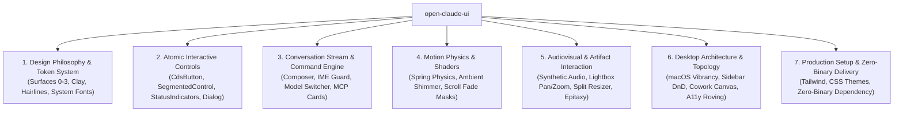

# Open Claude UI (`open-claude-ui`)

<p align="center">
  
</p>

<p align="center">
  <strong>Production-grade, clean-room reverse-engineered implementation of the Claude Design System (CDS) and interaction physics.</strong>
</p>

<p align="center">
  <a href="README.md">简体中文</a> · <strong>English</strong>
</p>

<p align="center">
  <a href="https://github.com/Caho1/open-claude-ui/stargazers"></a>
  <a href="LICENSE"></a>
  <a href="https://github.com/morluto/rea"></a>
  <a href="assets/README.md"></a>
  <a href="https://www.typescriptlang.org/"></a>
  <a href="https://react.dev/"></a>
  <a href="https://tailwindcss.com/"></a>
  <a href="https://www.framer.com/motion/"></a>
</p>

---

## 📖 Introduction

`open-claude-ui` is a high-fidelity open-source UI component library and motion physics engine, built through in-depth clean-room reverse engineering of the modern desktop AI client.

All reverse derivation, de-obfuscation static analysis, and ASAR package deconstruction were conducted using the advanced multi-platform reverse engineering framework **[REA (Reverse Engineer Anything)](https://github.com/morluto/rea)**. Leveraging REA's static AST deconstruction, closure de-obfuscation, and runtime tracing capabilities, we penetrated production bundles to faithfully extract the underlying physical constants, interaction constraints, and mathematical models.

Unlike superficial visual approximations or guesswork replicas, every component specification, damping constant, shader keyframe, and audio pipeline in this project has been **rigorously verified against decompiled production front-end architecture**:
* **Editorial Warmth**: Signature Clay orange (`#d97757`), a 4-tier micro-contrast surface ladder (Surfaces 0 to 3), and Retina subpixel hairline compensation rings;
* **Rigorous Interaction Physics**: 4 production-tuned spring physics presets, 4px pointer movement deadzones, CJK IME composition guards, and 7-stop non-linear alpha fade masks;
* **Audiovisual & Desktop Architecture**: Zero-latency procedural audio synthesis via Web Audio API oscillators, cursor-anchored gallery pan/zoom affine transformations, macOS vibrancy glass fusion, and Cowork multi-agent orchestration topologies.

> 💡 **Architecture & Portability Note**:  
> The **Design Tokens and Pure-CSS presentation layer can be consumed completely independently from React and Tailwind**. Whether you are integrating into custom desktop harnesses (e.g. DSH, agent desktop shells), standard web pages, or Vue/Svelte environments, simply import `@import "open-claude-ui/tokens.css";` or `@import "open-claude-ui/pure.css";` to access all 183 design tokens, zero-JS native scroll-fade masks (`[data-cds-scroll-fade]`), and core animations.

> ⚖️ **Copyright & Asset Compliance (DMCA & Assets Policy)**:  
> This open-source repository **does not distribute any proprietary binary assets** (including commercial `.ttf` fonts and recorded `.mp3` audio). We provide native system font fallback stacks and procedural Web Audio synthesis algorithms, ensuring a completely self-contained, legal, and clean-room compliant codebase. For details, see [assets/README.md](assets/README.md).

---

## 🌟 Key Features



1. **30 Production-Grade Independent Modules**: 11 atomic UI components + 19 deep architecture physics modules and React Hooks. Copy-paste ready with zero black-box dependencies.
2. **Native System Typography & Procedural Audio**: Engineered system font fallback stacks and zero-latency Web Audio oscillator synthesis engines.
3. **Interactive Offline Storybook Preview**: Single-file offline storybook previewable directly in any browser without spinning up local dev servers.
4. **Complete 7-Part Technical Engineering Manual**: Accompanied by a 3,000+ line reverse engineering manual: [`docs/Claude Design System (CDS).md`](docs/Claude%20Design%20System%20(CDS).md).

---

## 📚 Complete Technical Manual (Seven Volumes)

The crown jewel of this repository is the exhaustive 3,000+ line, 31-chapter reverse engineering manual: [`docs/Claude Design System (CDS).md`](docs/Claude%20Design%20System%20(CDS).md).

It documents exact decompilation evidence locations alongside Anthropic's architectural solutions for modern LLM client engineering hurdles:

### 📖 Part 1: Design Philosophy & Design Token System
* **[1.1 Design Philosophy & Visual Tone](docs/v1/01-设计哲学与设计令牌体系.md#11-设计哲学与视觉调性)**: Editorial Warmth, 4-tier micro-contrast surfaces, and lightweight, high-frame-rate motion.
* **[1.2 Surface System & Color Ladder](docs/v1/01-设计哲学与设计令牌体系.md#12-表面体系与色彩阶梯)**: Surface 0 to 3 lightness ladder (Light `#f5f5f3` to `#ffffff`, Dark `#0b0b0a` to `#20201e`) and brand Clay (`#d97757`).
* **[1.3 Control Sizing & Precision Corner Radius Matrix](docs/v1/01-设计哲学与设计令牌体系.md#13-控件尺寸与精密圆角矩阵)**: Precision corner radius hierarchy: Composer 20px, Bubbles 18px, Panels 10px, Buttons 6/8/10px.
* **[1.4 Hairline Rings, Diffused Glow & Anti-Bloat Borders](docs/v1/01-设计哲学与设计令牌体系.md#14-发丝细边微光阴影与边框防臃肿体系)**: Retina 0.5px hairline ring compensation, single-stroke border discipline, and dual-ring diffused popover shadows.
* **[1.5 Typography & Optical Icon Alignment Constraints](docs/v1/01-设计哲学与设计令牌体系.md#15-字体排版与图标对齐系统约束)**: Dark mode Retina font-weight de-dilation (counteracting glyph bloom on black backgrounds) and inline icon `-.125em` optical vertical centering.
* **[1.6 Core Motion Token System](docs/v1/01-设计哲学与设计令牌体系.md#16-基础动效令牌体系)**: Physical time constant matrix (70ms haptic snap, 120ms geometric bite, 300ms panel slide) and asymmetric cubic beziers.

### 🧩 Part 2: Atomic Interactive Controls
* **[2.1 Universal Button Ladder](docs/v1/02-基础原子组件与交互控件.md#21-全能按钮控件阶梯)**: 4-tier size ladder (XS/SM/MD/LG), 5 variants (Primary/Secondary/Ghost/Outline/Danger), and `active:scale-[0.98]` tactile snap.
* **[2.2 Segmented Sliding Pill Control](docs/v1/02-基础原子组件与交互控件.md#22-分段滑动选择胶囊)**: 999px fully rounded track, 2px geometric padding, dual mode supporting pure CSS geometric positioning and Framer Motion `layoutId`.
* **[2.3 Status Indicators & Micro-Motion Suite](docs/v1/02-基础原子组件与交互控件.md#23-状态指示灯与微动效套件)**: Clay breathing indicator (2.4s), live activity pulse (1.2s), 3-dot thinking wave, and 105° slanted skeleton sweep bar.
* **[2.4 Modal Confirmation Dialog](docs/v1/02-基础原子组件与交互控件.md#24-模态确认对话框)**: 16px corner radius, dual-ring popover shadow, Gaussian blur backdrop, focus trap, and Danger/Default dual variants.
* **[2.5 Attachment Cards & Context Pills](docs/v1/02-基础原子组件与交互控件.md#25-附件磁贴与上下文胶囊)**: Desktop card grid (128×96px) and composer inline pill dual-mode with `file-thumbnail-grow-in` entrance physics.

### 💬 Part 3: Conversation Stream & Command Interaction Engine
* **[3.1 Chat Message Bubbles & Typography Specs](docs/v1/03-会话核心流与指令交互引擎.md#31-会话气泡套件与排版规范)**: User bubble with strict 18px radius and subtle tint vs Assistant zero-border transparent layout with synchronized code blocks.
* **[3.2 Thinking Process Accordion & Temporal State Machine](docs/v1/03-会话核心流与指令交互引擎.md#32-思考过程折叠与时间状态机)**: CSS Grid `0fr -> 1fr` jitter-free spring expansion, enforcing an expansion mutex during active generation (`onOpenChange = undefined`).
* **[3.3 Next-Gen Rich Text Input Terminal & Command Engine](docs/v1/03-会话核心流与指令交互引擎.md#33-新一代富文本输入框终端与指令交互引擎)**: CJK IME dual-interlock guard, `/` command & `@` context dual triggers, auto-expanding viewport, and token budget estimation.
* **[3.4 Model Matrix Switcher & Token Gauge Dashboard](docs/v1/03-会话核心流与指令交互引擎.md#34-模型矩阵切换器与-token-计量仪表盘)**: 3-tier model hierarchy, Extended Thinking toggle, 4-color Prompt Caching cost breakdown, and circular SVG gauge.
* **[3.5 Interactive Tool Calls & MCP Decision Cards](docs/v1/03-会话核心流与指令交互引擎.md#35-交互式工具调用与-mcp-决策卡片)**: Strict 3-state authorization lifecycle (`pending_approval` → `running` → `success` / `error`), 3-tier action button array, and structured payload inspector.

### ⚡ Part 4: Motion Physics, Shaders & Ambient Atmosphere
* **[4.1 Complete Motion Engine & Keyframe Specifications](docs/v1/04-动效物理学、着色器与环境光影.md#41-全量动效引擎与关键帧规范)**: Exact mathematical analytical solutions for second-order damped harmonic oscillators, 4 production spring presets, and core `@keyframes`.
* **[4.2 Dynamic Light Effects, Shaders & Reasoning Atmosphere](docs/v1/04-动效物理学、着色器与环境光影.md#42-动态光效着色器与推理氛围感)**: `wl-glow` warm Clay diffuse light field, `cds-shimmer-text-shine` asymmetric bezier sweep, and caustic light field.
* **[4.3 Smooth Scroll Edge Alpha Mask System](docs/v1/04-动效物理学、着色器与环境光影.md#43-滚动边缘平滑渐变遮罩系统)**: Official 7-stop quintic ease non-linear alpha gradient mask with dynamic scroll sensors (zeroing at edges).

### 🎨 Part 5: Audiovisual Multimedia & Artifact Interaction Physics
* **[5.1 Voice Mode & Web Audio Physical Acoustics System](docs/v1/05-视听多媒体与产物交互物理学.md#51-语音模式与-web-audio-物理声学系统)**: Procedural Web Audio API oscillator synthesis, 30% soothing gain standard, and 6-band non-linear gamma spectrum bars (with decompiled AudioWorklet architecture analysis).
* **[5.2 Multimodal Media Viewer & Gallery Runway Physics](docs/v1/05-视听多媒体与产物交互物理学.md#52-多模态媒体查看器与画廊转场物理学)**: View Transitions shared-element morphing, cursor-anchored infinite pan/zoom affine equations, and 75vw runway viewport.
* **[5.3 Split Pane Resizing & Collapsing Physics](docs/v1/05-视听多媒体与产物交互物理学.md#53-双栏弹性分割与折叠物理学)**: Iframe pointer shield, 4px deadzone, double-click 50/50 spring snap, collapse thresholds, and geometric clamping.
* **[5.4 Artifact Preview Sandbox & Isolated IPC Architecture](docs/v1/05-视听多媒体与产物交互物理学.md#54-工件预览沙箱与隔离通信架构)**: Epitaxy isolated container, 7 proprietary MIME dispatchers, user-gesture gating, and virtual package redirection.
* **[5.5 Streaming Code Diff Viewer & Syntax Highlighting Engine](docs/v1/05-视听多媒体与产物交互物理学.md#55-代码差异对比与多线程语法高亮系统)**: Shadow DOM boundary isolation, CSS Grid line-height lock, incremental streaming pipeline, and unified/split dual viewing modes.

### 🖥️ Part 6: System-Level Desktop Architecture & Collaboration Topology
* **[6.1 macOS Desktop Host Fusion & Window Materials](docs/v1/06-系统级桌面架构与协作拓扑.md#61-macos-桌面宿主深度融合与窗口材质)**: `hiddenInset` titlebar, traffic light counter-scaling geometric compensation, `-webkit-app-region: drag` safe zones, and macOS Vibrancy glass integration.
* **[6.2 Sidebar Session Drag-and-Drop Reordering & Topology Grid](docs/v1/06-系统级桌面架构与协作拓扑.md#62-侧边栏会话拖放重排与拓扑网格)**: `pinnedOrder` optimistic topological reordering, 4px movement deadzone, tilted ghost drop shadow, and insertion collision indicators.
* **[6.3 Multi-Agent Collaboration Board & Cowork Topology](docs/v1/06-系统级桌面架构与协作拓扑.md#63-多代理协作看板与-cowork-空间拓扑)**: Multi-agent task delegation state machine, team-shared artifact asset pool, and cross-window `BroadcastChannel` synchronization.
* **[6.4 Streaming Large-Text Output & Scroll Viewport Physics](docs/v1/06-系统级桌面架构与协作拓扑.md#64-流式大文本输出与滚动视口物理学)**: 150ms cooldown latch against scroll hijacking, 40px bottom-tolerance scroll pin, and GPU subpixel blur elimination.
* **[6.5 Container Query Responsive Layout & Anti-Squeeze Protection](docs/v1/06-系统级桌面架构与协作拓扑.md#65-容器查询自适应排版与极端防挤压)**: `@container`-driven 4-tier fluid compression matrix (>=576px / <480px / <384px / <320px), preventing single-glyph line wrapping.
* **[6.6 Full-Keyboard Roving TabIndex & Accessibility](docs/v1/06-系统级桌面架构与协作拓扑.md#66-全键盘盲操网格与无障碍访问)**: W3C WAI-ARIA compliance, roving tabindex focus loop, 2D arrow key grid navigation, and RTL mirroring.
* **[6.7 Resiliency, Rate Limiting & Circuit Breaker State Machine](docs/v1/06-系统级桌面架构与协作拓扑.md#67-异常容灾模型限流与业务状态机)**: Truncated exponential backoff for 429/503 errors, full jitter injection, and automatic 3-retry circuit breaker recovery.

### 🛠️ Part 7: Engineering Setup & Codebase Overview
* **[7.1 Out-of-the-Box Tailwind Configuration & Base CSS](docs/v1/07-工程配置与资产代码库总览.md#71-开箱即用的-tailwind-配置与基础-css-代码)**: Complete global theme stylesheet and Tailwind engineering configuration extensions.
* **[7.2 Production Source Code Inventory](docs/v1/07-工程配置与资产代码库总览.md#72-生产级工程源码清单)**: Full inventory of all 30 standalone production source files (11 atomic controls + 19 architecture modules).
* **[7.3 Asset Specifications & System-Level Font/Audio Alternatives](docs/v1/07-工程配置与资产代码库总览.md#73-资产规范与系统级字体音频替代方案)**: High-fidelity system font fallback stacks and procedural Web Audio synthesis specifications.

### 🤖 Part 8: AI Agent Frontend UI & Motion Guidelines
* **[8.1~8.7 Agent Roles, Design Token Contracts & Spring Decision Tree](docs/v1/08-AI-Agent-前端-UI-与动效开发指南.md)**: Standardized guidelines for AI Coding Agents to implement pixel-perfect CDS components.

### 🚀 Claude Desktop 2.0 (v2.37337.1) Comprehensive Reverse Engineering Analysis
* **[1~6 Overview, Additions, Refactorings, Baseline Secrets, Reference Implementations & Summary](docs/v2/README.md)**: Standalone decompilation report for Claude Desktop 2.0.

---

## 🔬 Decompiled Algorithms & Engineering Physics

UI components are merely the presentation layer. **What truly sets Claude's interaction quality apart are the mathematical models and physics equations buried beneath minified production code**. This repository decompiled and faithfully recreated 8 core algorithms:

### 1. 7-Stop Non-Linear Alpha Gradient Fade Mask
* **The Problem**: Conventional two-stop linear scroll masks cause harsh color banding and jarring geometric cutoffs on high-DPI Retina displays.
* **Claude's Algorithm**: Discards blunt linear cuts in favor of 7 non-linear gradient stops across the fade distance (15% position with 5.1% alpha `#0d`, 30% with 14.9% `#26`, 45% with 30.2% `#4d`, 60% with 50.2% `#80`, 75% with 70.2% `#b3`, 87% with 85.1% `#d9`, closely tracking a $y \approx x^{1.5}$ power curve), dynamically zeroed out by scroll boundary sensors at the top and bottom:
```css
/* Extracted from production bundle c6a992d55-C0zTICcS.css */
mask-image: linear-gradient(to bottom,
  transparent,
  #0000000d calc(var(--cds-scroll-fade-top) * .15),
  #00000026 calc(var(--cds-scroll-fade-top) * .3),
  #0000004d calc(var(--cds-scroll-fade-top) * .45),
  #00000080 calc(var(--cds-scroll-fade-top) * .6),
  #000000b3 calc(var(--cds-scroll-fade-top) * .75),
  #000000d9 calc(var(--cds-scroll-fade-top) * .87),
  #000 var(--cds-scroll-fade-top),
  #000 calc(100% - var(--cds-scroll-fade-bottom)),
  #000000d9 calc(100% - var(--cds-scroll-fade-bottom) * .87),
  #000000b3 calc(100% - var(--cds-scroll-fade-bottom) * .75),
  #00000080 calc(100% - var(--cds-scroll-fade-bottom) * .6),
  #0000004d calc(100% - var(--cds-scroll-fade-bottom) * .45),
  #00000026 calc(100% - var(--cds-scroll-fade-bottom) * .3),
  #0000000d calc(100% - var(--cds-scroll-fade-bottom) * .15),
  transparent
);
```

### 2. Microphone 8% Noise Floor Gating & Procedural Web Audio Engine (Noise Floor Gating & Synthetic SFX)
* **The Problem**: Ambient room noise (e.g. AC rumble) causes voice visualizers to jitter during silence; additionally, external MP3 audio assets introduce download latency and audio popping on abrupt interruption.
* **Claude's Algorithm**: First, introduces an 8% noise floor gate (`NOISE_FLOOR = 0.08`) to cut out ambient hum before rendering voice bars; second, synthesizes pleasant interaction chimes using native Web Audio `OscillatorNode` with frequency ramps (e.g. 440Hz → 880Hz) and anti-pop exponential gain ramp smoothing, requiring zero external audio assets.

### 3. CJK IME Composition Double-Interlock Guard
* **The Problem**: When Chinese, Japanese, or Korean users press Enter on an IME candidate floating list to confirm phonetic characters, the unfinished message is erroneously sent.
* **Claude's Algorithm**: Establishes a double-interlock guard checking `!(e.nativeEvent.isComposing || e.keyCode === 229)`, while intercepting `Escape` events inside an event state machine to prevent accidental dialog dismissals when closing candidate palettes.

### 4. 150ms Scroll Pinning Cooldown Latch & 40px Tolerance
* **The Problem**: While streaming large volumes of tokens, users who scroll up to review previous messages are aggressively dragged back to the bottom.
* **Claude's Algorithm**: Couples a 40px bottom-tolerance scroll pin with a 150ms manual scroll cooldown latch. Once an intentional upward scroll is detected, auto-scrolling is locked out for 150ms, permanently eliminating "scroll viewport hijacking".

### 5. Cursor-Anchored Affine Pan/Zoom Equation
* **The Problem**: Standard gallery viewers zoom relative to viewport center, pushing the specific detail under the user's cursor off-screen.
* **Claude's Algorithm**: Treats the pointer $(O_x, O_y)$ as an invariant physical anchor in screen space, solving the affine transformation matrix:
$$\text{idealTx} = O_x - (O_x - \text{prevTx}) \cdot \frac{S_{\text{target}}}{S_{\text{current}}}$$
Integrated with a 4px hand-tremor deadzone and viewport boundary overflow damping ($y = 0.7$).

### 6. Microphone 6-Band Non-Linear Gamma 0.7 Power Compression
* **The Problem**: Linearly mapping decibels to bar height causes bass clipping, while ambient room noise (e.g., air conditioning) causes jitter during speech pauses.
* **Claude's Algorithm**: Introduces an 8% noise floor gate, followed by a 0.7-power non-linear Gamma curve:
$$\text{Compressed} = \min\left(1, (\max(0, E - 0.08) / 0.92)^{0.7} \times 1.5 \times W_b\right)$$
Gently boosting quiet vocal nuances while curbing peak saturation for a silky, balanced audio visualizer.

### 7. Shadow DOM Isolation + CSS Grid Line-Height Geometric Hard-Lock
* **The Problem**: In code diff viewers with long line wrapping, line numbers on the left frequently fall out of vertical alignment with code lines on the right.
* **Claude's Algorithm**: Employs Shadow DOM encapsulation to shield token styles, while enforcing identical CSS Grid row spans on both sides (`gridRow = span ${lines}`). Sends incremental deltas to Web Workers via `feed: e.slice(m.length)`, avoiding $O(N^2)$ full-tree syntax reflows.

### 8. Iframe Pointer Event Shield & Double-Click 50/50 Spring Snap
* **The Problem**: When resizing split panes over an embedded Artifact iframe, the iframe captures pointer events, causing resize dragging to lock up.
* **Claude's Algorithm**: Injects `data-pane-dragging="true"` onto the root upon drag initiation, overlaying an invisible `pointer-events: none` shield above the iframe; double-clicking the splitter handle triggers a second-order spring transition that snaps the panes to a precise 50/50 split.

---

## 📂 Repository Structure

```
open-claude-ui/
├── assets/                           # Compliance guidelines & asset notices
│   ├── images/logo.svg               # Open-source vector mark
│   └── README.md                     # Asset compliance & fallback stack guide
├── code-examples/                    # 30 standalone production source files (ready-to-use)
│   ├── ArtifactsSplitPaneResizer.tsx # Split pane elastic resizer & collapse engine
│   ├── AttachmentCard.tsx            # Attachment cards & inline context pills
│   ├── cds-theme.css                 # Global theme stylesheet (CSS variables & Keyframes)
│   ├── CdsButton.tsx                 # 4 sizes, 5 variants universal button suite
│   ├── ChatComposer.tsx              # Core composer input terminal
│   ├── ChatMessageBubbles.tsx        # Conversation bubbles (User & Assistant)
│   ├── ClaudeAudioPlayer.ts          # Low-latency audio engine (procedural Web Audio oscillators)
│   ├── ClaudeDesktopHeader.tsx       # macOS immersive titlebar component
│   ├── ClaudeMotionPresets.ts        # Motion presets & damped harmonic oscillator math solver
│   ├── CodeBlock.tsx                 # Code container with 2.5s copy cooldown state machine
│   ├── ConfirmationDialog.tsx        # Modal confirmation dialog
│   ├── ContainerResponsiveBar.tsx    # Responsive container query bar
│   ├── CoworkAgentCanvas.tsx         # Multi-agent collaboration canvas & topology
│   ├── createClaudeMainWindow.ts     # Electron main window host factory
│   ├── DraggableSessionList.tsx      # Sidebar drag-and-drop session reordering physics
│   ├── EpitaxyIframeBridge.tsx       # Artifacts preview sandbox bridge
│   ├── LiveMicActivityBars.tsx       # 6-band non-linear microphone visualizer bars
│   ├── McpToolDecisionCard.tsx       # MCP interactive tool decision card
│   ├── MediaLightboxViewer.tsx       # Multimodal media viewer & runway lightbox
│   ├── ModelSwitcherWithTokenGauge.tsx # Model matrix switcher with token gauge
│   ├── ReasoningAmbientGlow.tsx      # Dynamic glow & reasoning atmosphere component
│   ├── RichComposerWithMentions.tsx  # CJK guard, / and @ dual trigger input terminal
│   ├── ScrollFadeContainer.tsx       # 7-stop quintic ease non-linear alpha scroll fade mask
│   ├── SegmentedControl.tsx          # 999px fully rounded sliding segmented pill
│   ├── StatusIndicators.tsx          # Clay breathing indicator, activity pulse & skeleton sweeps
│   ├── StreamingDiffViewer.tsx       # Code diff viewer with streaming highlight engine
│   ├── tailwind.config.js            # Tailwind theme extension config
│   ├── ThinkingAccordion.tsx         # Thinking process state machine accordion
│   ├── useClaudeRovingFocus.ts       # Full keyboard accessibility roving focus hook
│   ├── useClaudeScrollPinning.ts     # Streaming scroll viewport pinning hook
│   ├── useClaudeSharedElementTransition.ts # View Transitions shared-element morphing hook
│   └── useRateLimitBackoff.ts        # 429/503 exponential backoff & circuit breaker hook
├── docs/
│   ├── Claude Design System (CDS).md # 7-part / 31-chapter deep technical guide
│   └── claude-components-storybook.html # Interactive offline visual storybook
├── src/
│   └── index.ts                      # Unified TypeScript library entry point
├── package.json
├── tsconfig.json
├── README.md                         # Chinese documentation (Default)
└── README-en.md                      # English documentation
```

---

## 🚀 Quick Start

### 1. Import Stylesheet & Tokens (Pure CSS Support)

Regardless of whether you use React, you can directly import the CDS core stylesheet and its 183 design tokens:
```css
/* Import global theme variables, scroll-fade masks, and keyframes */
@import "open-claude-ui/css";
/* Or via the tokens alias */
@import "open-claude-ui/tokens";
```

If you use Tailwind CSS, extend your theme in `tailwind.config.js`:
```javascript
const cdsTheme = require("open-claude-ui/tailwind");

module.exports = {
  content: [
    "./src/**/*.{js,ts,jsx,tsx}",
    "./node_modules/open-claude-ui/**/*.{js,ts,jsx,tsx}"
  ],
  theme: {
    extend: {
      ...cdsTheme.theme.extend
    }
  }
};
```

### 2. Using Core Components

```tsx
import React, { useState } from 'react';
import { 
  ChatComposer, 
  CdsButton, 
  ModelSwitcherWithTokenGauge, 
  ScrollFadeContainer 
} from 'open-claude-ui';

export function App() {
  const [model, setModel] = useState<'sonnet-3.5' | 'haiku-3.5' | 'opus-3'>('sonnet-3.5');
  const [thinking, setThinking] = useState(true);

  return (
    <div className="flex h-screen w-full bg-[var(--cds-surface-1)]">
      <ScrollFadeContainer axis="vertical" fadeSize={32} className="flex-1 p-6">
        <div className="mx-auto max-w-3xl space-y-4">
          <ModelSwitcherWithTokenGauge
            currentModel={model}
            onModelChange={setModel}
            extendedThinking={thinking}
            onThinkingChange={setThinking}
            tokenBudget={{
              inputTokens: 12400,
              outputTokens: 3200,
              cacheReadTokens: 48000,
              cacheWriteTokens: 16000,
              maxContextWindow: 200000
            }}
          />
          <ChatComposer onSend={(text) => console.log('Send message:', text)} />
        </div>
      </ScrollFadeContainer>
    </div>
  );
}
```

---

## 🎨 Interactive Storybook Preview

No need to spin up a heavy local development server—simply double-click the bundled standalone HTML file to experience the complete suite of high-fidelity components:
```bash
open docs/claude-components-storybook.html
```

The storybook includes:
* Clay color system with real-time Dark Mode switching
* All button sizes and tactile hover/active feedback
* 999px fully rounded sliding segmented pill controls
* Second-order spring motion demos in real time
* Attachment cards and code copy decay cooldown state machines

---

## 🤖 AI Agent Guidelines & Development Standards

This repository includes first-class development specifications tailored for modern AI Coding Agents (such as Cursor, Windsurf, Claude Code, GitHub Copilot, Devin, Antigravity, etc.):

* **Universal Agent Guidelines**: [`AGENTS.md`](AGENTS.md) (Loaded automatically in repository root, covering semantic design tokens, the 4-tier spring preset matrix, single-stroke border discipline, IME guards, and verification gates).
* **Claude Code Instructions**: [`CLAUDE.md`](CLAUDE.md) (Dedicated CLI commands and conventions for Anthropic's Claude Code toolchain).
* **IDE Agent Rules**: [`.cursorrules`](.cursorrules) and [`.github/copilot-instructions.md`](.github/copilot-instructions.md).

> 💡 **Tip for developers using AI assistants**:  
> When prompting Cursor / Claude Code / Copilot to implement frontend UI or animations for your application, simply instruct:  
> *"Strictly adhere to the AGENTS.md specification in this repository, using CDS Clay design tokens and ClaudeMotionPresets physics."*

---

## 🙏 Acknowledgements

* Special thanks to the open-source reverse engineering framework **[REA (Reverse Engineer Anything)](https://github.com/morluto/rea)** for providing the AST deconstruction, Electron runtime analysis, and engineering constant decompilation toolchain that made this project possible.
* Deep appreciation to the Anthropic design and front-end engineering teams for crafting an editorial-grade interaction system and meticulous engineering details that inspired this clean-room study.

---

## 📜 License

Distributed under the [MIT License](LICENSE). All decompiled research findings and code reproductions are intended solely for educational, research, and engineering exchange purposes.

---

## 📈 Star History

<div align="center">

[](https://star-history.com/#Caho1/open-claude-ui&Date)

</div>
