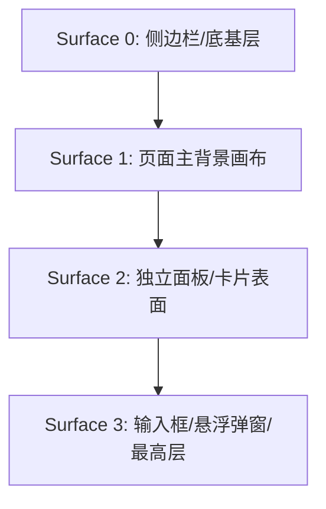
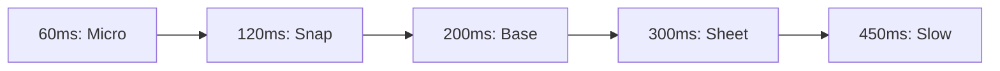

<p align="center">
  [📚 返回总目录](Claude%20Design%20System%20(CDS).md) · [下一篇：第二篇：基础原子组件与交互控件 ➡️](02-基础原子组件与交互控件.md)
</p>

---

## 第一篇：设计哲学与设计令牌体系

> **技术领域与英文指代**：`Design Philosophy & Design Tokens`

### 1.1 设计哲学与视觉调性

Claude 的界面设计在当下 AI 产品中独树一帜，其核心调性可以总结为三点：

1. **温润的人文质感（Editorial Warmth）**：
   - 彻底摒弃冰冷的高饱和赛博朋克蓝/紫色，主品牌色选用温润的**陶土色（Clay: `#d97757`）**与柔和米白/暗灰底色（`#fcfcfb` / `#151515`）。
2. **多层微对比表面（Low-contrast Surface Layering）**：
   - 界面几乎不使用生硬的 1px 黑色边框，而是通过 `Surface 0 - 3` 的层级微小明度差以及 `color-mix()` 半透明外环投影来建立空间感。
3. **高帧率轻负担动效（Lightweight Organic Motion）**：
   - 文字流式输出使用 GPU 硬件加速的模糊消解，复杂展开使用 CSS Grid 0fr 解决高度抖动，手势交互使用真实的阻尼弹簧。

---

### 1.2 表面体系与色彩阶梯

> **技术领域与英文指代**：`Surfaces & Colors`

Claude 在浅色和深色模式下具有严格的 4 层表面明度阶梯：



| 令牌名称 | 浅色模式 (Light) | 深色模式 (Dark) | 用途说明 |
| :--- | :--- | :--- | :--- |
| `--cds-surface-0` | `#f5f5f3` (`gray-20`) | `#0b0b0a` (`gray-900`) | 侧边栏底色、窗口背景根底 |
| `--cds-surface-1` | `#fcfcfb` (`gray-10`) | `#151515` (`gray-850`) | 页面主聊天画布背景 |
| `--cds-surface-2` | `#ffffff` (`gray-0`) | `#1a1a19` (`gray-830`) | 对话消息容器、卡片表面 |
| `--cds-surface-3` | `#ffffff` (`gray-0`) | `#20201e` (`gray-800`) | 聊天输入框容器、高亮浮层 |
| `--cds-clay` | `#d97757` | `#d97757` | Claude 标志性陶土橙（思考跳动点、火花图标） |
| `--cds-clay-emphasized` | `#cc5a36` | `#cc5a36` | 陶土色悬停/深色加重态 |
| `--cds-border` | `rgba(0, 0, 0, 0.08)` | `rgba(255, 255, 255, 0.08)` | 通用柔和边框 |
| `--cds-border-strong` | `rgba(0, 0, 0, 0.16)` | `rgba(255, 255, 255, 0.16)` | 控件外环、激活边框 |

---

### 1.3 控件尺寸与精密圆角矩阵

> **技术领域与英文指代**：`Border Radius, Heights & Sizing`

#### 1.3.1 圆角阶梯体系 (Border Radius Hierarchy)
Claude 绝非全局采用单一圆角，而是有着极严格的**角色语义圆角阶梯**。组件圆角令牌矩阵如下：

| 令牌名称 / 变量 | 精确像素 | 对应 Tailwind 类 | 角色语义与典型组件 |
| :--- | :--- | :--- | :--- |
| `--radius-xs` | **2px** | `rounded-[2px]` | 微型角标、聚焦环内衬指示点 |
| `--radius-sm` (`--cds-keycap-radius`) | **4px** | `rounded` | 快捷键徽章 (`Kbd`)、微型标签、复选框 |
| `--radius-md` | **6px** | `rounded-md` | 极小尺寸按钮 (XS 26px)、Prompt 建议胶囊 |
| `--radius-lg` | **8px** | `rounded-lg` | **标准按钮 (SM/MD)、表单输入框、下拉菜单项** |
| `--cds-panel-radius` | **10px** | `rounded-[10px]` | 子面板卡片、上传文件附件条目 (`.cds-attachment`) |
| `--radius-xl` | **12px** | `rounded-xl` | 代码块容器、Artifact 预览卡片、抽屉面板 |
| `--radius-2xl` | **16px** | `rounded-2xl` | 系统弹窗模态框 (`ConfirmationDialog`)、设置卡片 |
| `--cds-message-bubble-radius` | **18px** | `rounded-[18px]` | **用户发送的消息气泡 (`User Message Bubble`)** |
| `--cds-radius-composer` | **20px** | `rounded-[20px]` | **底部常驻聊天输入框 (`Chat Composer Box`)** |
| `--df-radius-pill` | **999px** | `rounded-full` | 分段滑动滑块 (`Segmented Control`)、状态呼吸点 |

> [!IMPORTANT]
> **视觉嵌套嵌套同心圆角法则**：
> 在 Claude 中，当一个 10px 附件条目或 8px 按钮被包裹在 20px Composer 内部时，内外半径严格满足 `R_outer = R_inner + padding` 的视觉同心过渡，避免内外角曲率冲突造成的呆滞感。

---

#### 1.3.2 控件高度与排版尺寸 (Heights & Sizing)
| 令牌名称 | 高度定义 | 实际像素 | 对应组件 |
| :--- | :--- | :--- | :--- |
| `--cds-h-control--xs` | `1.25rem - 1.5rem` | **20px - 24px** | 极小按钮、标签关闭按钮、行内操作栏 |
| `--cds-h-control--sm` | `1.5rem - 1.75rem` | **24px - 28px** | 紧凑型按钮、下拉选择器触发器 |
| `--cds-h-control` (默认) | `2rem` | **32px** | **标准交互按钮、输入框内操作图标、Tab 导航项** |
| `--cds-h-control--lg` | `2.5rem` | **40px** | 强调大按钮、登录/注册主操作按钮 |
| `--df-titlebar` | 固定 `46px - 48px` | **46px - 48px** | 桌面端无边框窗口顶部拖拽条（Titlebar） |
| `--static-sidebar-width` | `18rem` | **288px** | 桌面端常驻侧边栏宽度 |
| `--chat-max-width` | `42rem / 48rem` | **672px - 768px** | 最佳阅读体验的中心对话宽度（`max-w-2xl / max-w-3xl`） |
| `--composer-max-height` | `24rem` | **384px** | 输入框内容自动撑开的最大高度（超出滚动） |

---

---

### 1.4 发丝细边、微光阴影与边框防臃肿体系

> **技术领域与英文指代**：`Borders, Hairlines & Shadows`

#### 1.4.1 边框粗细系统、发丝细边与微光阴影阶梯
在很多仿 Claude 的产品中，“视觉廉价感”几乎 100% 来自**边框过粗过硬**与**阴影单层死黑**。Claude 桌面端对此构建了极端精密的物理光学规则：

#### 1. 边框大小阶梯与视网膜高分屏发丝细边规范 (Border Width & Retina Hairline)

在视网膜高分屏（MacBook Retina `@2x/@3x`）上，标准的 `1px` 边框在物理像素上实际占据了 2 到 3 个物理发光点，视觉感受极其厚重笨拙。Claude 借助媒体查询与内阴影轮廓技术实现了真正的动态发丝细边：

| 边框级别 | 规格定义 | 对应工程 Token / 实现 | 核心承载组件与场景 |
| :--- | :--- | :--- | :--- |
| **0.5px 发丝细边 (Hairline)** | `@media (resolution >= 2x) { 0.5px }` | `--cds-ring-hairline` / `box-shadow: 0 0 0 0.5px var(--cds-border)` | 表格行间分割线、未激活分段 Tab 缝隙、次级辅助标签微标、极细胶囊底衬 |
| **1.0px 基础结构边框** | 标准 `1px` (10% Alpha) | `--cds-border: var(--cds-alpha-2);` (`hsla(0, 0%, 8%, 0.1)`) | 卡片面板主体、输入框常态外轮廓、顶栏底部分割线、浮动弹窗基础边界 |
| **1.5px 激活指示边框** | `1.5px` (Accent Ring) | `box-shadow: inset 0 0 0 1.5px currentColor;` | 分段滑动胶囊激活项边缘、当前选中状态指示器、表单单选/复选被选中轮廓 |
| **2.0px 焦点与吸附高亮** | `2.0px` (Focus Ring & Glow) | `--cds-shadow-drop-ring: inset 0 0 0 2px var(--cds-clay);` | 文件拖拽悬停至输入框吸附光晕、键盘 Tab 导航可访问性聚焦高亮圈 |

```css
/* 组件样式示例 */
:root {
  --cds-alpha-0: hsla(0, 0%, 8%, 0);
  --cds-alpha-1: hsla(0, 0%, 8%, 0.05); /* 幽灵按钮悬浮、骨架屏、禁用态 */
  --cds-alpha-2: hsla(0, 0%, 8%, 0.10); /* 标准边框 (--cds-border)、次级填充 */
  --cds-alpha-3: hsla(0, 0%, 8%, 0.20); /* 强对比边框 (--cds-border-strong)、控件悬浮 */
  --cds-alpha-4: hsla(0, 0%, 8%, 0.35); /* 重分割线 */

  --cds-border: var(--cds-alpha-2);
  --cds-border-strong: var(--cds-alpha-3);
  --cds-ring-hairline: 1px;
}

/* 视网膜高分屏发丝细边微调 */
@media (-webkit-min-device-pixel-ratio: 2), (min-resolution: 2dppx), (resolution >= 2x) {
  :root { --cds-ring-hairline: 0.5px; }
}
@media (-webkit-min-device-pixel-ratio: 3), (min-resolution: 3dppx), (resolution >= 3x) {
  :root { --cds-ring-hairline: calc(1px / 3); }
}
```

> [!TIP]
> **为什么 Claude 极少使用 CSS `border: 1px solid ...`？**  
> 因为传统 CSS `border` 会计入元素的盒模型排版尺寸，在动态切换激活/未激活状态时易引发微观的“1px 尺寸抖动与重排”。Claude 大量采用 `box-shadow: inset 0 0 0 1px ...` 或 `box-shadow: 0 0 0 1px ...` 代替边框，完全脱离盒模型排版计算，实现 0 抖动的顺滑物理过渡。

---

#### 2. 生产级四层环境光扩散阴影阶梯 (4-Tier Ambient & Elevation Shadow System)

Claude 彻底摒弃单一维度的模糊阴影，全量采用**【近距微遮蔽 (Ambient Occlusion)】+【远距深层漫反射 (Elevation Diffusion)】**双层复合公式：

| 阴影层级 (Token) | 浅色模式投影参数 (Light) | 深色模式投影参数 (Dark) | 核心承载业务场景 |
| :--- | :--- | :--- | :--- |
| **`--cds-shadow-sm`** | `0 1px 2px 0 rgba(0,0,0,0.05), 0 2px 8px 0 rgba(0,0,0,0.08)` | `0 1px 2px 0 rgba(0,0,0,0.40), 0 2px 8px 0 rgba(0,0,0,0.40)` | 卡片面板底衬、附件卡片基础立体感，防止纯扁平生硬 |
| **`--cds-shadow-md`** | `0 2px 4px 0 rgba(0,0,0,0.05), 0 6px 16px 0 rgba(0,0,0,0.08)` | `0 2px 4px 0 rgba(0,0,0,0.40), 0 6px 16px 0 rgba(0,0,0,0.40)` | 卡片 Hover 悬浮抬升态、模型选择下拉菜单、折叠面板展开 |
| **`--cds-shadow-lg`** | `0 4px 8px 0 rgba(0,0,0,0.06), 0 12px 28px -2px rgba(0,0,0,0.08)` | `0 4px 8px 0 rgba(0,0,0,0.50), 0 16px 36px -2px rgba(0,0,0,0.40)` | 全局模态确认弹窗 (Modal Dialog)、全屏工件预览抽屉 |
| **`--cds-shadow-popover`** | `inset 0 0 0 0px transparent, 0 0 0 1px var(--cds-border), 0 8px 24px rgba(0,0,0,0.12), 0 2px 6px rgba(0,0,0,0.08)` | **`inset 0 0 0 1px rgba(255,255,255,0.10)`**`, 0 0 0 0px transparent, 0 8px 28px rgba(0,0,0,0.65), 0 2px 8px rgba(0,0,0,0.45)` | 右键上下文菜单、快捷指令气泡、富文本操作条 |
| **`--cds-panel-shadow`** | `0 0 0 1px var(--cds-border), var(--cds-shadow-sm)` | `0 0 0 1px var(--cds-border), var(--cds-shadow-sm)` | 标准独立面板外壳（边框与微阴影一体化绑定） |

#### 3. 双环浮动气泡架构（Dual-Ring Architecture）的光学奥秘

请格外注意 `--cds-shadow-popover` 在浅色与深色模式下的质感差异：
* **浅色模式**：外环为 `0 0 0 1px var(--cds-border)`，提供一层细致的外边缘包围线，结合向下落差 8px 的柔和漫反射。
* **深色模式（倒角高光逆转！）**：外轮廓变为 `0px`（消除黑底上突兀的白框），同时在内侧增加 `inset 0 0 0 1px rgba(255, 255, 255, 0.10)`！这一行如同真实物理世界中**边缘倒角捕捉到顶光所产生的一道微弱反光**，既凸显了浮层的立体轮廓，又完全没有多余的边框感！

---

#### 4. 聊天输入框双环投影公式（Composer Dual-Ring Shadow）

输入框是 Claude 最具标志性的界面灵魂：
```css
/* 常态（Resting 未聚焦） */
box-shadow: 
  0 4px 20px rgba(0, 0, 0, 0.035),
  inset 0 0 0 1px var(--cds-border);

/* 鼠标悬停态（Hover） */
box-shadow: 
  0 4px 24px rgba(0, 0, 0, 0.06),
  inset 0 0 0 1px var(--cds-border-strong);

/* 聚焦态（Focus-Within） */
box-shadow: 
  0 4px 24px rgba(0, 0, 0, 0.08),
  inset 0 0 0 1px var(--cds-border-strong),
  0 0 0 1px var(--cds-border-strong);
```

#### 5. 全局交互焦点环（Triple-Layer Focus Ring）

当用户通过键盘或点击激活交互控件时，Claude 绝不使用操作系统刺眼的默认蓝色外框，而是渲染专有的三层陶土高亮环：
```css
--cds-focus-shadow: 
  inset 0 0 0 1px var(--cds-surface-1),    /* 第一层：1px 隔离垫片，隔开控件与光晕 */
  0 0 0 1.5px var(--cds-clay),             /* 第二层：1.5px 陶土品牌色主聚焦环 */
  0 0 6px 1px rgba(217, 119, 87, 0.25);    /* 第三层：柔和外扩的陶土环境漫射光晕 */
```

---

#### 6. 全交互 Hover 态与微反馈物理规范 (Interactive Hover & Micro-Feedback)

Claude 的交互反馈极度顺滑克制，遵循“有感知但不喧宾夺主”的微动效原则：

1. **幽灵按钮悬浮与按压（Ghost Button Feedback）**：
   * **常态**：背景完全透明，文字为次级弱灰 (`var(--cds-text-secondary)`)。
   * **悬浮态 (Hover)**：背景在 **150ms 贝塞尔曲线** (`cubic-bezier(0.16, 1, 0.3, 1)`) 内渐变至 5% 灰度底衬 (`var(--cds-fill-ghost-hover)`)，文字点亮为 Primary 主色。
   * **按压态 (Active Press)**：触发 `scale(0.98)` 轻量回弹压感，底衬加深至 10% 灰度 (`var(--cds-fill-ghost-selected)`)。
2. **卡片物理抬升 (Card Elevation Y-Lift)**：
   * **常态**：平铺于画布，呈现 `--cds-panel-shadow`。
   * **悬浮态 (Hover)**：向上物理抬升 `transform: translateY(-1.5px)`，同时阴影平滑过渡至 `--cds-panel-shadow-hover`，边框变深至 `--cds-border-strong`。
   * **离开态**：顺滑落回原始位置，无硬弹跳。
3. **浮动菜单行高亮 (Dropdown Row Highlight)**：
   * 鼠标滑过菜单项时，背景瞬间点亮为带有 `4px` 圆角（`var(--radius-sm)`）的轻量高亮胶囊，行内图标与快捷键同步点亮。
4. **拖拽吸附光晕 (Drag & Drop Target Glow)**：
   * 拖拽文件接近输入框时，输入框内侧触发 `inset 0 0 24px -2px rgba(217, 119, 87, 0.20)` 陶土呼吸辉光，并伴随 `inset 0 0 0 2px var(--cds-clay)` 吸附圈。

---

#### 1.4.2 边界哲学与边框防臃肿体系 (Borders vs. Borderless Architecture)
在现代 Web 前端与大模型 UI 生成中，**“套娃边框（Russian-Doll Borders）”是导致界面臃肿、沉重、业余的最普遍元凶**。很多模型在生成前端界面时，机械地将产品需求中的“视觉分组”直接等价为 CSS `border border-neutral-200`，造成卡片嵌套卡片、消息套线框、工具栏套线框、输入框内部的每一个按钮再套一层线框，视线被无数条灰色线条切割得支离破碎。

Claude Desktop 之所以呈现出极具高级感、通透呼吸感的杂志排版质感，核心在于一套严密的**边界极简与表面微对比架构**：

#### 1. 核心黄金准则：单闭合边框原则 (The 1-Border Rule)
* **视线深度控制**：在从屏幕主画布向内穿透的任何一条视线路径上，**至多只能穿过 1 层闭合的矩形边框**。
* **容器内自动降级协议**：一旦外层容器已经是一个带边框的物理实体（如 Chat Composer、Modal 弹窗、Code Block 代码块），其内部包含的所有子控件（按钮、输入区、标签、工具条）**严禁再次使用闭合边框**：
  * **Secondary 按钮**：严禁写成 `border border-neutral-300`，必须使用基于 Surface-2 的柔和填充（`bg-neutral-100 hover:bg-neutral-200/80 dark:bg-neutral-800 border-0`）。
  * **工具栏按钮与内联操作**：必须降级为 `Ghost` 变体（常态完全透明 `bg-transparent border-0`，悬停时仅展现微弱背景 `hover:bg-neutral-100/70`）。
  * **内部输入框**：Composer 内部的文字输入域完全去除原生边框与高亮环（`border-0 outline-none ring-0 bg-transparent`）。

#### 2. 组件边界授权决策树 (The Boundary Decision Matrix)

| 边界类型 | 授权准则 | 典型生产组件 | CSS 实现规范 |
| :--- | :--- | :--- | :--- |
| **🚫 坚决无边框 (Strictly Borderless)** | 依靠留白、文字层级或纯背景色聚合，杜绝描边线条阻隔阅读流动 | • **AI 助手回复正文**<br>• **用户消息气泡 (`#f0f4f8`)**<br>• 容器内的所有次级操作按钮<br>• 侧边栏/导航条目<br>• 消息底部 Reaction 反馈条<br>• 思考链展开文本 | `border-0`<br>`bg-transparent` 或 `bg-[#f0f4f8] rounded-[18px]` |
| **📦 必须具备闭合外框 (Mandatory Closed Border)** | 自成一体、具备独立交互物理沙盒、实体化对象或跨越 Z 轴的浮层 | • **常驻聊天输入框 (Composer)**<br>• **语法高亮代码块 (Code Sandbox)**<br>• **独立文件附件卡片 (`.cds-attachment`)**<br>• **Artifact 独立产物卡片**<br>• **模态弹窗对话框 (`Dialog`)**<br>• 右键上下文菜单 (`ContextMenu`) | `border border-neutral-200/90 dark:border-neutral-800`<br>结合弥散双层投影 |
| **➖ 单向细线替代原则 (Hairline Divider)** | 容器内部结构划分，严禁使用闭合方框套娃，严格采用 1px 单向细线 | • 代码块顶部语言栏与代码区中缝 (`border-b`)<br>• 下拉菜单与上下文菜单的功能组隔离 (`border-t`)<br>• 桌面端左右分栏中缝 (`border-r`)<br>• Composer 输入区与底部工具栏中缝 (`border-t`) | `border-b border-neutral-200/60`<br>或 `border-t border-neutral-100` |
| **🌓 深色模式物理倒角 (Dark Mode 0.5px Chamfer)** | 深色背景下 1px solid 白色会产生刺眼的荧光感，改用内嵌阴影模拟工业硬件高光倒角 | • 所有深色模式卡片、代码块与浮层外边缘 | `box-shadow: inset 0 0 0 1px rgba(255, 255, 255, 0.08);`<br>或 `color-mix(in srgb, var(--cds-border) 30%, transparent)` |

#### 3. 常见“套娃边框”重构对比范例

##### 反模式（AI 模型常见臃肿生成）：
```html
<!-- ❌ 错误：4 层边框套娃，界面极其厚重压抑 -->
<div class="border border-gray-300 p-4"> <!-- 框 1: 外卡片 -->
  <div class="border border-gray-200 p-3"> <!-- 框 2: 助手气泡 -->
    <p>回复文本</p>
    <div class="border border-gray-300 p-1"> <!-- 框 3: 操作栏小卡片 -->
      <button class="border border-gray-400">复制</button> <!-- 框 4: 按钮带框 -->
    </div>
  </div>
</div>
```

##### 正模式（Claude 生产级标准）：
```html
<!-- ✅ 正确：单边框极简，呼吸感十足 -->
<div class="p-4"> <!-- 主画布 Surface 0，无框 -->
  <div class="space-y-2"> <!-- 助手消息，无框无底色，直接浮于画布 -->
    <p class="text-neutral-800 dark:text-neutral-200 leading-relaxed">回复文本</p>
    <div class="flex items-center gap-1 text-neutral-400"> <!-- 操作栏，无框 -->
      <button class="p-1 rounded-md hover:bg-neutral-100 dark:hover:bg-neutral-800 border-0"> <!-- 纯 Ghost 悬停 -->
        <CopyIcon className="size-3.5" />
      </button>
    </div>
  </div>
</div>
```

---

### 1.5 字体排版与图标对齐系统约束

> **技术领域与英文指代**：`Typography, Alignment & Icons`

Claude 桌面端对于字重、排版折叠以及矢量图标的对齐有着近乎偏执的微观调校，涵盖六大核心工程约束：

#### 1. 真实字体栈与可变字体轴配置 (Font Stacks & Variable Axes)

* **主字体栈 (`--font-anthropic-sans`)**：
  ```css
  --font-anthropic-sans: "anthropic-sans", ui-sans-serif, -apple-system, BlinkMacSystemFont, "Segoe UI", "PingFang SC", "Hiragino Sans", "Apple SD Gothic Neo", sans-serif;
  ```
* **问候语 Serif 栈 (`--font-anthropic-serif`)**：
  ```css
  --font-anthropic-serif: "anthropic-serif", ui-serif, Georgia, "Times New Roman", serif;
  ```
* **代码字体栈 (`--font-anthropic-mono`)**：
  ```css
  --font-anthropic-mono: "anthropic-mono", "SF Mono", ui-monospace, Menlo, Consolas, monospace;
  ```
* **图标字体族 (`--font-anthropicons`)**：
  ```css
  font-family: Anthropicons-Variable, sans-serif;
  font-feature-settings: "liga" 0; /* 禁用连字替换，确保图标不被误合并 */
  ```

#### 2. 全量 7-Tier 字号阶梯系统与行高规范 (7-Tier Font Size & Leading Scale)

Claude 桌面端构建了一套专为高密度信息架构设计的 7 阶排版标尺系统，并通过桌面端光学缩放因子 `--cds-rem-scale: calc(16 / 17)`（≈ 0.941176）将 Web 默认 17px 基准平滑缩放至原生视网膜屏的 16px 精确渲染。

| 阶梯等级 (Token) | CSS 表达式 (Rem Scale) | 换算像素 (Desktop) | 行高 (Leading) | 行高比率 | 核心承载内容场景 |
| :--- | :--- | :--- | :--- | :--- | :--- |
| **`caption`** | `calc(0.6875rem * var(--cds-rem-scale))` | **10.35px (约 11px)** | `1rem` (16px) | 1.55 | 快捷键徽标 (`Kbd`)、消息时间戳、模型版本号、Token 消耗统计 |
| **`footnote`** | `calc(0.75rem * var(--cds-rem-scale))` | **11.29px (约 12px)** | `calc(0.9375rem * scale)` (14.1px) | 1.25 | 附件文件体积大小、图片元数据、次级辅助说明文本、免责声明 |
| **`code`** | `calc(0.75rem * var(--cds-rem-scale))` | **11.29px (约 12px)** | `1rem` (16px) | 1.42 | 代码块语法高亮文本、行内代码、Thinking 内部思维链路日志、Diff 差异 |
| **`body`** | `calc(0.8125rem * var(--cds-rem-scale))` | **12.24px (约 13px / 14px)** | `1.125rem` (18px) | 1.46 | 对话流助理回答、用户气泡正文、主输入框 (Composer) 键入文本与占位符 |
| **`prose`** | `0.875rem - 1rem` (舒适阅读) | **14.0px - 16.0px** | `1.25rem - 1.5rem` (20px - 24px) | 1.43 - 1.50 | 长文 Artifacts 渲染、Markdown 深度阅读、文档预览视图 |
| **`heading`** | `calc(0.875rem * var(--cds-rem-scale))` | **13.18px (约 14px / 15px)** | `calc(1.125rem * scale)` (17px) | 1.29 | 弹窗标题 (Modal Title)、卡片分块小标题、侧边栏分组标题、设置项名称 |
| **`title`** | `calc(1.25rem * var(--cds-rem-scale))` | **18.82px (约 20px / 21px)** | `calc(1.5rem * scale)` (23.5px) | 1.25 | 对话顶栏标题、Project 项目主标题、工作区主导航头部 |

```css
/* 组件样式示例 */
:root {
  --cds-rem-scale: calc(16 / 17); /* 桌面端光学微调系数 ≈ 0.94117647 */

  --cds-font-size-caption: calc(0.6875rem * var(--cds-rem-scale, 1));
  --cds-leading-caption: 1rem;

  --cds-font-size-footnote: calc(0.75rem * var(--cds-rem-scale, 1));
  --cds-leading-footnote: calc(0.9375rem * var(--cds-rem-scale, 1));

  --cds-font-size-code: calc(0.75rem * var(--cds-rem-scale, 1));
  --cds-leading-code: 1rem;

  --cds-font-size-body: calc(0.8125rem * var(--cds-rem-scale, 1));
  --cds-leading-body: 1.125rem;

  --cds-font-size-prose: 0.875rem;
  --cds-leading-prose: 1.25rem;

  --cds-font-size-heading: calc(0.875rem * var(--cds-rem-scale, 1));
  --cds-leading-heading: calc(1.125rem * var(--cds-rem-scale, 1));

  --cds-font-size-title: calc(1.25rem * var(--cds-rem-scale, 1));
  --cds-leading-title: calc(1.5rem * var(--cds-rem-scale, 1));
}
```

#### 3. 暗色模式视网膜光渗字重逆补偿 (Retinal Irradiation Compensation)

在物理光学与人眼视网膜感知中，**高对比度白字在黑底上会向外发散光晕（Irradiation Phenomenon）**，导致同等粗细的文字在深色模式下显得比浅色模式粗 10% - 15%，产生视觉膨胀与边缘模糊。

Claude 依托其专有 Variable Font 轴进行了精准的物理逆补偿：在深色模式下，主动将字重数值降低 **30 - 40 个刻度**，使文字在人眼感官中达到与浅色模式完全绝对一致的感知纤细度与锐度。

| 语义字重级别 | 浅色模式字重 (Light) | 深色模式减薄字重 (Dark) | 补偿工程机制与变化幅度 |
| :--- | :--- | :--- | :--- |
| **Regular (正文常规)** | `font-weight: 400` / `"wght" 400` | `--cds-font-axis-wght: "wght" 360` | **主动减薄 40 刻度**，消除纯白正文字体发散 |
| **Medium (操作/强调)** | `font-weight: 500` / `"wght" 500` | `--cds-font-axis-wght: "wght" 460` | **主动减薄 40 刻度**，保持中等强度的利落感 |
| **Semibold (标题/身份)**| `font-weight: 580` / `"wght" 580` | `--cds-font-axis-wght: "wght" 550` | **主动减薄 30 刻度**，避免粗体在深色背景下糊成一团 |
| **Bold (强警示/重强调)** | `font-weight: 600` / `"wght" 660` | `--cds-font-axis-wght: "wght" 660` | 保持稳固的醒目重音边界 |

```css
/* 组件样式示例 */
/* 浅色模式基准 */
.font-normal {
  --cds-font-axis-wght: "wght" 400;
  font-variation-settings: var(--font-opsz-axis,) var(--cds-font-axis-wght,) "GRAD" var(--cds-font-grad, 0);
}
.font-medium {
  --cds-font-axis-wght: "wght" 500;
  font-variation-settings: var(--font-opsz-axis,) var(--cds-font-axis-wght,) "GRAD" var(--cds-font-grad, 0);
}
.font-semibold {
  --cds-font-axis-wght: "wght" 580;
  font-variation-settings: var(--font-opsz-axis,) var(--cds-font-axis-wght,) "GRAD" var(--cds-font-grad, 0);
}

/* 深色模式光学逆补偿 */
[data-theme=claude][data-mode=dark] .font-normal {
  --cds-font-axis-wght: "wght" 360;
}
[data-theme=claude][data-mode=dark] .font-medium {
  --cds-font-axis-wght: "wght" 460;
}
[data-theme=claude][data-mode=dark] .font-semibold {
  --cds-font-axis-wght: "wght" 550;
}
[data-theme=claude][data-mode=dark] .font-bold {
  --cds-font-axis-wght: "wght" 660;
}
```

#### 4. 核心业务内容场景排版全景速查矩阵 (Content-to-Typography Matrix)

为了在工程实现中彻底杜绝字号、字重的“随意臆造与层层嵌套”，下表严格归纳了 Claude 桌面端所有核心业务模块的标准字体参数：

| 模块区域 (Module) | 界面具体内容元素 (Content Element) | 字体族 (Font Family) | 阶梯/大小 (Size) | 行高 (Leading) | 字重 (Light / Dark) | 特殊排版属性 / 说明 |
| :--- | :--- | :--- | :--- | :--- | :--- | :--- |
| **对话流 (Chat)** | 助理身份名称 ("Claude") | Sans | `12px` | 16px | `580` / `550` (Semibold) | 稳固的首部身份标识 |
| | 模型版本微标 ("3.7 Sonnet") | Mono | `10.5px` (Caption) | 14px | `500` / `460` (Medium) | 药丸微标，等宽字母 |
| | 消息时间戳 ("09:42") | Mono | `11px` (Footnote) | 14px | `400` / `360` (Regular) | `tabular-nums`，弱对比度文本 |
| | 助理正文回答 (Paragraph) | Sans | `14px` (Body) | 20px (1.428) | `400` / `360` (Regular) | `text-wrap: pretty;` 消除孤行单字 |
| | 用户发送气泡内文本 | Sans | `14px` (Body) | 20px (1.428) | `400` / `360` (Regular) | 紧凑包裹，自然折行 |
| | 消息底部操作栏 (复制/重新生成按钮) | Sans | `12px` | 16px | `500` / `460` (Medium) | 鼠标悬浮才显示的二级淡出按钮 |
| **思考链路 (Thinking)** | 思考折叠触发器 ("Thought for 5.2s") | Sans | `12px` | 16px | `500` / `460` (Medium) | 包含行内旋转箭头与动态计时器 |
| | 内部思维推理日志 (Raw Thought) | Mono | `11.5px` (Code) | 16px (1.39) | `400` / `360` (Regular) | 极细等宽流，无背景包裹，弱灰文本 |
| **输入区 (Composer)** | 多行文本输入区 (Textarea) | Sans | `14px` (Body) | 20px (1.428) | `400` / `360` (Regular) | 移动端保底 `max(16px, 14px)` |
| | 占位符文本 (Placeholder) | Sans | `14px` (Body) | 20px (1.428) | `400` / `360` (Regular) | 45% 透明度底衬颜色 |
| | 底部辅助操作 ("+ Add content") | Sans | `12px` | 16px | `500` / `460` (Medium) | 紧凑工具栏按钮 |
| | 模型选择器下拉 ("Claude 3.7 Sonnet") | Sans | `12px` | 16px | `500` / `460` (Medium) | 药丸胶囊交互控件 |
| | 发送按钮 ("Send" / 图标) | Sans | `12px` | 16px | `580` / `550` (Semibold) | 视觉焦点权重 |
| **代码与工件 (Artifacts)** | 代码块语法高亮代码 (Code block) | Mono | `12px` (Code) | 17.5px (1.46) | `400` / `360` (Regular) | `tabular-nums;` 横向平滑滚动 |
| | 行内代码微标 (`inline code`) | Mono | `12px` (Code) | 14px | `500` / `460` (Medium) | 1px 细边框，3px 圆角，内边距 1px 4px |
| | 工件卡片标题 (Artifact Title) | Sans | `13px` (Heading) | 18px | `580` / `550` (Semibold) | 点击展开全屏工件抽屉 |
| | 工件语言标签 ("REACT", "HTML") | Mono | `10.5px` (Caption) | 12px | `500` / `460` (Medium) | 大写等宽无衬线，字距 `letter-spacing: 0.05em` |
| | 附件卡片主文件名 | Sans | `12px` | 16px | `500` / `460` (Medium) | 文本截断 `text-overflow: ellipsis;` |
| | 附件卡片文件大小 ("24.8 KB") | Mono | `10.5px` (Caption) | 14px | `400` / `360` (Regular) | `tabular-nums`，辅助弱灰 |
| **控制与弹窗 (Controls)** | 模态弹窗主标题 (Modal Dialog) | Sans | `15px - 16px` | 20px (1.25) | `580` / `550` (Semibold) | `text-wrap: balance;` 居中或左对齐 |
| | 分段选择器标签 (Segmented Tab) | Sans | `12px` | 16px | 常规 `400` / 激活 `500` | 胶囊滑块平移背景 |
| | 按钮 (Button SM / 32px) | Sans | `12.5px` | 16px | `500` / `460` (Medium) | 紧凑控制动作 |
| | 按钮 (Button MD / 38px) | Sans | `13.5px` | 18px | `500` / `460` (Medium) | 标准页面主次操作按钮 |
| | 快捷键键帽 (`Kbd`) | Mono | `10px - 11px` | 12px | `580` / `550` (Semibold) | 阴影衬底，紧凑字形 |

---

#### 5. 行内图标光学基线校准 (.align-[-0.125em])

在 Web 排版中，默认行内 SVG 或图标会坐落于 `vertical-align: baseline`，导致图标的视觉几何重心明显高于小写字母的 x-Height 与大写字母的 Cap-Height，产生“图标浮在上空”的脱节感。

Claude 体系强制采用专门提取的负偏置实用类：
* **`.align-[-0.125em]` (`vertical-align: -0.125em;`)**：用于 14px - 16px 标准 Body 与 Heading 文本。将图标恰好下沉 1/8em（约 1.75px - 2px），使图标的上下对称中心与字母几何重心 100% 严丝合缝重合！
* **`.align-[-0.075em]` (`vertical-align: -0.075em;`)**：用于 11px - 12px Caption 与说明性小字。
* **`.align-[-1px]` / `.align-[-2px]`**：用于固定高度（32px/46px）工具栏与标题栏的行内徽章。

```css
/* 组件样式示例 */
.align-\[-0\.125em\] { vertical-align: -.125em; }
.align-\[-0\.075em\] { vertical-align: -.075em; }
.align-\[-1px\] { vertical-align: -1px; }
```

#### 4. 文本换行与防折断约束 (Text-Wrap & Word-Break Constraints)

* **标题行长均衡 (`text-wrap: balance`)**：
  针对所有 `:is(h1, h2, h3, h4)` 和卡片主标题应用 `text-wrap: balance;`，算法自动在多行之间分配字数，避免末行出现孤零零的单个词汇。
* **正文孤字消除 (`text-wrap: pretty`)**：
  针对正文段落 `:is(p, li, dd, blockquote)` 应用 `text-wrap: pretty;`，防止段落最后一行遗留单字（Typographic Runts）。
* **超长字符串与 Token 安全换行 (`overflow-wrap: anywhere`)**：
  针对包含超长模型 ID（如 `claude-3-7-sonnet-20250219-thinking-exp`）、Git commit hash、代码变量名的提示框，严格采用：
  ```css
  overflow-wrap: anywhere;
  word-break: normal;
  ```
  在保护常规英文与中文单词连贯性（不强制无理打断正常词）的同时，确保遇到超界长串时能安全折行，绝不撑破容器。
* **移动端输入防缩放底线**：
  ```css
  input, textarea, select {
    font-size: max(16px, var(--cds-font-size-body));
  }
  ```
  在 iOS WebKit 下，任何 `font-size < 16px` 的输入框获得焦点时都会触发页面强制缩放。Claude 设置 16px 下限地板彻底规避此问题。

#### 5. 等宽数字绝对锁定 (Tabular Numerics)

所有涉及动态计数的区域（Thinking 思考耗时 `00:03.2`、Token 消耗 `1,284 tokens`、日期与表格）强制配置：
```css
font-variant-numeric: tabular-nums;
/* 或 */
font-feature-settings: "tnum" 1;
```
使数字 `0` 到 `9` 占用完全相同的字形宽度，消除数字递增时引发的整行动量抖动。

#### 6. 矢量图标架构与双层色协议 (Phosphor & Duotone Layering)

* **原生坐标系**：`viewBox="0 0 256 256"`（Phosphor Icons 架构）。
* **标准字重与代码字重**：
  * 常规状态：Stroke 16px（对应字重 533.3，常规粗细）。
  * 激活/代码状态：Stroke 24px（对应字重 700，`--df-app-switch-code-weight: 700`）。
* **双层色（Duotone）协议**：
  ```html
  <span data-cds="Icon">
    <!-- 主层：前景色 -->
    <path data-cds-icon-layer="primary" fill="currentColor" />
    <!-- 次层：45% 透明度底衬 -->
    <path data-cds-icon-layer="secondary" fill="color-mix(in srgb, currentColor 45%, transparent)" />
  </span>
  ```
* **尺寸阶梯**：
  * **XS (12px)**：徽章、关闭小图标
  * **SM (14px)**：密集操作栏按钮
  * **MD (16px)**：标准交互件，应用公式 `calc(1rem * var(--cds-rem-scale, 1))` ≈ `15.06px - 16px`
  * **LG (20px)**：卡片主操作按钮
  * **XL (24px)**：模态窗与空状态主图

#### 7. 完整字阶角色梯级全量映射 (Typography Role Scale Hierarchy)

Claude 针对各 UI 语义角色定义了严格绑定的原子类，内置了基准字号、等比行高与可变字体光学校准：

| 语义原子类名 | 字号 (`font-size`) | 行高 (`line-height`) | 默认字重 (`font-weight`) | 光学校准 (`font-variation-settings`) | 适用场景 |
| :--- | :--- | :--- | :--- | :--- | :--- |
| `.text-caption-regular` | `calc(0.6875rem * scale)` (约 11px) | `calc(1.0625rem * scale)` (约 17px) | Regular (400) | `"GRAD" 0` | 时间戳、底部小字说明、微徽章 |
| `.text-caption-medium` | `calc(0.6875rem * scale)` (约 11px) | `calc(1.0625rem * scale)` (约 17px) | Medium (470 / 460) | `"wght" 460` (Dark) | 紧凑状态标签、计数微标 |
| `.text-caption-bold` | `calc(0.6875rem * scale)` (约 11px) | `calc(1.0625rem * scale)` (约 17px) | Bold (700 / 660) | `"wght" 660` (Dark) | 强调小标签、快捷键提示 |
| `.text-footnote-medium` | `calc(0.8125rem * scale)` (约 13px) | `calc(1.0625rem * scale)` (约 17px) | Medium (470 / 460) | `"wght" 460` (Dark) | 列表项副标题、侧边栏次级文本 |
| `.text-footnote-semibold` | `calc(0.8125rem * scale)` (约 13px) | `calc(1.0625rem * scale)` (约 17px) | Semibold (600 / 560)| `"wght" 560` (Dark) | 侧边栏活动会话分组头 |
| `.text-body-regular` | `calc(0.875rem * scale)` (约 14px) | `calc(1.25rem * scale)` (约 20px) | Regular (400) | `"GRAD" 0` | **标准聊天对话正文、设置表单文字** |
| `.text-body-medium` | `calc(0.875rem * scale)` (约 14px) | `calc(1.25rem * scale)` (约 20px) | Medium (470 / 460) | `"wght" 460` (Dark) | 按钮文本、常规交互链接 |
| `.text-body-bold` | `calc(0.875rem * scale)` (约 14px) | `calc(1.25rem * scale)` (约 20px) | Bold (700 / 660) | `"wght" 660` (Dark) | 正文强调文本（`<b>`, `<strong>`） |
| `.text-heading-regular` | `calc(0.9375rem * scale)` (约 15px) | `calc(1.25rem * scale)` (约 20px) | Regular (400) | `"opsz" 20` | 对话轮次提示头、卡片小标题 |
| `.text-heading-semibold`| `calc(0.9375rem * scale)` (约 15px) | `calc(1.25rem * scale)` (约 20px) | Semibold (600 / 560)| `"opsz" 20, "wght" 560` | 卡片主标题、弹窗面板分组名 |
| `.text-title-medium` | `calc(1.25rem * scale)` (约 20px) | `calc(1.75rem * scale)` (约 28px) | Medium (500 / 460) | `"opsz" 28, "wght" 460` | 页面级主标题、设置大栏目 |
| `.text-title-bold` | `calc(1.25rem * scale)` (约 20px) | `calc(1.75rem * scale)` (约 28px) | Bold (700 / 660) | `"opsz" 28, "wght" 660` | 模态框首要标题 |
| `.font-display` | `2.375rem` (38px) | `1.2 (45.6px)` | Light (`wght: 330`) | `"opsz" 48` (Serif 轴) | **问候语首屏大字标（Serif Greeting）** |

#### 8. 多行文本截断阶梯 (Multi-line Truncation & Clamp Scale)

Claude 针对各种卡片和气泡采用特定的 `-webkit-line-clamp` 阶梯，配合 `overflow: hidden; display: -webkit-box; -webkit-box-orient: vertical;`：

```css
/* 1. 侧边栏历史会话标题（单行防撑爆） */
.line-clamp-1 {
  -webkit-line-clamp: 1;
  -webkit-box-orient: vertical;
  display: -webkit-box;
  overflow: hidden;
}

/* 2. 思考折叠卡片摘要（双行预览） */
.line-clamp-2 {
  -webkit-line-clamp: 2;
  -webkit-box-orient: vertical;
  display: -webkit-box;
  overflow: hidden;
}

/* 3. 系统提示词卡片与模型描述（三行预览） */
.line-clamp-3 {
  -webkit-line-clamp: 3;
  -webkit-box-orient: vertical;
  display: -webkit-box;
  overflow: hidden;
  overflow-wrap: anywhere;
}
```

---

### 1.6 基础动效令牌体系

> **技术领域与英文指代**：`Motion Tokens`



* **时序常数**：
  * `--cds-dur-fast: 60ms`（微交互）
  * `--cds-dur-snap: 120ms`（吸附切换）
  * `--cds-dur-base: 200ms`（基础过渡）
  * `--cds-dur-sheet: 300ms`（抽屉滑入）
  * `--cds-dur-slow: 450ms`（环境转场）
* **缓动函数**：
  * `--cds-ease-out: cubic-bezier(.165, .84, .44, 1)`
  * `--cds-ease-snap: cubic-bezier(.32, .72, 0, 1)`
  * `--cds-ease-overshoot: cubic-bezier(.34, 1.3, .64, 1)`

---

<p align="center">
  [📚 目录](Claude%20Design%20System%20(CDS).md) · [第二篇：基础原子组件与交互控件 ➡️](02-基础原子组件与交互控件.md)
</p>
