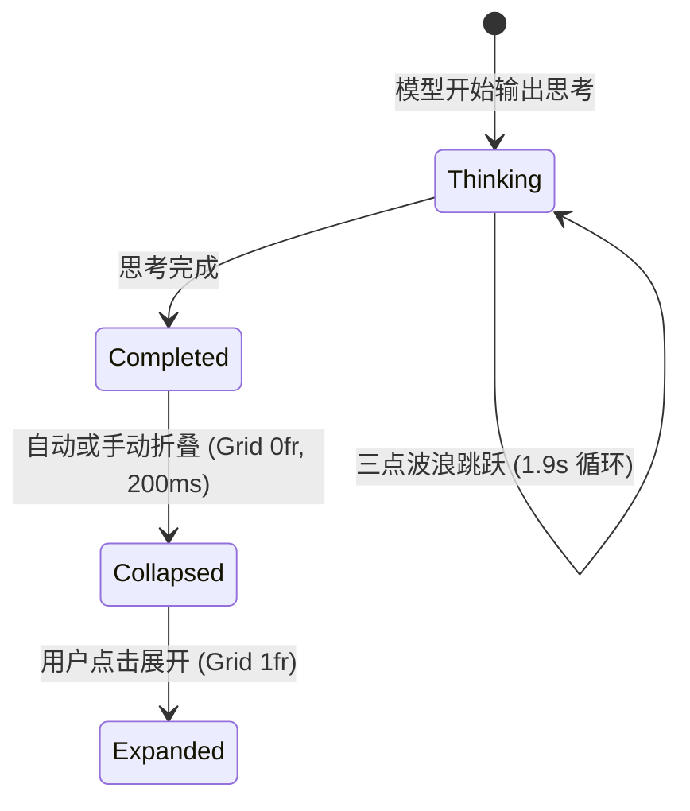

<p align="center">
  [⬅️ 上一篇：第二篇：基础原子组件与交互控件](02-基础原子组件与交互控件.md) · [📚 返回总目录](Claude%20Design%20System%20(CDS).md) · [下一篇：第四篇：动效物理学、着色器与环境光影 ➡️](04-动效物理学、着色器与环境光影.md)
</p>

---

## 第三篇：会话核心流与指令交互引擎

> **技术领域与英文指代**：`Chat Stream & Composer Engine`

### 3.1 会话气泡套件与排版规范

> **技术领域与英文指代**：`User & Assistant Message Bubbles`

#### 1. 用户提问气泡（User Message）
* **对齐方式**：靠右或居中最大宽度靠右，背景使用柔和的冷灰/浅蓝微调底色。
* **背景色**：`var(--cds-bg-tint-blue)`（浅色为极浅灰蓝 `rgb(240, 244, 248)`，深色为 `rgba(255,255,255,0.06)`）。
* **圆角**：`rounded-[18px]` 或 `rounded-2xl`。
* **内边距**：`px-4 py-2.5`。
* **入场动效**：`animation: code-user-bubble-enter 0.45s cubic-bezier(.34, 1.3, .64, 1);`

#### 2. 模型回答正文（Assistant Message）
* **背景色**：完全透明无背景，直接呈现在画布表面。
* **版心控制**：最大宽度 `max-w-2xl` 到 `max-w-3xl`（`672px - 768px`），保持最佳行长。
* **入场动效**：新消息块以 `message-fade-up`（`1.1s cubic-bezier(.34, 1.56, .64, 1)`）超调微弹进入。

---

> **生产级独立组件实现**：[`code-examples/ChatMessageBubbles.tsx`](../code-examples/ChatMessageBubbles.tsx)（包含 User 18px 浅蓝微调底色与 Assistant 零边框透明排版）。

### 3.2 思考过程折叠与时间状态机

> **技术领域与英文指代**：`Thinking Accordion`

Claude 呈现“思考过程（Thinking Process）”时，卡片具有极度细腻的状态机：



#### 思考卡片完整复现代码
```tsx
import React, { useState } from "react";

export function ThinkingCard({ isThinking, content }: { isThinking: boolean; content: string }) {
  const [expanded, setExpanded] = useState(false);

  return (
    <div className="w-full max-w-[42rem] mx-auto my-3 border border-neutral-200/80 dark:border-neutral-800 rounded-xl overflow-hidden bg-neutral-50/50 dark:bg-neutral-900/30">
      {/* 头部状态条 */}
      <div 
        onClick={() => !isThinking && setExpanded(!expanded)}
        className="flex items-center justify-between px-3.5 py-2 cursor-pointer select-none"
      >
        <div className="flex items-center gap-2 text-xs text-neutral-500 font-medium">
          {isThinking ? (
            <>
              {/* 思考中 3 点跳动 */}
              <div className="inline-flex items-center gap-[3.5px]">
                <span className="size-[3px] rounded-full bg-[#d97757] animate-quiet-dot" style={{ animationDelay: "0s" }} />
                <span className="size-[3px] rounded-full bg-[#d97757] animate-quiet-dot" style={{ animationDelay: "0.15s" }} />
                <span className="size-[3px] rounded-full bg-[#d97757] animate-quiet-dot" style={{ animationDelay: "0.3s" }} />
              </div>
              <span className="animate-pulse">Thinking...</span>
            </>
          ) : (
            <>
              <span className="size-1.5 rounded-full bg-neutral-400" />
              <span>Thought for 3 seconds</span>
            </>
          )}
        </div>

        {!isThinking && (
          <span className={`text-xs text-neutral-400 transition-transform duration-200 ${expanded ? "rotate-180" : ""}`}>
            ▾
          </span>
        )}
      </div>

      {/* 内容区域：CSS Grid 0fr -> 1fr 伸缩容器 */}
      <div 
        className="grid transition-[grid-template-rows] duration-200 ease-[cubic-bezier(.19,1,.22,1)]"
        style={{ gridTemplateRows: expanded || isThinking ? "1fr" : "0fr" }}
      >
        <div className="min-h-0 overflow-hidden px-3.5 pb-3 text-xs leading-relaxed text-neutral-600 dark:text-neutral-400 font-mono border-t border-neutral-100 dark:border-neutral-800/60 pt-2">
          {content}
        </div>
      </div>
    </div>
  );
}
```

---

> **生产级独立组件实现**：[`code-examples/ThinkingAccordion.tsx`](../code-examples/ThinkingAccordion.tsx)（包含 CSS Grid 0fr 伸缩与生成中强制展开互斥锁）。

### 3.3 新一代富文本输入框终端与指令交互引擎

> **技术领域与英文指代**：`Chat Composer & Next-Gen Engine`

#### 视觉规范表
* **外壳容器**：宽度最大 `42rem (672px)`，外边距 `margin: 0 auto`，圆角 `20px`。
* **背景与边框**：`bg-surface-3`，配合双环投影。
* **内边距**：外容器 `p-[0.875rem] (14px)`，内部输入域左边距 `pl-[8px]`。
* **高度自适应**：原生 CSS `field-sizing: content`，最低 `min-height: calc(2lh + 6px)`，最高 `max-height: 24rem`。

#### 完整组件复现代码 (React + Tailwind)
```tsx
import React, { useState } from "react";

export function ClaudeComposer() {
  const [value, setValue] = useState("");

  return (
    <div className="w-full max-w-[42rem] mx-auto px-4">
      <div 
        className="relative flex flex-col w-full rounded-[20px] bg-white dark:bg-[#20201e] p-[0.875rem] gap-y-2 cursor-text transition-shadow duration-200"
        style={{
          boxShadow: "0 0.25rem 1.25rem rgba(0,0,0,0.035), inset 0 0 0 1px rgba(0,0,0,0.08)",
        }}
      >
        {/* 输入文本框 */}
        <textarea
          value={value}
          onChange={(e) => setValue(e.target.value)}
          placeholder="How can I help you today?"
          rows={1}
          className="w-full max-h-[24rem] min-h-[3rem] bg-transparent border-none outline-none resize-none text-[15px] leading-[1.4] text-neutral-900 dark:text-neutral-100 placeholder-neutral-400 pl-2 focus:ring-0"
          style={{ fieldSizing: "content" as any }}
        />

        {/* 底部功能条 */}
        <div className="flex items-center justify-between pt-1">
          {/* 左侧附加操作 */}
          <div className="flex items-center gap-1">
            <button className="h-8 px-2.5 rounded-lg flex items-center gap-1.5 text-xs font-medium text-neutral-500 hover:text-neutral-800 hover:bg-neutral-100 dark:hover:bg-neutral-800 transition-colors">
              <span>+</span>
              <span>Add content</span>
            </button>
          </div>

          {/* 右侧发送按钮 */}
          <div className="flex items-center gap-2">
            <button
              disabled={!value.trim()}
              className="size-8 rounded-lg flex items-center justify-center transition-all duration-150 disabled:opacity-30 disabled:cursor-not-allowed bg-[#d97757] hover:bg-[#cc5a36] text-white"
            >
              <svg className="size-4" viewBox="0 0 24 24" fill="none" stroke="currentColor" strokeWidth="2">
                <path d="M5 12h14M12 5l7 7-7 7"/>
              </svg>
            </button>
          </div>
        </div>
      </div>
    </div>
  );
}
```

---

---

在官方 Claude Desktop / Web 客户端中，输入框已由传统简单的 `<textarea>` 全面进化为以 ProseMirror / Tiptap 内核驱动的下一代富文本与多模态指令交互系统。

#### 3.3.1 核心实现示例

输入框需要处理键盘事件并保护输入法合成过程：
```javascript
// Claude 官方输入法合成中断拦截与 Escape/Enter 状态机
let e = e => {
  if (e.defaultPrevented || !I.current || !L.current && !j) return;
  if (e.key === "Escape") {
    if (e.isComposing || e.keyCode === 229) {
      e.stopPropagation();
      return;
    }
    // 处理 Popover 关闭与焦点归还
  }
  // 在 Enter 键判定中同样强制执行合成拦截
  if (!(e.nativeEvent.isComposing || e.keyCode === 229)) {
    if (!(e.key !== "Enter" || e.shiftKey)) {
      if (!e.metaKey && !e.ctrlKey) {
        e.preventDefault();
        handleSend();
      }
    }
  }
}
```

指令与文件引用解析示例：
```javascript
// Slash 指令与 Mention 文件胶囊正向解析器
function bs(e, t, n, r) {
  let { nonInteractive: i, leadingSlashCommand: a, knownSlashCommands: o, renderMentionPill: s, threadChip: c, fileMentions: l } = t,
      f = o ?? os,
      p = [],
      m = e;
  
  // 1. 匹配行首 Slash Command (如 /help, /clear, /model)
  if (a) {
    let t = Rn.exec(e);
    if (t) {
      p.push(u(Pt, { name: t[1], nonInteractive: i }, "slash-command"));
      m = e.slice(t[0].length);
    }
  }

  // 2. 匹配 @ 提及与文件胶囊 (_s 函数解析本地文件路径)
  if (l) {
    for (let e of _s(m, n)) {
      g(e.index) || _.push({
        index: e.index,
        end: e.index + e.text.length,
        node: u(An, { fileRef: i ? null : e.fileRef, className: Fn, fallback: e.text, children: e.text }, `file:${e.index}`)
      });
    }
  }
  return p;
}
```

#### 3.3.2 严苛 CJK 输入法合成守卫机制 (IME Composition Guard)
在中文、日文、韩文等使用输入法编辑器 (IME) 的语言中，用户按下字母进行拼音输入时，浏览器会触发连续的 `compositionstart`、`compositionupdate` 和 `compositionend` 事件。
- **致命痛点**：若仅监听 `onKeyDown={(e) => if (e.key === 'Enter') send()}`，用户在候选词浮层按下回车确认汉字时，会导致未写完的消息直接误发送！
- **Claude 生产解法**：建立 `isComposing` 与 `keyCode === 229`（IME 专用键码）的双重互锁守卫：
  $$\text{CanSubmit} = (\text{Key} == \text{'Enter'}) \land (\neg \text{ShiftKey}) \land (\neg \text{isComposing}) \land (\text{keyCode} \neq 229)$$
  只有当用户明确敲击 Enter 且非合成态时，才触发消息提交。

#### 3.3.3 双触发符指令与引用建议系统 (`/` Slash Command 与 `@` Context Mentions)
- **`/` 指令引擎**：在段首或空格后输入 `/`，呼出弹层并触发模糊前缀匹配（如 `/compact`, `/plan`, `/model`），支持快速切换运行参数与会话模式。
- **`@` 引用引擎**：输入 `@` 触发本地工程拓扑搜索，自动嗅探上下文代码文件（检查常见文件后缀，上限 `hs = 1024` 路径长度，单次上限 `256` 个引用），解析为包含图标、路径与高亮样式的内联 `FileMentionPill`。
- **焦点漫游 (Roving Focus)**：浮层内部采用方向键 `ArrowUp` / `ArrowDown` 循环漫游高亮项，按 `Tab` 或 `Enter` 快速补全并消费触发字符。

#### 3.3.4 弹性高度自适应与 Token 动态计量预测数学模型
- **高度自适应**：基于 `scrollHeight` 动态计算，施加物理高度限制区间 `44px - 240px`，超出阈值时无缝切换为内部原生滚动条。
- **Token 预测算法**：对输入缓冲区采用混合权值估算模型：
  $$\text{EstimatedTokens} \approx \lceil \text{CharLength} \times 0.7 \rceil + 10 \times \mathbb{I}_{\text{Slash}} + 25 \times N_{\text{Mentions}}$$
  当预测值接近窗口极限（90%）时，右上角计量指示灯由中性灰色渐变转换为陶土警示红。

#### 3.3.5 生产级完整 React 落地实现
完整独立源码已落地至：[`code-examples/RichComposerWithMentions.tsx`](../code-examples/RichComposerWithMentions.tsx)。

---

### 3.4 模型矩阵切换器与 Token 计量仪表盘

> **技术领域与英文指代**：`Model Switcher & Context Gauge`

Claude 为开发者提供了直观的模型阶梯选择器以及业界最先进的 Prompt Caching 显存成本解构仪表盘。

#### 3.4.1 核心实现示例

以下示例展示 Token 结构与缓存读写计量器：
```javascript
// 上下文窗口与 Prompt Caching 解构统计
function calculateContextBudget(e) {
  let { inputTokens: t, outputTokens: n, cacheReadTokens: r, cacheWriteTokens: i } = e;
  let total = t + n + r + i;
  let maxWindow = 200000; // Claude 3.5 200k 上下文
  return {
    ratio: Math.min(1, total / maxWindow),
    percent: Math.round((total / maxWindow) * 100),
    isNearLimit: total > maxWindow * 0.8
  };
}
```

#### 3.4.2 官方三大模型梯队架构与 Thinking 思考开关联动
- **Claude 3.5 Sonnet**：全能主力，综合编程、架构设计与系统推理最强者；
- **Claude 3.5 Haiku**：极速响应，每秒超高 Token 吞吐，适合自动化流式交互；
- **Claude 3 Opus**：深度攻坚，专注高阶数理与长篇巨构分析；
- **Extended Thinking 联动**：在 Sonnet/Opus 模式下提供独立的思考开关，允许自由开启逐步思维链展开。

#### 3.4.3 Prompt Caching 显存成本解构与环形 SVG 仪表盘
- **Prompt Caching 成本透视**：
  将上下文细分为四色复合条：
  - 翡翠绿：`cache_read_input_tokens`（命中上下文缓存，享受阶梯优惠）；
  - 天空蓝：`cache_creation_input_tokens`（写入 5 分钟热缓存）；
  - 陶土橙：`input_tokens`（常规冷启动输入）；
  - 紫罗兰：`output_tokens`（模型生成输出）。
- **SVG 环形仪表盘**：微型按钮内置基于 `strokeDashoffset = 2\pi r \times (1 - \text{ratio})` 的无损矢量环，占用率突破 80% 触发预警变色。

#### 3.4.4 生产级完整 React 落地实现
完整独立源码已落地至：[`code-examples/ModelSwitcherWithTokenGauge.tsx`](../code-examples/ModelSwitcherWithTokenGauge.tsx)。

---

### 3.5 交互式工具调用与 MCP 决策卡片

> **技术领域与英文指代**：`Tool Decisions & Human-in-the-Loop`

在接入 Model Context Protocol (MCP) 与本地命令行执行时，Claude 绝不静默运行具有副作用的外部指令，而是呼出具有三阶授权生命周期的决策卡片。

#### 3.5.1 核心实现示例

以下示例展示权限检查与决议回调接口：
```javascript
// MCP 工具调用过滤与决议派发
function Lo(e, t, n) {
  let r = [];
  for (let i of e) {
    if (i.type !== "tool_use" || !i.name || !i.id) continue;
    let e = t.get(i.id);
    if (!e || e.is_error) continue;
    let a = e.structured_content;
    r.push({ toolUseId: i.id, path: a?.path ?? "", version: a?.version ?? "" });
  }
  return r;
}

// 决议完成状态绑定
function ql(e, t, n) {
  return {
    ...t,
    resolved: e !== void 0 && !!n?.toolUseId && e.tool_use_id === n?.toolUseId,
    is_error: e?.is_error,
    ...e?.is_error ? { error_text: Hl(e) } : {}
  };
}
```

#### 3.5.2 严格的三态授权生命周期状态机
- **`pending_approval`（等待授权）**：卡片呈现微暖陶土色光晕边框 (`--cds-border-accent`，40% 透明度)，显示待调用的 MCP Server 地址与工具名称，等待人工审查；
- **`running`（执行中）**：批准后卡片进入运行态，指示灯切换为动态转动的蓝色光圈，实时捕获下游 CLI 或服务端的输出流；
- **`success` / `error`（终态收口）**：执行成功切换为翡翠绿徽标，失败切换为警示红，并可折叠展开纯黑底色的终端控制台输出 (`#0d0d0c`)。

#### 3.5.3 三阶决议按钮动作阵列与 Payload 审查
- **[单次批准 (Allow Once)]**：采用陶土高亮按钮 (`var(--cds-fill-brand)`)，仅赋予当前单次调用执行权限；
- **[始终允许 (Always Allow)]**：采用次级表面灰底按钮，将当前工具签名计入会话临时白名单，后续相同模式调用不再反复打断用户；
- **[拒绝执行 (Deny)]**：采用幽灵危险红按钮，向大模型回传 `is_error: true, error_text: "User denied tool execution"`，促使模型反思并提出替代方案。

#### 3.5.4 生产级完整 React 落地实现
完整独立源码已落地至：[`code-examples/McpToolDecisionCard.tsx`](../code-examples/McpToolDecisionCard.tsx)。

---

<p align="center">
  [⬅️ 第二篇：基础原子组件与交互控件](02-基础原子组件与交互控件.md) · [📚 目录](Claude%20Design%20System%20(CDS).md) · [第四篇：动效物理学、着色器与环境光影 ➡️](04-动效物理学、着色器与环境光影.md)
</p>
