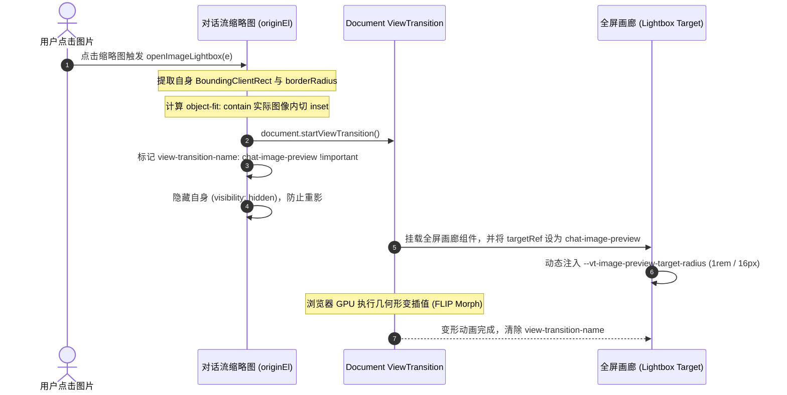

<p align="center">
  [⬅️ 上一篇：第四篇：动效物理学、着色器与环境光影](04-动效物理学、着色器与环境光影.md) · [📚 返回总目录](Claude%20Design%20System%20(CDS).md) · [下一篇：第六篇：系统级桌面架构与协作拓扑 ➡️](06-系统级桌面架构与协作拓扑.md)
</p>

---

## 第五篇：视听多媒体与产物交互物理学

> **技术领域与英文指代**：`Audiovisual, Lightbox & Artifacts Experience`

### 5.1 语音模式与 Web Audio 物理声学系统

> **技术领域与英文指代**：`Voice Mode & AudioWorklet Architecture`

> **实现说明**：音效使用 Web Audio API 合成，频域可视化参考 `LiveMicActivityBars`。流式音频缓冲示例用于说明线程间的数据传递；接入应用需配置相应浏览器能力。

---

#### 5.1.1 流式音频架构说明：AudioWorklet 与 SharedArrayBuffer 环形缓冲 (`audioSinkWorklet.js`)

在语音大模型实时对话（如 Claude Voice / Realtime API）场景下，传统的 `AudioContext.decodeAudioData` 或单次 `AudioBufferSourceNode` 调度会因为主线程垃圾回收（GC）或长任务阻塞而产生致命的爆音、破音或断断续续。

#### 1. 核心实现示例
流式音频可以使用现代浏览器的 `AudioWorkletProcessor` 在独立的高优先级音频渲染线程中运行，并通过 `SharedArrayBuffer` 与 `Atomics` 原子操作实现主线程与音频线程之间的**无锁零拷贝生产-消费者队列（RingBuffer）**：

```javascript
// audioSinkWorklet.js: Atomics 驱动的环形无锁缓冲区
const RD = 0; // 读指针索引
const WR = 1; // 写指针索引
const UNDERRUNS = 2; // 欠载计数器
const PLAYED = 3; // 已播放样本计数

class RingBuffer {
  constructor(sab) {
    this.indices = new Int32Array(sab, 0, 4);
    this.storage = new Float32Array(sab, 16);
    this.capacity = this.storage.length;
  }

  // 生产者（主线程 / Opus 解码器写入 PCM 样本）
  push(input) {
    const wr = Atomics.load(this.indices, WR);
    const rd = Atomics.load(this.indices, RD);
    const n = Math.min(input.length, this._availableWrite(rd, wr));
    if (n === 0) return 0;

    const tail = this.capacity - wr;
    if (n <= tail) {
      this.storage.set(input.subarray(0, n), wr);
    } else {
      this.storage.set(input.subarray(0, tail), wr);
      this.storage.set(input.subarray(tail, n), 0);
    }
    Atomics.store(this.indices, WR, (wr + n) % this.capacity);
    return n;
  }

  // 消费者（AudioWorklet 高优先级线程以约 375Hz 频率读取）
  pop(output) {
    const rd = Atomics.load(this.indices, RD);
    const wr = Atomics.load(this.indices, WR);
    const n = Math.min(output.length, this._availableRead(rd, wr));
    if (n === 0) return 0;

    const tail = this.capacity - rd;
    if (n <= tail) {
      output.set(this.storage.subarray(rd, rd + n));
    } else {
      output.set(this.storage.subarray(rd, this.capacity));
      output.set(this.storage.subarray(0, n - tail), tail);
    }
    Atomics.store(this.indices, RD, (rd + n) % this.capacity);
    return n;
  }
}

// 音频帧处理器 (以 128 样本为一量度，48kHz 下每秒执行 375 次)
class AudioSinkProcessor extends AudioWorkletProcessor {
  process(_inputs, outputs) {
    const channel = outputs[0]?.[0];
    if (!channel) return true;

    const read = this.ring.pop(channel);
    if (read < channel.length) {
      // 欠载保护：不足部分用 0 填充静音，并触发欠载检测，绝不输出爆音
      channel.fill(0, read);
      if (this.hasStarted && this.gapReady) {
        this.dryGapPending = true;
        if (read === 0 && !this.drainPosted) {
          this.notifyDrained();
        }
      }
    }
    return true;
  }
}
registerProcessor("audio-sink-processor", AudioSinkProcessor);
```

---

#### 5.1.2 SFX 交互音效与 30% 舒适声学规范

在桌面端与语音模式中，过度刺耳的蜂鸣提示音会破坏 Claude 温润的人文调性。音效示例采用**30% 舒缓音量原则**与硬件路由：

#### 1. 核心实现示例
```javascript
// 官方音效调度器
function createSoundElement(url, volume = 0.3) {
  if (typeof window === "undefined") return null;
  let audio = new Audio(url);
  // 核心声学标准：全局固定 30% 音量，温和舒适，绝不产生惊吓感
  audio.volume = volume;
  return audio;
}

async function initClaudeSoundPipeline() {
  let AudioContextClass = window.AudioContext || window.webkitAudioContext;
  let ctx = new AudioContextClass();
  
  // 四大官方交互音效矩阵
  let sfxMap = {
    "voice-mode-ready":     createSoundElement("/audio/voice/sfx/enter_voice_mode.mp3", 0.3),
    "exit-voice-mode":      createSoundElement("/audio/voice/sfx/exit_voice_mode.mp3", 0.3),
    "disconnected":         createSoundElement("/audio/voice/sfx/disconnected.mp3", 0.3),
    "tool-approval-needed": createSoundElement("/audio/voice/sfx/tool_approval_needed.mp3", 0.3)
  };

  // 通过 AudioContext 目的节点进行直通低延迟连接
  Object.values(sfxMap).forEach(audio => {
    if (audio && ctx) {
      ctx.createMediaElementSource(audio).connect(ctx.destination);
      audio.load();
    }
  });

  // 支持 setSinkId 独立选择外接会议扬声器或耳机
  let selectedSpeakerId = getSelectedSpeakerDevice();
  if (selectedSpeakerId && typeof ctx.setSinkId === "function") {
    await ctx.setSinkId(selectedSpeakerId);
  }
}
```

| 音效标识 | 物理文件路径 | 声学特征与设计动机 | 触发时机 |
| :--- | :--- | :--- | :--- |
| `enter_voice_mode` | `sfx/enter_voice_mode.mp3` | 双音阶上扬泛音，清脆柔和（9.7KB） | 用户点击麦克风开启语音交互通道 |
| `exit_voice_mode` | `sfx/exit_voice_mode.mp3` | 单音阶下沉泛音，平缓收束（10.4KB） | 用户主动挂断或语音闲置超时 |
| `tool_approval_needed` | `sfx/tool_approval_needed.mp3` | 温暖的木质敲击共振双音（9.2KB） | 模型触发高风险电脑使用或 Bash 待确认 |
| `disconnected` | `sfx/disconnected.mp3` | 微弱的电平降调衰减音（10.7KB） | WebSocket / SSE 连接中断 |

---

#### 5.1.3 6 频段非线性 Gamma 幂律波形动效 (`LiveMicActivityBars`)

在语音交互中，麦克风波形如果直接绑定分贝线，会因为低音轰鸣导致视觉上总是“顶格”，而说话停顿时的背景噪音又会导致微小抖动。

Anthropic 在 `c4a1e6da6-B9dxf4-D.js` 中构建了 **LiveMicActivityBars** 算法：


#### 1. 核心数学公式与交互算法
```javascript
// c4a1e6da6-B9dxf4-D.js
// 1. Web Audio AnalyserNode 配置
analyser.fftSize = 512;
analyser.smoothingTimeConstant = 0.5; // 消除帧间视觉毛刺
analyser.minDecibels = -70;          // 静音底噪基准线
analyser.maxDecibels = -10;          // 正常说话饱和上限

// 2. 核心 3 频段能量提取与 Gamma 幂律映射公式
for (let b = 0; b < 3; b++) {
  let rawEnergy = computeAverageBinEnergy(dataArray, b); // [0.0, 1.0]
  let noiseFloor = 0.08; // 8% 噪声门限：彻底消除空调背景杂音引发的虚假微动
  let gated = Math.max(0, rawEnergy - noiseFloor) / (1 - noiseFloor);
  
  // 核心视觉物理学：0.7 次幂非线性 Gamma 压缩
  // 放大微弱的人声细语，同时压制高分贝爆音，使波形动态范围分布极度均匀
  let compressed = Math.min(1, Math.pow(gated, 0.7) * 1.5 * bandWeights[b]);
  
  // 映射至 4px - 24px 物理高度
  let targetHeight = 4 + (24 - 4) * compressed;
  motionValues[b].set(targetHeight);
}
```

---

#### 5.1.4 5 大官方语音人格与声学特征解构

Claude 语音模式提供了 5 种经过严格声学调优与情绪定位的官方音色人格（本开源实现推荐通过 Web Audio API 合成或接入自定义音频）：

```
voice-personas/
├── airy                     # 空灵柔和 (Airy): 呼吸感强、语速适中，适合深度思考与陪伴
├── buttery                  # 醇厚顺滑 (Buttery): 磁性饱满、亲和力强，默认主推人格
├── glassy                   # 清澈明朗 (Glassy): 咬字清晰、高频透亮，适合代码讲解与教学
├── mellow                   # 沉稳温润 (Mellow): 语调舒缓、低频共鸣，适合夜间阅读与长文本
└── rounded                  # 饱满圆润 (Rounded): 节奏轻快、干脆利落，适合效率型问答
```

---

### 5.2 多模态媒体查看器与画廊转场物理学

> **技术领域与英文指代**：`Lightbox, Pan/Zoom & Shared Element Transitions`

> **实现说明**：媒体预览由平移缩放、共享元素转场和附件布局组成，可参考 `MediaLightboxViewer` 与 `useClaudeSharedElementTransition`。

---

#### 5.2.1 核心实现示例

#### 1. 物理常数与阻尼阈值矩阵 (Interaction Constants)

在 `c4b054ed5-BGjH-Uu6.js` 头部，Anthropic 确立了一组极其严苛的物理常数：

```javascript
// 核心物理学与阻尼常数
var ae = 2;        // 最小最大缩放倍数 (Math.max(naturalWidth / fitWidth, 2))
var oe = 4;        // 手势死区过滤阈值 (Math.hypot(dx, dy) < 4px 判定为手部微抖，不触发拖拽)
var se = 0.01;     // 滚轮缩放指数因子 (Math.exp(-deltaY * 0.01))
var v = 1.05;      // 缩放吸附下限 (当 scale <= 1.05 时自动顺滑吸附回 1.0)
var ce = 1.25;     // 单次触击/跳变放大默认比例
var y = 0.7;       // 视口阻尼溢出系数
var le = 2;        // 虚拟画廊跑道预加载跨度 (Math.abs(t - O) <= 2，前后仅预载 2 帧)
```

---

#### 5.2.2 View Transitions API 共享元素无缝变形（FLIP Morphing & Object-Fit 几何计算）

在 Claude 中点击对话气泡或文件卡片里的图片时，图片**绝不是粗暴地凭空弹窗**，而是如同原生系统级相册一般，从对话流里的缩略图**无缝平滑膨胀展开至全屏 Lightbox**；关闭时又能精准原路飞回缩略图。



#### 核心实现示例

```javascript
// 1. 动态提取生效圆角 (向上穿透 5 层 DOM 捕获真实裁剪半边距)
function S(element, fallbackRadius) {
  let curr = element;
  for (let i = 0; curr && i < 5; i++) {
    let style = getComputedStyle(curr);
    if ((curr.tagName === "IMG" || style.overflow === "hidden" || style.overflow === "clip") 
        && style.borderRadius !== "0px" && style.borderRadius !== "") {
      return style.borderRadius;
    }
    curr = curr.parentElement;
  }
  return fallbackRadius;
}

// 2. 针对 object-fit: contain 图像的精确内切剪裁百分比算法
function T(img) {
  if (img.tagName !== "IMG") return null;
  let { naturalWidth: nw, naturalHeight: nh } = img;
  if (!(nw > 0 && nh > 0)) return null;
  let style = getComputedStyle(img);
  if (style.objectFit !== "contain" && style.objectFit !== "scale-down") return null;

  let rect = img.getBoundingClientRect();
  let padL = parseFloat(style.paddingLeft) || 0, padT = parseFloat(style.paddingTop) || 0;
  let padR = parseFloat(style.paddingRight) || 0, padB = parseFloat(style.paddingBottom) || 0;
  let availW = rect.width - padL - padR, availH = rect.height - padT - padB;
  if (!(availW > 0 && availH > 0)) return null;

  let scale = Math.min(availW / nw, availH / nh);
  if (style.objectFit === "scale-down") scale = Math.min(scale, 1);

  let renderW = nw * scale, renderH = nh * scale;
  let insetTop = (availH - renderH) / 2 + padT;
  let insetRight = (availW - renderW) / 2 + padR;
  let insetBottom = (availH - renderH) / 2 + padB;
  let insetLeft = (availW - renderW) / 2 + padL;

  let toPercent = (val, total) => `${Number((100 * val / total).toFixed(3))}%`;
  return {
    inset: `${toPercent(insetTop, rect.height)} ${toPercent(insetRight, rect.width)} ${toPercent(insetBottom, rect.height)} ${toPercent(insetLeft, rect.width)}`
  };
}
```

---

#### 5.2.3 仿射变换与以光标为锚点的 Pan / Zoom 物理学数学公式

当图片放大时，如果简单使用中心点缩放，用户想看细节的位置会被推移出屏幕。Claude 的核心是**以当前鼠标指针（或双指中心点）为物理世界不变不动点（Fixed Anchor Point）**：

$$\begin{cases}
c = \frac{S_{\text{target}}}{S_{\text{current}}} \\
\text{idealTx} = O_x - (O_x - \text{idealTx}_{\text{prev}}) \cdot c \\
\text{idealTy} = O_y - (O_y - \text{idealTy}_{\text{prev}}) \cdot c \\
\text{tx} = \text{clamp}(\text{idealTx}, \text{maxTx}) \\
\text{ty} = \text{clamp}(\text{idealTy}, \text{maxTy})
\end{cases}$$

其中允许平移的最大物理边界 $\text{maxTx}, \text{maxTy}$ 根据视口与图像尺寸动态解算：
$$\text{maxTx} = \max\left(0, \frac{\text{fitWidth} \cdot S - \text{viewportWidth}}{2}\right) \cdot \min\left(1, \max\left(0, \frac{S - 1.05}{0.95}\right)\right)$$

#### 核心实现示例

```javascript
// 核心锚点平移缩放方程
function pe(fitInfo, currentPos, targetScale, pointerPos) {
  let maxTx = calcMaxTranslate(fitInfo.fitWidth, fitInfo.viewportWidth, targetScale);
  let maxTy = calcMaxTranslate(fitInfo.fitHeight, fitInfo.viewportHeight, targetScale);
  let offsetX = pointerPos ? pointerPos.clientX - fitInfo.fitCenterX : 0;
  let offsetY = pointerPos ? pointerPos.clientY - fitInfo.fitCenterY : 0;

  let c = targetScale / currentPos.scale;
  let idealTx = offsetX - (offsetX - currentPos.idealTx) * c;
  let idealTy = offsetY - (offsetY - currentPos.idealTy) * c;

  let tx = clamp(idealTx, maxTx);
  let ty = clamp(idealTy, maxTy);
  return { ...fitInfo, scale: targetScale, idealTx, idealTy, tx, ty, maxTx, maxTy };
}

// 滚轮指数缩放监听与 4px 拖拽死区捕获
function handleWheel(e) {
  if (e.ctrlKey) {
    e.preventDefault();
    let zoomRatio = Math.exp(-e.deltaY * 0.01);
    let newScale = Math.min(Math.max(currentScale * zoomRatio, 1), maxScale);
    if (newScale <= 1.05) {
      resetZoom(); // 自动吸附回归 1.0
    } else {
      applyAnchorZoom(newScale, e.clientX, e.clientY);
    }
  }
}
```

---

#### 5.2.4 75vw 画廊跑道视口与前后两帧预加载架构

在拥有多张图片附件（多轮会话或批量上传）的画廊中，Claude 使用了一套独特的 **75vw 弹性跑道与滑动视口模型**：

```css
/* 跑道滑动位移方程 */
.gallery-runway {
  gap: 32px;
  transform: translateX(calc(12.5vw - var(--active-index) * 75vw - var(--active-index) * 32px));
  transition: transform 300ms cubic-bezier(0.165, 0.84, 0.44, 1);
}
.gallery-slide {
  width: 75vw;
}
.gallery-slide[data-active="true"] {
  opacity: 1;
}
.gallery-slide[data-active="false"] {
  opacity: 0.4;
  cursor: pointer;
}
.gallery-slide[data-active="false"]:hover {
  opacity: 0.75;
}
```

* **视口布局精髓**：每个幻灯片宽度恰好为 `75vw`（屏幕宽度的 3/4），起始偏移量设为 `12.5vw`（刚好处于屏幕正中央）。两侧各露出 `12.5vw - 32px` 的相邻图片边缘，给用户明确的“画廊可左右滑动”视觉暗示。
* **虚拟预加载机制**：通过 `Math.abs(index - currentIndex) <= 2`，跑道上只保留当前项及前后各两张的真实 DOM 与高清图片，避免在百图大聊天记录中爆掉显存。

---

#### 5.2.5 生产级完整 React 落地实现

完整生产级实现已独立打包存放在工程代码库中，支持即拷即用：
1. **组件本体**：[`code-examples/MediaLightboxViewer.tsx`](../code-examples/MediaLightboxViewer.tsx) —— 包含完整的以光标为锚点的双击缩放、指针拖拽锁定、滚轮指数缩放、75vw 跑道平移、键盘箭头导航与无障碍焦点保护。
2. **变形转场 Hook**：[`code-examples/useClaudeSharedElementTransition.ts`](../code-examples/useClaudeSharedElementTransition.ts) —— 包含基于原生 `startViewTransition` 的缩略图圆角与 `object-fit: contain` 内切剪裁百分比几何计算。

---

### 5.3 双栏弹性分割与折叠物理学

> **技术领域与英文指代**：`Artifacts Split-Pane Resizer & Docking Physics`

在 Artifacts 产物展示、代码编辑与长文档审查场景中，Claude 拥有精密的可拖拽左右双栏分割与折叠交互。

#### 5.3.1 核心实现示例

以下示例展示拖拽生命周期与分栏比例算法：
```javascript
// 拖拽激活与光标指针跟随
w = e => {
  if (e.pointerId !== u) return;
  if (!p.current) {
    if (Math.abs(t) < qM && Math.abs(r) < qM) return; // qM 为 4px 移动死区
    p.current = !0;
    d(!0);
    l.setAttribute("data-pane-dragging", String(c.current));
    y.showCursor("move");
  }
  // 计算基于容器宽度的浮点比例，默认锚定 0.5 (50%)
  let i = oN(n, c.current, BM(XM(l), parseFloat(getComputedStyle(l).getPropertyValue("--df-pane-row")) || .5, e.clientX, e.clientY));
  m.current = i;
  iN(i);
};

// Escape 键拦截与快速回滚
C = e => {
  if (e.key === "Escape" && p.current) {
    e.preventDefault();
    e.stopImmediatePropagation();
    // 立即终止拖拽并恢复原分割比例
    _.abort();
    x("cancelled");
  }
};
```

#### 5.3.2 连续指针动力学与事件屏蔽护盾 (Pointer Stream & Iframe Shield)
- **Iframe 事件防吞噬护盾**：当用户在主窗口拖拽分割条时，一旦光标划过展示 HTML/React 产物的子 iframe，iframe 的内部 DOM 会截断主窗口的 `pointermove` 与 `pointerup` 事件，导致拖拽死锁。Claude 的解决机制是在拖拽激活时向全局注入 `data-pane-dragging="true"`，在预览容器上方强制覆盖一层透明的 `pointer-events: none` 阻断层；
- **4px 移动死区与 Escape 恢复**：设定 4px 阈值防止单击或轻微手颤激活拖拽；在拖拽过程中随时按 `Escape` 键可取消操作并瞬间回滚至先前的分割比例。

#### 5.3.3 双击居中吸附 (50/50 Snap) 与边缘折叠门限 (Docking Threshold)
- **双击归位**：双击分割条上的胶囊手柄（Pill Handle），立即触发弹性重置，将视口精准平分（50/50 居中吸附）；
- **边缘折叠门限 (Docking)**：当拖拽比例超过临界值（如右栏宽度 < 18% 或视口像素 < 420px）时，系统自动触发吸附折叠，将右栏收起为侧边微型挂钩，为主聊天流释放完整阅读空间。
- **极值约束钳制**：左栏会话流最小保留 380px，右栏 Artifacts 最小保留 420px。

#### 5.3.4 生产级完整 React 落地实现
完整独立源码已落地至：[`code-examples/ArtifactsSplitPaneResizer.tsx`](../code-examples/ArtifactsSplitPaneResizer.tsx)。

---

---

#### 5.3.5 Artifacts 分屏工作台与抽屉容器规范
#### 3. Artifacts 分屏工作台与抽屉容器 (Artifacts Workbench)
当触发独立代码或 UI 产物生成时，Claude 会在主聊天流右侧唤起 Artifacts 专属面板：
* **分栏比例**：桌面端默认为 `50% : 50%` 双栏分屏；移动端或窄屏转为全屏覆盖抽屉（Sheet）。
* **抽屉滑入转场**：从屏幕右侧平滑滑入，时序 `--cds-dur-sheet: 300ms`，缓动函数 `cubic-bezier(.165, .84, .44, 1)`。
* **顶部工具栏**：高度 `46px`（`--cds-h-titlebar`），包含版本历史步进器（`< 1/3 >`）、Code/Preview 纯几何分段选择器与最大化/关闭按钮。
* **防挤压保障**：Artifacts 内部沙箱 iframe 或代码编辑器必须声明独立的 `@container`，确保代码换行不干扰左侧聊天画布的宽度分配。

### 5.4 工件预览沙箱与隔离通信架构

> **技术领域与英文指代**：`Artifacts Sandbox & Epitaxy Architecture`

Claude 拥有强大的动态渲染（React/SVG/Mermaid/HTML）能力，其底层运行在代号为 **Epitaxy** 的隔离容器中。

#### 1. 核心实现示例

```javascript
// Epitaxy 权限隔离与通信门禁
var EPITAXY_IFRAME_SANDBOX = [
  "allow-scripts",
  "allow-same-origin",
  "allow-forms",
  "allow-popups",
  "allow-modals"
].join(" ");

// 7 种专有 MIME 协议分发器
var EPITAXY_MIME_REGISTRY = {
  "application/vnd.ant.react":    "renderReactComponent",
  "application/vnd.ant.code":     "renderCodeHighlighter",
  "application/vnd.ant.markdown": "renderMarkdownDoc",
  "application/vnd.ant.mermaid":  "renderMermaidChart",
  "application/vnd.ant.svg":      "renderRawSvg",
  "application/vnd.ant.html":     "renderSandboxedHtml",
  "application/vnd.ant.latex":    "renderKatexMath"
};

// 用户手势激活门禁安全过滤器
window.addEventListener("message", function(event) {
  var data = event.data;
  if (!data || typeof data !== "object") return;

  // 严格校验消息来源源域与结构签名
  if (data.channel === "epitaxy_mcp_app") {
    // 核心安全防御：拦截未经过 iframe 内真实用户点击/激活的恶意反射事件
    if (!event.isTrusted || !data.hasUserActivation) {
      console.warn("[Epitaxy MCP App] ui/message without iframe-originated user activation blocked");
      return;
    }
    dispatchAppMessage(data.payload);
  }
});

// 12 项 Virtual Package 自愈重定向表
function resolveVirtualModule(importName) {
  var packageAliases = {
    "lucide-react": "@ant/epitaxy-lucide-shim",
    "framer-motion": "@ant/epitaxy-motion-shim",
    "recharts": "@ant/epitaxy-recharts-shim"
  };
  return packageAliases[importName] || importName;
}
```

#### 2. 生产级沙箱宿主组件 (`EpitaxyIframeBridge.tsx`)

```tsx
import React, { useRef, useEffect, useCallback } from 'react';

interface EpitaxyIframeBridgeProps {
  srcDoc: string;
  onMessage?: (payload: any) => void;
  onError?: (err: any) => void;
}

export const EpitaxyIframeBridge: React.FC<EpitaxyIframeBridgeProps> = ({
  srcDoc,
  onMessage,
  onError
}) => {
  const iframeRef = useRef<HTMLIFrameElement>(null);

  const handleMessage = useCallback(
    (event: MessageEvent) => {
      // 保证仅响应来自该 iframe 的事件
      if (event.source !== iframeRef.current?.contentWindow) return;
      const { type, payload, hasUserActivation } = event.data || {};

      if (type === 'EPITAXY_USER_ACTION') {
        if (!hasUserActivation) {
          console.warn('[Epitaxy] Blocked synthetic message without user activation');
          return;
        }
        onMessage?.(payload);
      } else if (type === 'EPITAXY_RUNTIME_ERROR') {
        onError?.(payload);
      }
    },
    [onMessage, onError]
  );

  useEffect(() => {
    window.addEventListener('message', handleMessage);
    return () => window.removeEventListener('message', handleMessage);
  }, [handleMessage]);

  return (
    <iframe
      ref={iframeRef}
      title="Claude Epitaxy Sandbox"
      srcDoc={srcDoc}
      sandbox="allow-scripts allow-same-origin allow-forms allow-popups allow-modals"
      referrerPolicy="strict-origin"
      className="h-full w-full border-0 bg-transparent"
    />
  );
};
```

---

### 5.5 代码差异对比与多线程语法高亮系统

> **技术领域与英文指代**：`Diff Viewer, Syntax Highlighter & CodeBlock`

在生成和修改代码文件时，Claude 会在 Artifacts 面板与会话气泡内呼出其专属的代码差异比对引擎。

#### 5.5.1 核心实现示例

以下示例展示流式高亮调度器 `Jh` 与 Shadow DOM 挂载函数 `Xh`：
```javascript
// Shadow DOM 隔离与双栏 Grid 锁定挂载
function Xh(e, t, n, r, i) {
  let a = e.ownerDocument,
      o = a.createElement("div"),
      s = o.shadowRoot ?? o.attachShadow({ mode: "open" });
  
  let c = a.createElement("style");
  let l = a.createElement("style");
  
  // 建立双栏网格 (gutter 行号栏与 content 代码内容栏)
  let f = a.createElement("div"); f.dataset.gutter = "";
  let p = a.createElement("div"); p.dataset.content = "";
  
  let v = 0;
  let b = () => {
    v += 1;
    // 左右两栏强制锁定相同网格跨度
    f.style.gridRow = p.style.gridRow = `span ${v}`;
    // ...创建行号元素与代码行容器
  };

  // 增量消费 Worker 传递的 Tokens
  let x = Kh({
    lang: t,
    themes: n,
    onTokens: ({ recall: t, tokens: n, caughtUp: r, plain: a }) => {
      // 增量追加 span 节点，不重绘旧行
    }
  });

  return {
    accepts(e, r, i) {
      return r === t && e.startsWith(m); // 判定前缀是否承接，承接则增量追加
    },
    feed(e) {
      let t = e.slice(m.length);
      m = e;
      t && x.push(t); // 仅向 Worker 传递新增 Delta
    },
    settle() {
      x.closeWhenIdle();
    }
  };
}
```

#### 5.5.2 Shadow DOM 样式隔离与 CSS Grid 行高几何锁死
- **Shadow DOM 隔离**：高亮语法包含大量的样式规则（如关键字、类型、操作符的颜色）。通过 `attachShadow({ mode: "open" })`，彻底将代码块语法样式与外层 UI 样式隔离，避免 CSS 选择器层叠膨胀；
- **行高物理锁死**：代码与行号分置于两栏，行内换行（Word Wrap）极易导致行号与代码行高不一致。Claude 采用 CSS Grid 布局，将行号栏 `f` 与代码栏 `p` 的网格跨度同步赋值为 `gridRow = span ${totalLines}`，从布局引擎底层抹平错位。

#### 5.5.3 增量流式追加管道 (Incremental Stream Feed)
- 当模型逐字生成差异时，传统高亮器会在每次 token 到来时重新 parse 整个代码文件，导致 $O(N^2)$ 的灾难级 CPU 消耗；
- Claude 通过 `e.startsWith(m)` 判定前缀连续性，使用 `e.slice(m.length)` 提取当前增量 Delta，直接派发至 Web Worker（`Kh`）进行流式语法分析，并将生成的 `span` 片段就地追加至对应行容器中。

#### 5.5.4 统一视图 (Unified) 与分屏视图 (Split) 双模式渲染算法
-- **Unified 模式**：按照标准 Git Unified 格式，单列纵向穿插输出增量（绿色高亮，`+` 号）与删除（红色高亮，`-` 号），适合窄屏与快速代码审查；
- **Split 模式**：双列并排渲染，左列呈现原文件基线并在新增处渲染占位空白行，右列呈现修改后结果并在删除处渲染占位空白行，双列保持绝对平行的行高拓扑。

#### 5.5.5 生产级完整 React 落地实现
完整独立源码已落地至：[`code-examples/StreamingDiffViewer.tsx`](../code-examples/StreamingDiffViewer.tsx)。

---

---

#### 5.5.6 代码块容器与 2.5s 复制衰减状态机
#### 1. 代码块与复制状态机 (Code Block & Copy Decay)
Claude 的代码高亮块具有独立而优雅的头部设计与状态机动效：
* **容器外壳**：圆角 `rounded-xl (12px)`，边框 `border border-neutral-200 dark:border-neutral-800`，背景深色 `bg-neutral-900`（或 `#0d0d0c`）。
* **头部工具栏**：高度 `36px`，左侧显示编程语言标签与对应图标（`.align-[-0.125em]`），右侧为复制按钮。
* **复制反馈 2.5s 状态机 (`saved-check-decay`)**：
  点击复制代码后，复制图标瞬时切换为绿色勾选图标并展示 "Copied"；经过 `2.5s` 静默展示期后，通过 CSS keyframes 自动淡隐恢复为默认复制状态：
  ```css
  /* 组件样式示例 */
  @keyframes saved-check-decay {
    0%   { opacity: 1; transform: scale(1); }
    70%  { opacity: 1; transform: scale(1); }
    100% { opacity: 0; transform: scale(0.92); }
  }
  .copied-badge-fade {
    animation: saved-check-decay 0.35s cubic-bezier(.165, .84, .44, 1) 2.5s forwards;
  }
  ```

> **生产级独立组件实现**：[`code-examples/CodeBlock.tsx`](../code-examples/CodeBlock.tsx) 与 [`code-examples/StreamingDiffViewer.tsx`](../code-examples/StreamingDiffViewer.tsx)。

---

<p align="center">
  [⬅️ 第四篇：动效物理学、着色器与环境光影](04-动效物理学、着色器与环境光影.md) · [📚 目录](Claude%20Design%20System%20(CDS).md) · [第六篇：系统级桌面架构与协作拓扑 ➡️](06-系统级桌面架构与协作拓扑.md)
</p>
