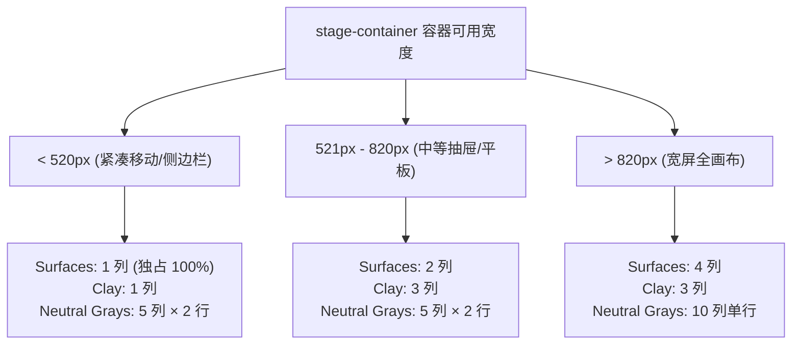

<p align="center">
  [⬅️ 上一篇：第五篇：视听多媒体与产物交互物理学](05-视听多媒体与产物交互物理学.md) · [📚 返回总目录](Claude%20Design%20System%20(CDS).md) · [下一篇：第七篇：工程配置与资产代码库总览 ➡️](07-工程配置与资产代码库总览.md)
</p>

---

## 第六篇：系统级桌面架构与协作拓扑

> **技术领域与英文指代**：`Desktop Host Architecture & Multi-Agent Topology`

### 6.1 macOS 桌面宿主深度融合与窗口材质

> **技术领域与英文指代**：`macOS Desktop Integration & Vibrancy`

在桌面端，Claude 摒弃了单窗口加载的简陋做法，采用 **Host BrowserWindow + Transparent WebContentsView** 双层解耦。

#### 1. 核心实现示例

```javascript
// 主窗口与透明内容视图构建
var TRAFFIC_LIGHT_DIAMETER = 12; // fBn: macOS 红绿灯按钮直径 12px
var TRAFFIC_LIGHT_BASELINE = 16.5; // gBn: 33 / 2, 标准 45px 顶栏物理中心线

// 核心红绿灯逆缩放几何补偿公式
function getTrafficLightPosition(zoomFactor) {
  var radius = TRAFFIC_LIGHT_DIAMETER / 2; // 6px 半径
  var calc = (pos) => Math.max(0, Math.round((pos + radius) * zoomFactor - radius));
  return {
    x: calc(TRAFFIC_LIGHT_BASELINE),
    y: calc(TRAFFIC_LIGHT_BASELINE)
  };
}

// 1. 实例化主宿主窗口
var hostWindow = new BrowserWindow({
  titleBarStyle: "hidden",
  titleBarOverlay: false,
  trafficLightPosition: getTrafficLightPosition(1),
  // 原生主题即时着色，彻底消除白闪
  backgroundColor: nativeTheme.shouldUseDarkColors ? "#151515" : "#fcfcfb",
  show: false,
  webPreferences: { preload: path.join(__dirname, "mainWindow.js") }
});

// 2. 实例化子视图 WebContentsView 并彻底透明化
var contentView = new WebContentsView({
  webPreferences: { preload: path.join(__dirname, "mainView.js"), sandbox: true }
});
contentView.setBackgroundColor("#00000000"); // 100% 透明穿透
hostWindow.contentView.addChildView(contentView);

// 3. 动态边缘圆角裁切算法
var updateRadius = () => {
  // 窗口化赋予 8px 圆角，最大化或全屏时收缩为 0px，防止黑色锯齿边缘溢出
  contentView.setBorderRadius(hostWindow.isMaximized() || hostWindow.isFullScreen() ? 0 : 8);
};
hostWindow.on("maximize", updateRadius);
hostWindow.on("unmaximize", updateRadius);
hostWindow.on("enter-full-screen", updateRadius);
hostWindow.on("leave-full-screen", updateRadius);
```

```javascript
// Web 端安全区动态计算
var TRAFFIC_LIGHT_SPACER_WIDTH = 74; // ew = 74px: 红绿灯物理占位宽

function computeTitlebarInsets(isMac, isFullscreen, isDesktop, incognito) {
  // 全屏状态下 macOS 自动隐藏交通灯，inset 动态归零
  var needsPadding = isMac && !isFullscreen;
  var inset = needsPadding ? 45 : isDesktop ? (incognito ? 45 : 36) : 0;
  var spacerWidth = needsPadding ? Math.round(TRAFFIC_LIGHT_SPACER_WIDTH / Math.min(zoomFactor, 1)) : 0;
  
  return { inset, spacerWidth };
}
```

```css
/* 纯 CSS 桌面端环境探测器  */
@supports ((-webkit-mask-clip: text)) and (-webkit-app-region: drag) {
  /* 仅在 Chromium / Electron 桌面宿主中生效 */
  .cds-desktop-drag-strip {
    height: var(--desktop-titlebar-inset, 45px);
    -webkit-app-region: drag;
  }
}

/* 全局交互防御拦截类 */
.draggable-none {
  -webkit-app-region: no-drag !important;
  app-region: no-drag !important;
}
```

---

### 6.2 侧边栏会话拖放重排与拓扑网格

> **技术领域与英文指代**：`Sidebar Drag-and-Drop & Pinning Physics`

Claude Desktop 的侧边栏采用高度模块化的多层级会话组织系统，支持会话图钉置顶、拖拽重排与跨区域拓扑分组。

#### 6.2.1 核心实现示例

会话项可以封装为带有重排操作接口的 `pinReorder` 实体：
```javascript
function mV(e, t) {
  return [
    ...fV(e.canPin && e.pinReorder?.onMoveUp, NB),
    ...fV(e.canPin && e.pinReorder?.onMoveDown, PB),
    ...fV(e.canPin, FB),
    // ...重命名、归档、共享、星标上下文菜单动作
  ];
}
```

侧边栏状态机示例包含持久化字段集合与拖拽标记：
```javascript
var rb = [
  "pinnedOrder",
  "homeProjectsPinnedOrder",
  "groupByByMode",
  "sortByByMode",
  "recentsTypeFilter",
  "recentsStatusFilter",
  "coworkActivityDays",
  "routinesSidebarPlacement",
  "navPinnedIds",
  "navPinV"
];

// 拖拽激活时的 DOM 标记注入
a.toggleAttribute("data-session-dragging", i);
a.toggleAttribute("data-pin-dragging", zt);
```

#### 6.2.2 乐观拓扑重排状态机与持久化策略 (`pinnedOrder: string[]`)
侧边栏的排序并非简单依赖后端的更新时间戳，而是通过维护一个有序 ID 数组 `pinnedOrder: string[]`。
- **乐观更新 (Optimistic Mutation)**：当用户完成一次拖放交互时，前端立即在本地状态数组中执行项的剪切与插入 (`result.splice(targetIndex, 0, movedItem)`)，实现 0ms 视觉即时响应；
- **异步同步 (Debounced Sync)**：通过持久化中间件将最新 `pinnedOrder` 批量提交至本地 Electron 配置存储与远端云端。

#### 6.2.3 指针动力学与 4px 移动死区容差过滤 (Pointer Drag Threshold Physics)
为了防止用户在点击选择会话、长按打开右键菜单或快速划过时意外激活拖拽：
- **4px 移动死区 (Dead-Zone Threshold)**：
  在 `onPointerDown` 时记录起始坐标 $(x_0, y_0)$，仅当位移满足：
  $$\Delta d = \max(|x - x_0|, |y - y_0|) > 4\text{px}$$
  时才将 `isDragging` 置为 `true`，触发拖拽态与手柄显示。

#### 6.2.4 幽灵投影与对撞占位线 (Ghost Elevation & Drop Indicators)
- **拖拽幽灵 (Ghost Preview)**：元素被拖拽时透明度衰减至 40%，外轮廓呈现 `border-dashed` 陶土边框；
- **落点对撞检测 (Midpoint Collision)**：拖拽经过目标行时，通过计算指针在目标行矩形框中的垂直比例：
  $$\text{Position} = \begin{cases} \text{'before'}, & y_{\text{cursor}} < y_{\text{top}} + \frac{h}{2} \\ \text{'after'}, & \text{otherwise} \end{cases}$$
  在目标上方或下方实时渲染高度 2px、陶土品牌色 (`var(--cds-fill-brand)`) 的弹性占位高亮导轨。

#### 6.2.5 生产级完整 React 落地实现
完整独立源码已落地至：[`code-examples/DraggableSessionList.tsx`](../code-examples/DraggableSessionList.tsx)。

---

### 6.3 多代理协作看板与 Cowork 空间拓扑

> **技术领域与英文指代**：`Cowork Space & Agent Delegation Topology`

在最新的 Claude Desktop / Code 客户端中，支持团队或自动化流水线以“Cowork 协作空间”形式组织多个智能体。

#### 6.3.1 核心实现示例

以下示例展示多代理会话通道与委派标识：
```javascript
// 协同会话类型与通道委派动作
case "channel_delegation":
case "channel_member_session":
case "channel_remote_control_session":
  return renderCoworkSessionCard(e);
```

#### 6.3.2 多智能体任务委派状态机与共享工件网格资产池
- **委派拓扑生命周期**：
  任务从主架构师 (Lead Architect) 派发至特定领域子智能体（如前端工程师、UI 设计师、QA 验收员），状态机包含：
  `idle` → `running`（陶土波浪脉冲）→ `waiting_review`（等待人工确认）→ `completed`；
- **共享工件库网格 (Shared Artifacts Pool)**：
  每个智能体生成的产物（文档、架构图、组件代码、音频脚本）自动同步至项目统一工件池，卡片支持类型过滤与一键预览对比。

#### 6.3.3 跨会话广播通道 (BroadcastChannel) 事件同步
多智能体可能分布在不同窗口或标签页运行，系统基于浏览器原生 `BroadcastChannel("claude_cowork_sync")` 广播状态心跳包与任务完成信号，确保各面板无延迟同态刷新。

#### 6.3.4 生产级完整 React 落地实现
完整独立源码已落地至：[`code-examples/CoworkAgentCanvas.tsx`](../code-examples/CoworkAgentCanvas.tsx)。

---

### 6.4 流式大文本输出与滚动视口物理学

> **技术领域与英文指代**：`Streaming Token Pipeline & Scroll Physics`

在长文本或代码流式输出时，最影响体验的是“**滚动抖动与视口抢夺**”：如果用户正在向上翻看历史消息，AI 每吐出一个 Token 就强行将视口拉到底部，会导致严重的操作对抗感。

#### 1. 核心实现示例

Anthropic 在 `ca2ef848d-Dz47ULRM.js` 中确立了 **150ms 冷却时间戳 + 用户滚轮打断 + 35vh 底部缓冲垫 + 6px 硬件加速模糊消解**：

```javascript
// 生产环境滚动图钉判定算法
var COOL_DOWN_MS = 150;
var lastUserInputAt = 0;
var programmaticScroll = false;
var isPinned = true;

// 1. 监听用户物理输入：wheel / touchmove / keydown / mousedown
function markUserInput() {
  lastUserInputAt = performance.now();
  isPinned = false; // 瞬间释放图钉锁定，绝不与用户手势争夺视口
}

// 2. Token 追加时的视口图钉判定算法
function onTokenChunkAppended(containerEl) {
  // 若用户在 150ms 内触发过物理输入，严格禁止任何程序化滚动调整
  if (performance.now() - lastUserInputAt <= COOL_DOWN_MS) {
    return;
  }

  // 判定视口当前是否处于底部边缘（容差 40px）
  var distanceFromBottom = containerEl.scrollHeight - containerEl.scrollTop - containerEl.clientHeight;
  if (distanceFromBottom <= 40) {
    isPinned = true;
  }

  // 若处于锁定态，以非平滑（behavior: auto）即时对齐底部，防止 requestAnimationFrame 帧率滞后抖动
  if (isPinned) {
    programmaticScroll = true;
    containerEl.scrollTo({
      top: containerEl.scrollHeight,
      behavior: "auto"
    });
  }
}
```

```css
/* 35vh 底部视口缓冲垫与字符硬件消解动画 */
.chat-scroll-container {
  /* 强制在最新一条消息下方预留 35% 屏幕高度的弹性缓冲，使阅读焦点永远在黄金分割线 */
  --chat-extra-space: 35vh;
  padding-bottom: var(--chat-extra-space);
}

/* 新 Token 到达时的 6px GPU 模糊消解动画 */
@keyframes _grapheme-reveal_1plog_1 {
  0% {
    opacity: 0.2;
    filter: blur(6px);
    transform: translateY(4px);
  }
  100% {
    opacity: 1;
    filter: blur(0px);
    transform: translateY(0);
  }
}
.token-reveal {
  animation: _grapheme-reveal_1plog_1 120ms cubic-bezier(0.16, 1, 0.3, 1) forwards;
  will-change: filter, opacity, transform;
}
```

#### 2. 生产级 React Hook 落地实现 (`useClaudeScrollPinning.ts`)

```typescript
import { useEffect, useRef, useState, useCallback } from 'react';

export function useClaudeScrollPinning(dependencies: any[]) {
  const containerRef = useRef<HTMLDivElement>(null);
  const [isPinned, setIsPinned] = useState(true);
  const [showJumpControl, setShowJumpControl] = useState(false);
  const lastUserInputAt = useRef(0);
  const programmaticScroll = useRef(false);

  const markUserInput = useCallback(() => {
    lastUserInputAt.current = performance.now();
    setIsPinned(false);
  }, []);

  const handleScroll = useCallback(() => {
    if (programmaticScroll.current) {
      programmaticScroll.current = false;
      return;
    }
    const el = containerRef.current;
    if (!el) return;
    const distanceFromBottom = el.scrollHeight - el.scrollTop - el.clientHeight;
    const pinned = distanceFromBottom <= 40;
    setIsPinned(pinned);
    setShowJumpControl(distanceFromBottom > 120);
  }, []);

  const scrollToBottom = useCallback((smooth = false) => {
    const el = containerRef.current;
    if (!el) return;
    programmaticScroll.current = true;
    el.scrollTo({
      top: el.scrollHeight,
      behavior: smooth ? 'smooth' : 'auto'
    });
    setIsPinned(true);
    setShowJumpControl(false);
  }, []);

  useEffect(() => {
    if (performance.now() - lastUserInputAt.current <= 150) return;
    if (isPinned) {
      scrollToBottom(false);
    }
  }, dependencies);

  return {
    containerRef,
    isPinned,
    showJumpControl,
    markUserInput,
    handleScroll,
    scrollToBottom
  };
}
```

---

### 6.5 容器查询自适应排版与极端防挤压

> **技术领域与英文指代**：`Container Queries & Anti-Squash Grid Guidelines`

在现代复杂 Web/桌面客户端（如 Claude Desktop）中，**绝对不能盲目依赖视口媒体查询（Window Media Queries，如 `@media (min-width: 768px)`）**。

#### 1. 为什么窗口媒体查询会导致严重的 UI 畸变？
在桌面 1440px / 1920px 分辨率下，视口宽度始终处于宽屏范围。如果一个组件处于一个固定 288px 的侧边栏、一个 390px 的抽屉（Sheet）或悬浮弹出卡片中：
* 视口媒体查询 `@media (min-width: 768px)` 会误判定当前为宽屏，强制应用 `grid-cols-4`；
* 导致原本需要充裕宽度的卡片被硬生生挤入仅有 `70px` 宽度的极窄列；
* 中文字符无法成行，被迫触发单字符垂直竖排走样（如 `S-u-r-f-a-c-e` 或 `底-基-层-侧-边-栏`），视觉完全崩塌！

#### 2. Claude 容器查询防御性矩阵规范
在独立展示卡片的外层根容器上，必须显式声明容器名称与内联尺寸：
```css
.cds-stage-card {
  container-type: inline-size;
  container-name: stage-container;
}
```

卡片内部网格根据自身可用宽度（`inline-size`）执行自适应降级：



#### 3. 核心 CSS 容器查询实现
```css
/* 紧凑容器：严格 1 列展开，每个卡片拥有 100% 充裕水平行宽 */
@container stage-container (max-width: 520px) {
  .cds-grid-surfaces { grid-template-columns: 1fr !important; }
  .cds-grid-clay { grid-template-columns: 1fr !important; }
  .cds-grid-grays { grid-template-columns: repeat(5, minmax(0, 1fr)) !important; }
  .cds-grid-radius { grid-template-columns: 1fr !important; }
  .cds-grid-heights { grid-template-columns: 1fr !important; }
  .cds-grid-shadows { grid-template-columns: 1fr !important; }
  .cds-grid-tokens { grid-template-columns: 1fr !important; }
}

/* 中等容器：2 列平铺 */
@container stage-container (min-width: 521px) and (max-width: 820px) {
  .cds-grid-surfaces { grid-template-columns: repeat(2, minmax(0, 1fr)) !important; }
  .cds-grid-clay { grid-template-columns: repeat(3, minmax(0, 1fr)) !important; }
  .cds-grid-grays { grid-template-columns: repeat(5, minmax(0, 1fr)) !important; }
  .cds-grid-radius { grid-template-columns: repeat(2, minmax(0, 1fr)) !important; }
  .cds-grid-tokens { grid-template-columns: repeat(2, minmax(0, 1fr)) !important; }
}

/* 宽屏容器：4 列至 10 列完整舒展 */
@container stage-container (min-width: 821px) {
  .cds-grid-surfaces { grid-template-columns: repeat(4, minmax(0, 1fr)) !important; }
  .cds-grid-clay { grid-template-columns: repeat(3, minmax(0, 1fr)) !important; }
  .cds-grid-grays { grid-template-columns: repeat(10, minmax(0, 1fr)) !important; }
  .cds-grid-radius { grid-template-columns: repeat(3, minmax(0, 1fr)) !important; }
  .cds-grid-tokens { grid-template-columns: repeat(3, minmax(0, 1fr)) !important; }
}
```

#### 4. 中文与 CJK 防裂字黄金组合
在卡片标题、徽章与按钮文本上，始终组合应用：
```css
/* 杜绝中文单字纵向断裂走样 */
.cds-card-title {
  text-wrap: balance;          /* 均衡行长 */
  overflow-wrap: break-word;   /* 正常单词换行 */
  word-break: normal;          /* 严禁无理打碎词汇 */
  min-width: 0;                /* 允许 flex 容器正确收缩 */
}
```

---

---

#### 6.5.4 极端窄视口与三档容器查询响应栏
在 Artifacts 侧边栏开启、多任务分栏或移动端窄屏时，传统基于全屏 `@media` 的响应式断点彻底失效。

#### 1. 核心实现示例

以下示例展示 281 条 `@container` 规则与 27 个命名容器：

```css
/* 1. 容器声明：为主消息流与操作栏建立独立容器上下文 */
.chat-feed-container {
  container-type: inline-size;
  container-name: feed;
}
.chat-toolbar-container {
  container-type: inline-size;
  container-name: toolbar;
}

/* 2. 4 阶弹性流体压缩断点梯队 */

/* Tier 1: >= 576px (豪华完整态) */
@container (min-width: 576px) {
  .model-selector-label { display: inline-block; }
  .action-button-text { display: inline; }
  .keyboard-shortcut-badge { display: inline-flex; }
}

/* Tier 2: < 480px (紧凑折叠态) */
@container (max-width: 480px) {
  .keyboard-shortcut-badge { display: none !important; }
  .toolbar-auxiliary-actions { display: none; }
}

/* Tier 3: < 384px (极简图标态) */
@container (max-width: 384px) {
  .action-button-text { display: none; }
  .model-selector-label { max-width: 4rem; overflow: hidden; text-overflow: ellipsis; }
  .chat-composer-buttons { gap: 4px; }
}

/* Tier 4: < 320px (零间距防爆安全网) */
@container (max-width: 320px) {
  .chat-composer-inner {
    padding-left: 4px !important;
    padding-right: 4px !important;
  }
  /* 采用 cqw 容器查询宽度安全封顶，杜绝水平滚动条溢出 */
  .chat-composer-prompt {
    max-width: max(6rem, calc(100cqw - 4rem)) !important;
  }
}
```

#### 2. 生产级自适应容器组件 (`ContainerResponsiveBar.tsx`)

```tsx
import React from 'react';

export const ContainerResponsiveBar: React.FC<{ children?: React.ReactNode }> = ({ children }) => {
  return (
    <div className="@container/toolbar relative w-full border-t border-[var(--cds-border)] bg-[var(--cds-surface-1)] py-2">
      <div className="flex items-center justify-between px-3 @[384px]/toolbar:px-4">
        {/* 左侧模型选择：宽屏显全名，窄屏截断 */}
        <div className="flex min-w-0 items-center gap-2">
          <span className="h-2 w-2 rounded-full bg-[var(--cds-clay)]" />
          <span className="truncate text-xs font-medium text-[var(--cds-text-primary)] @max-[384px]/toolbar:max-w-[80px]">
            Claude 3.7 Sonnet
          </span>
        </div>

        {/* 右侧操作按钮组：依据容器宽度动态隐藏文字 */}
        <div className="flex items-center gap-1 @[384px]/toolbar:gap-2">
          <button className="flex h-8 items-center gap-1 rounded-md px-2 text-xs font-medium text-[var(--cds-text-secondary)] hover:bg-[var(--cds-surface-2)]">
            <svg className="h-4 w-4" viewBox="0 0 16 16" fill="currentColor">
              <path d="M8 2a6 6 0 100 12A6 6 0 008 2zM0 8a8 8 0 1116 0A8 8 0 010 8z" />
            </svg>
            <span className="@max-[480px]/toolbar:hidden">Settings</span>
          </button>
          {children}
        </div>
      </div>
    </div>
  );
};
```

---

### 6.6 全键盘盲操网格与无障碍访问

> **技术领域与英文指代**：`Keyboard Focus Roving & A11y Grid`

针对高频键盘盲操，Claude 建立了基于 **Roving TabIndex** 的漫游焦点网格与全量无障碍通道。

#### 1. 核心实现示例

```javascript
// 漫游网格键位映射与 RTL 镜像翻转
var KEY_INTENT_MAP = {
  ArrowLeft:  "prev",
  ArrowUp:    "prev",
  ArrowRight: "next",
  ArrowDown:  "next",
  PageUp:     "first",
  Home:       "first",
  PageDown:   "last",
  End:        "last"
};

function resolveKeyDirection(key, dir) {
  // 阿拉伯语/希伯来语等 RTL 场景下自动镜像
  return dir === "rtl"
    ? key === "ArrowLeft" ? "ArrowRight" : key === "ArrowRight" ? "ArrowLeft" : key
    : key;
}

// 漫游焦点键盘事件驱动核心
function onRovingItemKeyDown(event, groupState) {
  // 核心规则 1：Tab / Shift+Tab 触发时必须立即释放焦点流，防止形成无障碍键盘陷阱
  if (event.key === "Tab") {
    groupState.onItemShiftTab();
    return;
  }
  if (event.metaKey || event.ctrlKey || event.altKey) return;

  var mappedIntent = KEY_INTENT_MAP[resolveKeyDirection(event.key, groupState.dir)];
  if (!mappedIntent) return;

  event.preventDefault();
  var focusableItems = groupState.getItems().filter(item => item.focusable);
  var currentIndex = focusableItems.indexOf(event.currentTarget);

  var nextIndex = currentIndex;
  if (mappedIntent === "first") nextIndex = 0;
  else if (mappedIntent === "last") nextIndex = focusableItems.length - 1;
  else if (mappedIntent === "prev") nextIndex = currentIndex - 1;
  else if (mappedIntent === "next") nextIndex = currentIndex + 1;

  // 核心规则 2：loop 边界回绕处理
  if (groupState.loop) {
    nextIndex = (nextIndex + focusableItems.length) % focusableItems.length;
  } else {
    nextIndex = Math.max(0, Math.min(focusableItems.length - 1, nextIndex));
  }

  // 核心规则 3：仅选中的目标项维持 tabIndex = 0，其余兄弟节点全置为 -1
  groupState.updateCurrentTabStop(focusableItems[nextIndex].id);
  focusableItems[nextIndex].focus({ preventScroll: true });
}
```

#### 2. 生产级 React Hook 落地实现 (`useClaudeRovingFocus.ts`)

```typescript
import { useState, useRef, useCallback } from 'react';

interface RovingFocusOptions {
  orientation?: 'horizontal' | 'vertical' | 'both';
  loop?: boolean;
  dir?: 'ltr' | 'rtl';
}

export function useClaudeRovingFocus(itemCount: number, options: RovingFocusOptions = {}) {
  const { orientation = 'vertical', loop = true, dir = 'ltr' } = options;
  const [currentFocusedIndex, setCurrentFocusedIndex] = useState(0);
  const itemsRef = useRef<(HTMLElement | null)[]>([]);

  const handleKeyDown = useCallback(
    (e: React.KeyboardEvent, index: number) => {
      if (e.key === 'Tab') return;

      let targetIndex = -1;
      const isRtl = dir === 'rtl';

      switch (e.key) {
        case 'ArrowDown':
          if (orientation === 'vertical' || orientation === 'both') targetIndex = index + 1;
          break;
        case 'ArrowUp':
          if (orientation === 'vertical' || orientation === 'both') targetIndex = index - 1;
          break;
        case 'ArrowRight':
          if (orientation === 'horizontal' || orientation === 'both') targetIndex = isRtl ? index - 1 : index + 1;
          break;
        case 'ArrowLeft':
          if (orientation === 'horizontal' || orientation === 'both') targetIndex = isRtl ? index + 1 : index - 1;
          break;
        case 'Home':
        case 'PageUp':
          targetIndex = 0;
          break;
        case 'End':
        case 'PageDown':
          targetIndex = itemCount - 1;
          break;
        default:
          return;
      }

      if (targetIndex !== -1) {
        e.preventDefault();
        const finalIndex = loop
          ? (targetIndex + itemCount) % itemCount
          : Math.max(0, Math.min(itemCount - 1, targetIndex));

        setCurrentFocusedIndex(finalIndex);
        itemsRef.current[finalIndex]?.focus({ preventScroll: true });
      }
    },
    [itemCount, orientation, loop, dir]
  );

  return {
    currentFocusedIndex,
    registerItem: (index: number) => (el: HTMLElement | null) => {
      itemsRef.current[index] = el;
    },
    getItemProps: (index: number) => ({
      tabIndex: index === currentFocusedIndex ? 0 : -1,
      onKeyDown: (e: React.KeyboardEvent) => handleKeyDown(e, index),
      onClick: () => setCurrentFocusedIndex(index)
    })
  };
}
```

---

### 6.7 异常容灾、模型限流与业务状态机

> **技术领域与英文指代**：`Error Resilience & UI State Machines`

在面临千万人高并发与复杂网络时，Claude 构建了多级防御与自愈机制。

#### 1. 核心实现示例

```javascript
// 429/503 指数退避与常数矩阵
var MIN_RETRY_DELAY = 5000;   // OR = 5000ms: 基准重试下限 5s
var MAX_RETRY_DELAY = 600000; // DR = 600000ms: 封顶重试上限 10min

// 指数退避算法公式：base * 2^(attempts - 1)
function calculateExponentialBackoff(baseDelay, attemptCount) {
  return Math.max(baseDelay, MIN_RETRY_DELAY) * Math.pow(2, attemptCount - 1);
}

function createErrorResilienceMachine(errorEvent, currentAttempts = 0) {
  var isOverloadOrLimit = errorEvent.status === 429 || (errorEvent.status === 503 && errorEvent.type === "overloaded_error");
  var nextAttempt = isOverloadOrLimit ? currentAttempts + 1 : 0;

  // 核心规则：最多自动重试 3 次 (currentAttempts < 3)
  // 超过 3 次强制切换为手动点击重试，防止雪崩放大效应
  var backoffDelay = (errorEvent.retryAfterMs !== void 0 && nextAttempt > 0 && nextAttempt < 3)
    ? Math.min(calculateExponentialBackoff(errorEvent.retryAfterMs, nextAttempt), MAX_RETRY_DELAY)
    : void 0;

  return {
    waitsInARow: nextAttempt,
    canAutoRetry: backoffDelay !== void 0,
    retryAtMs: backoffDelay !== void 0 ? Date.now() + backoffDelay : null
  };
}
```

```javascript
// Thinking 思考过程折叠互斥锁算法
var ThinkingAccordion = function({ text, expansionKey }) {
  var isThinkingLive = useModelThinkingStreamState(); // 模型是否正处于思考流式输出阶段
  var [userExpanded, setUserExpanded] = usePersistentToggle(expansionKey);

  return (
    <AccordionStep
      label="Thought process"
      // 核心互斥物理：生成中必定强制展开，忽略用户收起偏好
      open={isThinkingLive || (userExpanded ?? true)}
      // 核心权限剥夺：生成中传递 undefined，彻底禁用折叠手势，防止视口抖动
      onOpenChange={isThinkingLive ? undefined : setUserExpanded}
    >
      {text}
    </AccordionStep>
  );
};
```

#### 2. 生产级指数退避控制器落地实现 (`useRateLimitBackoff.ts`)

```typescript
import { useState, useEffect, useCallback, useRef } from 'react';

const MIN_DELAY_MS = 5000;
const MAX_DELAY_MS = 600000;

interface BackoffState {
  isWaiting: boolean;
  retryAtMs: number | null;
  secondsRemaining: number;
  waitsInARow: number;
  canManualRetry: boolean;
}

export function useRateLimitBackoff(onAutoRetry: () => void) {
  const [state, setState] = useState<BackoffState>({
    isWaiting: false,
    retryAtMs: null,
    secondsRemaining: 0,
    waitsInARow: 0,
    canManualRetry: false
  });

  const timerRef = useRef<NodeJS.Timeout | null>(null);

  const triggerBackoff = useCallback((retryAfterHeaderSeconds?: number) => {
    setState((prev) => {
      const nextAttempt = prev.waitsInARow + 1;
      // 连续重试 >= 3 次，停止自动重试，强制人工介入
      if (nextAttempt >= 3) {
        return {
          isWaiting: true,
          retryAtMs: null,
          secondsRemaining: 0,
          waitsInARow: nextAttempt,
          canManualRetry: true
        };
      }

      const baseDelay = retryAfterHeaderSeconds ? retryAfterHeaderSeconds * 1000 : MIN_DELAY_MS;
      const computedDelay = Math.min(
        Math.max(baseDelay, MIN_DELAY_MS) * Math.pow(2, nextAttempt - 1),
        MAX_DELAY_MS
      );
      const retryAtMs = Date.now() + computedDelay;

      return {
        isWaiting: true,
        retryAtMs,
        secondsRemaining: Math.ceil(computedDelay / 1000),
        waitsInARow: nextAttempt,
        canManualRetry: false
      };
    });
  }, []);

  useEffect(() => {
    if (!state.isWaiting || !state.retryAtMs) return;

    timerRef.current = setInterval(() => {
      const remaining = Math.max(0, Math.ceil((state.retryAtMs! - Date.now()) / 1000));
      if (remaining <= 0) {
        clearInterval(timerRef.current!);
        setState((prev) => ({ ...prev, isWaiting: false, retryAtMs: null, secondsRemaining: 0 }));
        onAutoRetry();
      } else {
        setState((prev) => ({ ...prev, secondsRemaining: remaining }));
      }
    }, 1000);

    return () => {
      if (timerRef.current) clearInterval(timerRef.current);
    };
  }, [state.isWaiting, state.retryAtMs, onAutoRetry]);

  const resetBackoff = useCallback(() => {
    if (timerRef.current) clearInterval(timerRef.current);
    setState({
      isWaiting: false,
      retryAtMs: null,
      secondsRemaining: 0,
      waitsInARow: 0,
      canManualRetry: false
    });
  }, []);

  return {
    ...state,
    triggerBackoff,
    resetBackoff
  };
}
```

---

<p align="center">
  [⬅️ 第五篇：视听多媒体与产物交互物理学](05-视听多媒体与产物交互物理学.md) · [📚 目录](Claude%20Design%20System%20(CDS).md) · [第七篇：工程配置与资产代码库总览 ➡️](07-工程配置与资产代码库总览.md)
</p>
