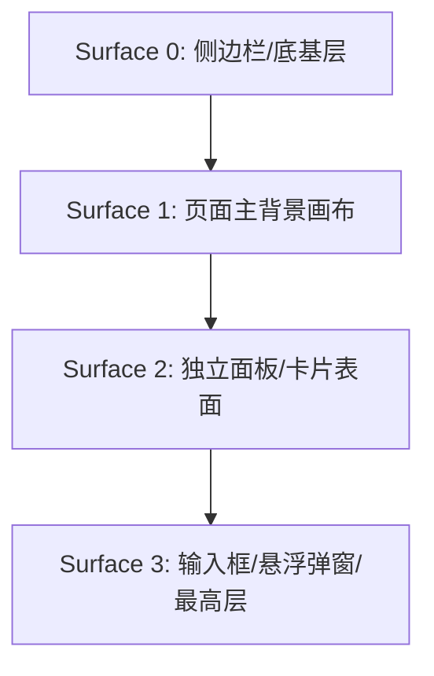
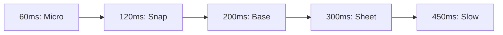
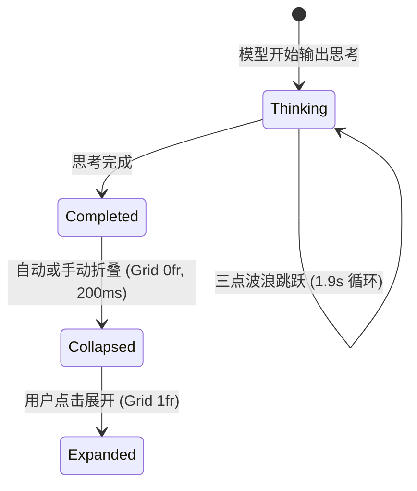
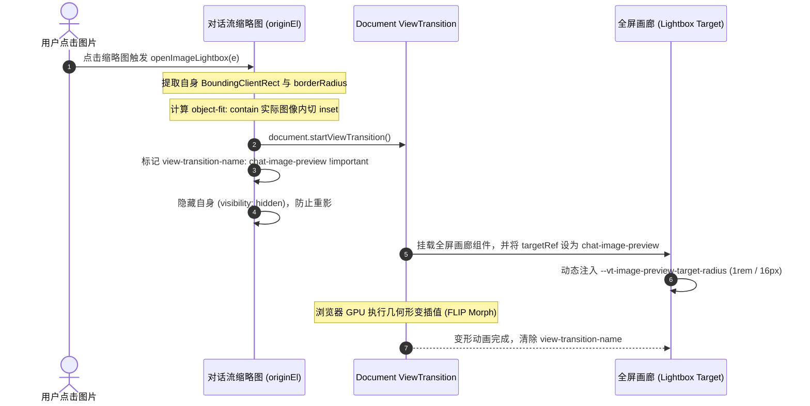
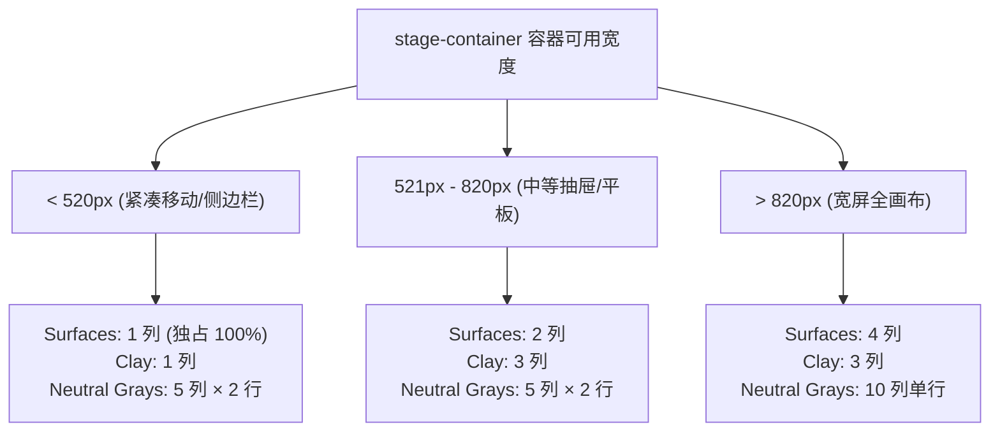

# Claude Design System (CDS) 前端 UI 与动效完整开发指导手册

> **版本**：1.0（前端组件与交互动效开发指南）<br>
> **定位**：供前端工程师、UI 设计师与独立开发者构建一致的视觉风格与交互体验的完整工程指导规范。<br>
> **技术栈适配**：HTML5 + Tailwind CSS v3/v4 + React/Vue + Framer Motion (或原生 CSS)

---

---

## 目录

1. [第一篇：设计哲学与设计令牌体系](#第一篇设计哲学与设计令牌体系)
   - [1.1 设计哲学与视觉调性](#11-设计哲学与视觉调性)
   - [1.2 表面体系与色彩阶梯](#12-表面体系与色彩阶梯)
   - [1.3 控件尺寸与精密圆角矩阵](#13-控件尺寸与精密圆角矩阵)
   - [1.4 发丝细边、微光阴影与边框防臃肿体系](#14-发丝细边微光阴影与边框防臃肿体系)
   - [1.5 字体排版与图标对齐系统约束](#15-字体排版与图标对齐系统约束)
   - [1.6 基础动效令牌体系](#16-基础动效令牌体系)
2. [第二篇：基础原子组件与交互控件](#第二篇基础原子组件与交互控件)
   - [2.1 全能按钮控件阶梯](#21-全能按钮控件阶梯)
   - [2.2 分段滑动选择胶囊](#22-分段滑动选择胶囊)
   - [2.3 状态指示灯与微动效套件](#23-状态指示灯与微动效套件)
   - [2.4 模态确认对话框](#24-模态确认对话框)
   - [2.5 附件磁贴与上下文胶囊](#25-附件磁贴与上下文胶囊)
3. [第三篇：会话核心流与指令交互引擎](#第三篇会话核心流与指令交互引擎)
   - [3.1 会话气泡套件与排版规范](#31-会话气泡套件与排版规范)
   - [3.2 思考过程折叠与时间状态机](#32-思考过程折叠与时间状态机)
   - [3.3 新一代富文本输入框终端与指令交互引擎](#33-新一代富文本输入框终端与指令交互引擎)
   - [3.4 模型矩阵切换器与 Token 计量仪表盘](#34-模型矩阵切换器与-token-计量仪表盘)
   - [3.5 交互式工具调用与 MCP 决策卡片](#35-交互式工具调用与-mcp-决策卡片)
4. [第四篇：动效物理学、着色器与环境光影](#第四篇动效物理学着色器与环境光影)
   - [4.1 全量动效引擎与关键帧规范](#41-全量动效引擎与关键帧规范)
   - [4.2 动态光效、着色器与推理氛围感](#42-动态光效着色器与推理氛围感)
   - [4.3 滚动边缘平滑渐变遮罩系统](#43-滚动边缘平滑渐变遮罩系统)
5. [第五篇：视听多媒体与产物交互物理学](#第五篇视听多媒体与产物交互物理学)
   - [5.1 语音模式与 Web Audio 物理声学系统](#51-语音模式与-web-audio-物理声学系统)
   - [5.2 多模态媒体查看器与画廊转场物理学](#52-多模态媒体查看器与画廊转场物理学)
   - [5.3 双栏弹性分割与折叠物理学](#53-双栏弹性分割与折叠物理学)
   - [5.4 工件预览沙箱与隔离通信架构](#54-工件预览沙箱与隔离通信架构)
   - [5.5 代码差异对比与多线程语法高亮系统](#55-代码差异对比与多线程语法高亮系统)
6. [第六篇：系统级桌面架构与协作拓扑](#第六篇系统级桌面架构与协作拓扑)
   - [6.1 macOS 桌面宿主深度融合与窗口材质](#61-macos-桌面宿主深度融合与窗口材质)
   - [6.2 侧边栏会话拖放重排与拓扑网格](#62-侧边栏会话拖放重排与拓扑网格)
   - [6.3 多代理协作看板与 Cowork 空间拓扑](#63-多代理协作看板与-cowork-空间拓扑)
   - [6.4 流式大文本输出与滚动视口物理学](#64-流式大文本输出与滚动视口物理学)
   - [6.5 容器查询自适应排版与极端防挤压](#65-容器查询自适应排版与极端防挤压)
   - [6.6 全键盘盲操网格与无障碍访问](#66-全键盘盲操网格与无障碍访问)
   - [6.7 异常容灾、模型限流与业务状态机](#67-异常容灾模型限流与业务状态机)
7. [第七篇：工程配置与资产代码库总览](#第七篇工程配置与资产代码库总览)
   - [7.1 开箱即用的 Tailwind 配置与基础 CSS 代码](#71-开箱即用的-tailwind-配置与基础-css-代码)
   - [7.2 生产级工程源码清单](#72-生产级工程源码清单)
   - [7.3 资产规范与系统级字体/音频替代方案](#73-资产规范与系统级字体音频替代方案)
8. [第八篇：AI Agent 前端 UI 与动效开发指南](#第八篇ai-agent-前端-ui-与动效开发指南)
   - [8.1 Agent 角色定位与设计哲学](#81-agent-角色定位与设计哲学)
   - [8.2 设计令牌与色彩引用契约](#82-设计令牌与色彩引用契约)
   - [8.3 动效物理学：四套弹簧预设决策树](#83-动效物理学四套弹簧预设决策树)
   - [8.4 控件原子规则与单闭合边框原则](#84-控件原子规则与单闭合边框原则)
   - [8.5 交互防御与边缘场景守卫](#85-交互防御与边缘场景守卫)
   - [8.6 生产级组件库快速装配指南 (30 模块)](#86-生产级组件库快速装配指南-30-模块)
   - [8.7 智能体自检与质量门禁清单](#87-智能体自检与质量门禁清单)
9. [第九篇：桌面端界面与交互设计](#第九篇桌面端界面与交互设计)
   - [9.1 版本发布定位与核心工程边界廓清](#91-版本发布定位与核心工程边界廓清)
   - [9.2 核心界面拓扑演进与工作流重构](#92-核心界面拓扑演进与工作流重构-anthony-morris-评述与社区焦点)
   - [9.3 通用桌面交互与 Electron 运行时升级](#93-通用桌面交互与-electron-运行时升级)
   - [9.4 Claude Code 桌面引擎与底座缺陷大清洗](#94-claude-code-桌面引擎与底座缺陷大清洗-bug-sweeps)
   - [9.5 Cowork 协同看板与离线资产化底座](#95-cowork-协同看板与离线资产化底座)
   - [9.6 企业托管配置 Breaking Changes 升级指南](#96-企业托管配置-breaking-changes-升级指南-it-管理员必读)

---

## 第一篇：设计哲学与设计令牌体系

> **技术领域与英文指代**：`Design Philosophy & Design Tokens`

### 1.1 设计哲学与视觉调性

Claude 的界面设计在当下 AI 产品中独树一帜，其核心调性可以总结为三点：

1. **温润的人文质感（Editorial Warmth）**：
   - 彻底摒弃冰冷的高饱和赛博朋克蓝/紫色，主品牌色选用温润的**陶土色（Clay: `#d97757`）**与柔和米白/暗灰底色（`#fcfcfb` / `#151515`）。
2. **多层微对比表面（Low-contrast Surface Layering）**：
   - 界面几乎不使用生硬的 1px 黑色边框，而是通过 `Surface 0 - 3` 的层级微小明度差以及 `color-mix()` 半透明外环投影来建立空间感。
3. **高帧率轻负担动效（Lightweight Organic Motion）**：
   - 文字流式输出使用 GPU 硬件加速的模糊消解，复杂展开使用 CSS Grid 0fr 解决高度抖动，手势交互使用真实的阻尼弹簧。

---

### 1.2 表面体系与色彩阶梯

> **技术领域与英文指代**：`Surfaces & Colors`

Claude 在浅色和深色模式下具有严格的 4 层表面明度阶梯：



| 令牌名称 | 浅色模式 (Light) | 深色模式 (Dark) | 用途说明 |
| :--- | :--- | :--- | :--- |
| `--cds-surface-0` | `#f5f5f3` (`gray-20`) | `#0b0b0a` (`gray-900`) | 侧边栏底色、窗口背景根底 |
| `--cds-surface-1` | `#fcfcfb` (`gray-10`) | `#151515` (`gray-850`) | 页面主聊天画布背景 |
| `--cds-surface-2` | `#ffffff` (`gray-0`) | `#1a1a19` (`gray-830`) | 对话消息容器、卡片表面 |
| `--cds-surface-3` | `#ffffff` (`gray-0`) | `#20201e` (`gray-800`) | 聊天输入框容器、高亮浮层 |
| `--cds-clay` | `#d97757` | `#d97757` | Claude 标志性陶土橙（思考跳动点、火花图标） |
| `--cds-clay-emphasized` | `#cc5a36` | `#cc5a36` | 陶土色悬停/深色加重态 |
| `--cds-border` | `rgba(0, 0, 0, 0.08)` | `rgba(255, 255, 255, 0.08)` | 通用柔和边框 |
| `--cds-border-strong` | `rgba(0, 0, 0, 0.16)` | `rgba(255, 255, 255, 0.16)` | 控件外环、激活边框 |

---

### 1.3 控件尺寸与精密圆角矩阵

> **技术领域与英文指代**：`Border Radius, Heights & Sizing`

#### 1.3.1 圆角阶梯体系 (Border Radius Hierarchy)
Claude 绝非全局采用单一圆角，而是有着极严格的**角色语义圆角阶梯**。组件圆角令牌矩阵如下：

| 令牌名称 / 变量 | 精确像素 | 对应 Tailwind 类 | 角色语义与典型组件 |
| :--- | :--- | :--- | :--- |
| `--radius-xs` | **2px** | `rounded-[2px]` | 微型角标、聚焦环内衬指示点 |
| `--radius-sm` (`--cds-keycap-radius`) | **4px** | `rounded` | 快捷键徽章 (`Kbd`)、微型标签、复选框 |
| `--radius-md` | **6px** | `rounded-md` | 极小尺寸按钮 (XS 26px)、Prompt 建议胶囊 |
| `--radius-lg` | **8px** | `rounded-lg` | **标准按钮 (SM/MD)、表单输入框、下拉菜单项** |
| `--cds-panel-radius` | **10px** | `rounded-[10px]` | 子面板卡片、上传文件附件条目 (`.cds-attachment`) |
| `--radius-xl` | **12px** | `rounded-xl` | 代码块容器、Artifact 预览卡片、抽屉面板 |
| `--radius-2xl` | **16px** | `rounded-2xl` | 系统弹窗模态框 (`ConfirmationDialog`)、设置卡片 |
| `--cds-message-bubble-radius` | **18px** | `rounded-[18px]` | **用户发送的消息气泡 (`User Message Bubble`)** |
| `--cds-radius-composer` | **20px** | `rounded-[20px]` | **底部常驻聊天输入框 (`Chat Composer Box`)** |
| `--df-radius-pill` | **999px** | `rounded-full` | 分段滑动滑块 (`Segmented Control`)、状态呼吸点 |

> [!IMPORTANT]
> **视觉嵌套嵌套同心圆角法则**：
> 在 Claude 中，当一个 10px 附件条目或 8px 按钮被包裹在 20px Composer 内部时，内外半径严格满足 `R_outer = R_inner + padding` 的视觉同心过渡，避免内外角曲率冲突造成的呆滞感。

---

#### 1.3.2 控件高度与排版尺寸 (Heights & Sizing)
| 令牌名称 | 高度定义 | 实际像素 | 对应组件 |
| :--- | :--- | :--- | :--- |
| `--cds-h-control--xs` | `1.25rem - 1.5rem` | **20px - 24px** | 极小按钮、标签关闭按钮、行内操作栏 |
| `--cds-h-control--sm` | `1.5rem - 1.75rem` | **24px - 28px** | 紧凑型按钮、下拉选择器触发器 |
| `--cds-h-control` (默认) | `2rem` | **32px** | **标准交互按钮、输入框内操作图标、Tab 导航项** |
| `--cds-h-control--lg` | `2.5rem` | **40px** | 强调大按钮、登录/注册主操作按钮 |
| `--df-titlebar` | 固定 `46px - 48px` | **46px - 48px** | 桌面端无边框窗口顶部拖拽条（Titlebar） |
| `--static-sidebar-width` | `18rem` | **288px** | 桌面端常驻侧边栏宽度 |
| `--chat-max-width` | `42rem / 48rem` | **672px - 768px** | 最佳阅读体验的中心对话宽度（`max-w-2xl / max-w-3xl`） |
| `--composer-max-height` | `24rem` | **384px** | 输入框内容自动撑开的最大高度（超出滚动） |

---

---

### 1.4 发丝细边、微光阴影与边框防臃肿体系

> **技术领域与英文指代**：`Borders, Hairlines & Shadows`

#### 1.4.1 边框粗细系统、发丝细边与微光阴影阶梯
在很多仿 Claude 的产品中，“视觉廉价感”几乎 100% 来自**边框过粗过硬**与**阴影单层死黑**。Claude 桌面端对此构建了极端精密的物理光学规则：

#### 1. 边框大小阶梯与视网膜高分屏发丝细边规范 (Border Width & Retina Hairline)

在视网膜高分屏（MacBook Retina `@2x/@3x`）上，标准的 `1px` 边框在物理像素上实际占据了 2 到 3 个物理发光点，视觉感受极其厚重笨拙。Claude 借助媒体查询与内阴影轮廓技术实现了真正的动态发丝细边：

| 边框级别 | 规格定义 | 对应工程 Token / 实现 | 核心承载组件与场景 |
| :--- | :--- | :--- | :--- |
| **0.5px 发丝细边 (Hairline)** | `@media (resolution >= 2x) { 0.5px }` | `--cds-ring-hairline` / `box-shadow: 0 0 0 0.5px var(--cds-border)` | 表格行间分割线、未激活分段 Tab 缝隙、次级辅助标签微标、极细胶囊底衬 |
| **1.0px 基础结构边框** | 标准 `1px` (10% Alpha) | `--cds-border: var(--cds-alpha-2);` (`hsla(0, 0%, 8%, 0.1)`) | 卡片面板主体、输入框常态外轮廓、顶栏底部分割线、浮动弹窗基础边界 |
| **1.5px 激活指示边框** | `1.5px` (Accent Ring) | `box-shadow: inset 0 0 0 1.5px currentColor;` | 分段滑动胶囊激活项边缘、当前选中状态指示器、表单单选/复选被选中轮廓 |
| **2.0px 焦点与吸附高亮** | `2.0px` (Focus Ring & Glow) | `--cds-shadow-drop-ring: inset 0 0 0 2px var(--cds-clay);` | 文件拖拽悬停至输入框吸附光晕、键盘 Tab 导航可访问性聚焦高亮圈 |

```css
/* 组件样式示例 */
:root {
  --cds-alpha-0: hsla(0, 0%, 8%, 0);
  --cds-alpha-1: hsla(0, 0%, 8%, 0.05); /* 幽灵按钮悬浮、骨架屏、禁用态 */
  --cds-alpha-2: hsla(0, 0%, 8%, 0.10); /* 标准边框 (--cds-border)、次级填充 */
  --cds-alpha-3: hsla(0, 0%, 8%, 0.20); /* 强对比边框 (--cds-border-strong)、控件悬浮 */
  --cds-alpha-4: hsla(0, 0%, 8%, 0.35); /* 重分割线 */

  --cds-border: var(--cds-alpha-2);
  --cds-border-strong: var(--cds-alpha-3);
  --cds-ring-hairline: 1px;
}

/* 视网膜高分屏发丝细边微调 */
@media (-webkit-min-device-pixel-ratio: 2), (min-resolution: 2dppx), (resolution >= 2x) {
  :root { --cds-ring-hairline: 0.5px; }
}
@media (-webkit-min-device-pixel-ratio: 3), (min-resolution: 3dppx), (resolution >= 3x) {
  :root { --cds-ring-hairline: calc(1px / 3); }
}
```

> [!TIP]
> **为什么 Claude 极少使用 CSS `border: 1px solid ...`？**  
> 因为传统 CSS `border` 会计入元素的盒模型排版尺寸，在动态切换激活/未激活状态时易引发微观的“1px 尺寸抖动与重排”。Claude 大量采用 `box-shadow: inset 0 0 0 1px ...` 或 `box-shadow: 0 0 0 1px ...` 代替边框，完全脱离盒模型排版计算，实现 0 抖动的顺滑物理过渡。

---

#### 2. 生产级四层环境光扩散阴影阶梯 (4-Tier Ambient & Elevation Shadow System)

Claude 彻底摒弃单一维度的模糊阴影，全量采用**【近距微遮蔽 (Ambient Occlusion)】+【远距深层漫反射 (Elevation Diffusion)】**双层复合公式：

| 阴影层级 (Token) | 浅色模式投影参数 (Light) | 深色模式投影参数 (Dark) | 核心承载业务场景 |
| :--- | :--- | :--- | :--- |
| **`--cds-shadow-sm`** | `0 1px 2px 0 rgba(0,0,0,0.05), 0 2px 8px 0 rgba(0,0,0,0.08)` | `0 1px 2px 0 rgba(0,0,0,0.40), 0 2px 8px 0 rgba(0,0,0,0.40)` | 卡片面板底衬、附件卡片基础立体感，防止纯扁平生硬 |
| **`--cds-shadow-md`** | `0 2px 4px 0 rgba(0,0,0,0.05), 0 6px 16px 0 rgba(0,0,0,0.08)` | `0 2px 4px 0 rgba(0,0,0,0.40), 0 6px 16px 0 rgba(0,0,0,0.40)` | 卡片 Hover 悬浮抬升态、模型选择下拉菜单、折叠面板展开 |
| **`--cds-shadow-lg`** | `0 4px 8px 0 rgba(0,0,0,0.06), 0 12px 28px -2px rgba(0,0,0,0.08)` | `0 4px 8px 0 rgba(0,0,0,0.50), 0 16px 36px -2px rgba(0,0,0,0.40)` | 全局模态确认弹窗 (Modal Dialog)、全屏工件预览抽屉 |
| **`--cds-shadow-popover`** | `inset 0 0 0 0px transparent, 0 0 0 1px var(--cds-border), 0 8px 24px rgba(0,0,0,0.12), 0 2px 6px rgba(0,0,0,0.08)` | **`inset 0 0 0 1px rgba(255,255,255,0.10)`**`, 0 0 0 0px transparent, 0 8px 28px rgba(0,0,0,0.65), 0 2px 8px rgba(0,0,0,0.45)` | 右键上下文菜单、快捷指令气泡、富文本操作条 |
| **`--cds-panel-shadow`** | `0 0 0 1px var(--cds-border), var(--cds-shadow-sm)` | `0 0 0 1px var(--cds-border), var(--cds-shadow-sm)` | 标准独立面板外壳（边框与微阴影一体化绑定） |

#### 3. 双环浮动气泡架构（Dual-Ring Architecture）的光学奥秘

请格外注意 `--cds-shadow-popover` 在浅色与深色模式下的质感差异：
* **浅色模式**：外环为 `0 0 0 1px var(--cds-border)`，提供一层细致的外边缘包围线，结合向下落差 8px 的柔和漫反射。
* **深色模式（倒角高光逆转！）**：外轮廓变为 `0px`（消除黑底上突兀的白框），同时在内侧增加 `inset 0 0 0 1px rgba(255, 255, 255, 0.10)`！这一行如同真实物理世界中**边缘倒角捕捉到顶光所产生的一道微弱反光**，既凸显了浮层的立体轮廓，又完全没有多余的边框感！

---

#### 4. 聊天输入框双环投影公式（Composer Dual-Ring Shadow）

输入框是 Claude 最具标志性的界面灵魂：
```css
/* 常态（Resting 未聚焦） */
box-shadow: 
  0 4px 20px rgba(0, 0, 0, 0.035),
  inset 0 0 0 1px var(--cds-border);

/* 鼠标悬停态（Hover） */
box-shadow: 
  0 4px 24px rgba(0, 0, 0, 0.06),
  inset 0 0 0 1px var(--cds-border-strong);

/* 聚焦态（Focus-Within） */
box-shadow: 
  0 4px 24px rgba(0, 0, 0, 0.08),
  inset 0 0 0 1px var(--cds-border-strong),
  0 0 0 1px var(--cds-border-strong);
```

#### 5. 全局交互焦点环（Triple-Layer Focus Ring）

当用户通过键盘或点击激活交互控件时，Claude 绝不使用操作系统刺眼的默认蓝色外框，而是渲染专有的三层陶土高亮环：
```css
--cds-focus-shadow: 
  inset 0 0 0 1px var(--cds-surface-1),    /* 第一层：1px 隔离垫片，隔开控件与光晕 */
  0 0 0 1.5px var(--cds-clay),             /* 第二层：1.5px 陶土品牌色主聚焦环 */
  0 0 6px 1px rgba(217, 119, 87, 0.25);    /* 第三层：柔和外扩的陶土环境漫射光晕 */
```

---

#### 6. 全交互 Hover 态与微反馈物理规范 (Interactive Hover & Micro-Feedback)

Claude 的交互反馈极度顺滑克制，遵循“有感知但不喧宾夺主”的微动效原则：

1. **幽灵按钮悬浮与按压（Ghost Button Feedback）**：
   * **常态**：背景完全透明，文字为次级弱灰 (`var(--cds-text-secondary)`)。
   * **悬浮态 (Hover)**：背景在 **150ms 贝塞尔曲线** (`cubic-bezier(0.16, 1, 0.3, 1)`) 内渐变至 5% 灰度底衬 (`var(--cds-fill-ghost-hover)`)，文字点亮为 Primary 主色。
   * **按压态 (Active Press)**：触发 `scale(0.98)` 轻量回弹压感，底衬加深至 10% 灰度 (`var(--cds-fill-ghost-selected)`)。
2. **卡片物理抬升 (Card Elevation Y-Lift)**：
   * **常态**：平铺于画布，呈现 `--cds-panel-shadow`。
   * **悬浮态 (Hover)**：向上物理抬升 `transform: translateY(-1.5px)`，同时阴影平滑过渡至 `--cds-panel-shadow-hover`，边框变深至 `--cds-border-strong`。
   * **离开态**：顺滑落回原始位置，无硬弹跳。
3. **浮动菜单行高亮 (Dropdown Row Highlight)**：
   * 鼠标滑过菜单项时，背景瞬间点亮为带有 `4px` 圆角（`var(--radius-sm)`）的轻量高亮胶囊，行内图标与快捷键同步点亮。
4. **拖拽吸附光晕 (Drag & Drop Target Glow)**：
   * 拖拽文件接近输入框时，输入框内侧触发 `inset 0 0 24px -2px rgba(217, 119, 87, 0.20)` 陶土呼吸辉光，并伴随 `inset 0 0 0 2px var(--cds-clay)` 吸附圈。

---

#### 1.4.2 边界哲学与边框防臃肿体系 (Borders vs. Borderless Architecture)
在现代 Web 前端与大模型 UI 生成中，**“套娃边框（Russian-Doll Borders）”是导致界面臃肿、沉重、业余的最普遍元凶**。很多模型在生成前端界面时，机械地将产品需求中的“视觉分组”直接等价为 CSS `border border-neutral-200`，造成卡片嵌套卡片、消息套线框、工具栏套线框、输入框内部的每一个按钮再套一层线框，视线被无数条灰色线条切割得支离破碎。

Claude Desktop 之所以呈现出极具高级感、通透呼吸感的杂志排版质感，核心在于一套严密的**边界极简与表面微对比架构**：

#### 1. 核心黄金准则：单闭合边框原则 (The 1-Border Rule)
* **视线深度控制**：在从屏幕主画布向内穿透的任何一条视线路径上，**至多只能穿过 1 层闭合的矩形边框**。
* **容器内自动降级协议**：一旦外层容器已经是一个带边框的物理实体（如 Chat Composer、Modal 弹窗、Code Block 代码块），其内部包含的所有子控件（按钮、输入区、标签、工具条）**严禁再次使用闭合边框**：
  * **Secondary 按钮**：严禁写成 `border border-neutral-300`，必须使用基于 Surface-2 的柔和填充（`bg-neutral-100 hover:bg-neutral-200/80 dark:bg-neutral-800 border-0`）。
  * **工具栏按钮与内联操作**：必须降级为 `Ghost` 变体（常态完全透明 `bg-transparent border-0`，悬停时仅展现微弱背景 `hover:bg-neutral-100/70`）。
  * **内部输入框**：Composer 内部的文字输入域完全去除原生边框与高亮环（`border-0 outline-none ring-0 bg-transparent`）。

#### 2. 组件边界授权决策树 (The Boundary Decision Matrix)

| 边界类型 | 授权准则 | 典型生产组件 | CSS 实现规范 |
| :--- | :--- | :--- | :--- |
| **🚫 坚决无边框 (Strictly Borderless)** | 依靠留白、文字层级或纯背景色聚合，杜绝描边线条阻隔阅读流动 | • **AI 助手回复正文**<br>• **用户消息气泡 (`#f0f4f8`)**<br>• 容器内的所有次级操作按钮<br>• 侧边栏/导航条目<br>• 消息底部 Reaction 反馈条<br>• 思考链展开文本 | `border-0`<br>`bg-transparent` 或 `bg-[#f0f4f8] rounded-[18px]` |
| **📦 必须具备闭合外框 (Mandatory Closed Border)** | 自成一体、具备独立交互物理沙盒、实体化对象或跨越 Z 轴的浮层 | • **常驻聊天输入框 (Composer)**<br>• **语法高亮代码块 (Code Sandbox)**<br>• **独立文件附件卡片 (`.cds-attachment`)**<br>• **Artifact 独立产物卡片**<br>• **模态弹窗对话框 (`Dialog`)**<br>• 右键上下文菜单 (`ContextMenu`) | `border border-neutral-200/90 dark:border-neutral-800`<br>结合弥散双层投影 |
| **➖ 单向细线替代原则 (Hairline Divider)** | 容器内部结构划分，严禁使用闭合方框套娃，严格采用 1px 单向细线 | • 代码块顶部语言栏与代码区中缝 (`border-b`)<br>• 下拉菜单与上下文菜单的功能组隔离 (`border-t`)<br>• 桌面端左右分栏中缝 (`border-r`)<br>• Composer 输入区与底部工具栏中缝 (`border-t`) | `border-b border-neutral-200/60`<br>或 `border-t border-neutral-100` |
| **🌓 深色模式物理倒角 (Dark Mode 0.5px Chamfer)** | 深色背景下 1px solid 白色会产生刺眼的荧光感，改用内嵌阴影模拟工业硬件高光倒角 | • 所有深色模式卡片、代码块与浮层外边缘 | `box-shadow: inset 0 0 0 1px rgba(255, 255, 255, 0.08);`<br>或 `color-mix(in srgb, var(--cds-border) 30%, transparent)` |

#### 3. 常见“套娃边框”重构对比范例

##### 反模式（AI 模型常见臃肿生成）：
```html
<!-- ❌ 错误：4 层边框套娃，界面极其厚重压抑 -->
<div class="border border-gray-300 p-4"> <!-- 框 1: 外卡片 -->
  <div class="border border-gray-200 p-3"> <!-- 框 2: 助手气泡 -->
    <p>回复文本</p>
    <div class="border border-gray-300 p-1"> <!-- 框 3: 操作栏小卡片 -->
      <button class="border border-gray-400">复制</button> <!-- 框 4: 按钮带框 -->
    </div>
  </div>
</div>
```

##### 正模式（Claude 生产级标准）：
```html
<!-- ✅ 正确：单边框极简，呼吸感十足 -->
<div class="p-4"> <!-- 主画布 Surface 0，无框 -->
  <div class="space-y-2"> <!-- 助手消息，无框无底色，直接浮于画布 -->
    <p class="text-neutral-800 dark:text-neutral-200 leading-relaxed">回复文本</p>
    <div class="flex items-center gap-1 text-neutral-400"> <!-- 操作栏，无框 -->
      <button class="p-1 rounded-md hover:bg-neutral-100 dark:hover:bg-neutral-800 border-0"> <!-- 纯 Ghost 悬停 -->
        <CopyIcon className="size-3.5" />
      </button>
    </div>
  </div>
</div>
```

---

### 1.5 字体排版与图标对齐系统约束

> **技术领域与英文指代**：`Typography, Alignment & Icons`

Claude 桌面端对于字重、排版折叠以及矢量图标的对齐有着近乎偏执的微观调校，涵盖六大核心工程约束：

#### 1. 真实字体栈与可变字体轴配置 (Font Stacks & Variable Axes)

* **主字体栈 (`--font-anthropic-sans`)**：
  ```css
  --font-anthropic-sans: "anthropic-sans", ui-sans-serif, -apple-system, BlinkMacSystemFont, "Segoe UI", "PingFang SC", "Hiragino Sans", "Apple SD Gothic Neo", sans-serif;
  ```
* **问候语 Serif 栈 (`--font-anthropic-serif`)**：
  ```css
  --font-anthropic-serif: "anthropic-serif", ui-serif, Georgia, "Times New Roman", serif;
  ```
* **代码字体栈 (`--font-anthropic-mono`)**：
  ```css
  --font-anthropic-mono: "anthropic-mono", "SF Mono", ui-monospace, Menlo, Consolas, monospace;
  ```
* **图标字体族 (`--font-anthropicons`)**：
  ```css
  font-family: Anthropicons-Variable, sans-serif;
  font-feature-settings: "liga" 0; /* 禁用连字替换，确保图标不被误合并 */
  ```

#### 2. 全量 7-Tier 字号阶梯系统与行高规范 (7-Tier Font Size & Leading Scale)

Claude 桌面端构建了一套专为高密度信息架构设计的 7 阶排版标尺系统，并通过桌面端光学缩放因子 `--cds-rem-scale: calc(16 / 17)`（≈ 0.941176）将 Web 默认 17px 基准平滑缩放至原生视网膜屏的 16px 精确渲染。

| 阶梯等级 (Token) | CSS 表达式 (Rem Scale) | 换算像素 (Desktop) | 行高 (Leading) | 行高比率 | 核心承载内容场景 |
| :--- | :--- | :--- | :--- | :--- | :--- |
| **`caption`** | `calc(0.6875rem * var(--cds-rem-scale))` | **10.35px (约 11px)** | `1rem` (16px) | 1.55 | 快捷键徽标 (`Kbd`)、消息时间戳、模型版本号、Token 消耗统计 |
| **`footnote`** | `calc(0.75rem * var(--cds-rem-scale))` | **11.29px (约 12px)** | `calc(0.9375rem * scale)` (14.1px) | 1.25 | 附件文件体积大小、图片元数据、次级辅助说明文本、免责声明 |
| **`code`** | `calc(0.75rem * var(--cds-rem-scale))` | **11.29px (约 12px)** | `1rem` (16px) | 1.42 | 代码块语法高亮文本、行内代码、Thinking 内部思维链路日志、Diff 差异 |
| **`body`** | `calc(0.8125rem * var(--cds-rem-scale))` | **12.24px (约 13px / 14px)** | `1.125rem` (18px) | 1.46 | 对话流助理回答、用户气泡正文、主输入框 (Composer) 键入文本与占位符 |
| **`prose`** | `0.875rem - 1rem` (舒适阅读) | **14.0px - 16.0px** | `1.25rem - 1.5rem` (20px - 24px) | 1.43 - 1.50 | 长文 Artifacts 渲染、Markdown 深度阅读、文档预览视图 |
| **`heading`** | `calc(0.875rem * var(--cds-rem-scale))` | **13.18px (约 14px / 15px)** | `calc(1.125rem * scale)` (17px) | 1.29 | 弹窗标题 (Modal Title)、卡片分块小标题、侧边栏分组标题、设置项名称 |
| **`title`** | `calc(1.25rem * var(--cds-rem-scale))` | **18.82px (约 20px / 21px)** | `calc(1.5rem * scale)` (23.5px) | 1.25 | 对话顶栏标题、Project 项目主标题、工作区主导航头部 |

```css
/* 组件样式示例 */
:root {
  --cds-rem-scale: calc(16 / 17); /* 桌面端光学微调系数 ≈ 0.94117647 */

  --cds-font-size-caption: calc(0.6875rem * var(--cds-rem-scale, 1));
  --cds-leading-caption: 1rem;

  --cds-font-size-footnote: calc(0.75rem * var(--cds-rem-scale, 1));
  --cds-leading-footnote: calc(0.9375rem * var(--cds-rem-scale, 1));

  --cds-font-size-code: calc(0.75rem * var(--cds-rem-scale, 1));
  --cds-leading-code: 1rem;

  --cds-font-size-body: calc(0.8125rem * var(--cds-rem-scale, 1));
  --cds-leading-body: 1.125rem;

  --cds-font-size-prose: 0.875rem;
  --cds-leading-prose: 1.25rem;

  --cds-font-size-heading: calc(0.875rem * var(--cds-rem-scale, 1));
  --cds-leading-heading: calc(1.125rem * var(--cds-rem-scale, 1));

  --cds-font-size-title: calc(1.25rem * var(--cds-rem-scale, 1));
  --cds-leading-title: calc(1.5rem * var(--cds-rem-scale, 1));
}
```

#### 3. 暗色模式视网膜光渗字重逆补偿 (Retinal Irradiation Compensation)

在物理光学与人眼视网膜感知中，**高对比度白字在黑底上会向外发散光晕（Irradiation Phenomenon）**，导致同等粗细的文字在深色模式下显得比浅色模式粗 10% - 15%，产生视觉膨胀与边缘模糊。

Claude 依托其专有 Variable Font 轴进行了精准的物理逆补偿：在深色模式下，主动将字重数值降低 **30 - 40 个刻度**，使文字在人眼感官中达到与浅色模式完全绝对一致的感知纤细度与锐度。

| 语义字重级别 | 浅色模式字重 (Light) | 深色模式减薄字重 (Dark) | 补偿工程机制与变化幅度 |
| :--- | :--- | :--- | :--- |
| **Regular (正文常规)** | `font-weight: 400` / `"wght" 400` | `--cds-font-axis-wght: "wght" 360` | **主动减薄 40 刻度**，消除纯白正文字体发散 |
| **Medium (操作/强调)** | `font-weight: 500` / `"wght" 500` | `--cds-font-axis-wght: "wght" 460` | **主动减薄 40 刻度**，保持中等强度的利落感 |
| **Semibold (标题/身份)**| `font-weight: 580` / `"wght" 580` | `--cds-font-axis-wght: "wght" 550` | **主动减薄 30 刻度**，避免粗体在深色背景下糊成一团 |
| **Bold (强警示/重强调)** | `font-weight: 600` / `"wght" 660` | `--cds-font-axis-wght: "wght" 660` | 保持稳固的醒目重音边界 |

```css
/* 组件样式示例 */
/* 浅色模式基准 */
.font-normal {
  --cds-font-axis-wght: "wght" 400;
  font-variation-settings: var(--font-opsz-axis,) var(--cds-font-axis-wght,) "GRAD" var(--cds-font-grad, 0);
}
.font-medium {
  --cds-font-axis-wght: "wght" 500;
  font-variation-settings: var(--font-opsz-axis,) var(--cds-font-axis-wght,) "GRAD" var(--cds-font-grad, 0);
}
.font-semibold {
  --cds-font-axis-wght: "wght" 580;
  font-variation-settings: var(--font-opsz-axis,) var(--cds-font-axis-wght,) "GRAD" var(--cds-font-grad, 0);
}

/* 深色模式光学逆补偿 */
[data-theme=claude][data-mode=dark] .font-normal {
  --cds-font-axis-wght: "wght" 360;
}
[data-theme=claude][data-mode=dark] .font-medium {
  --cds-font-axis-wght: "wght" 460;
}
[data-theme=claude][data-mode=dark] .font-semibold {
  --cds-font-axis-wght: "wght" 550;
}
[data-theme=claude][data-mode=dark] .font-bold {
  --cds-font-axis-wght: "wght" 660;
}
```

#### 4. 核心业务内容场景排版全景速查矩阵 (Content-to-Typography Matrix)

为了在工程实现中彻底杜绝字号、字重的“随意臆造与层层嵌套”，下表严格归纳了 Claude 桌面端所有核心业务模块的标准字体参数：

| 模块区域 (Module) | 界面具体内容元素 (Content Element) | 字体族 (Font Family) | 阶梯/大小 (Size) | 行高 (Leading) | 字重 (Light / Dark) | 特殊排版属性 / 说明 |
| :--- | :--- | :--- | :--- | :--- | :--- | :--- |
| **对话流 (Chat)** | 助理身份名称 ("Claude") | Sans | `12px` | 16px | `580` / `550` (Semibold) | 稳固的首部身份标识 |
| | 模型版本微标 ("3.7 Sonnet") | Mono | `10.5px` (Caption) | 14px | `500` / `460` (Medium) | 药丸微标，等宽字母 |
| | 消息时间戳 ("09:42") | Mono | `11px` (Footnote) | 14px | `400` / `360` (Regular) | `tabular-nums`，弱对比度文本 |
| | 助理正文回答 (Paragraph) | Sans | `14px` (Body) | 20px (1.428) | `400` / `360` (Regular) | `text-wrap: pretty;` 消除孤行单字 |
| | 用户发送气泡内文本 | Sans | `14px` (Body) | 20px (1.428) | `400` / `360` (Regular) | 紧凑包裹，自然折行 |
| | 消息底部操作栏 (复制/重新生成按钮) | Sans | `12px` | 16px | `500` / `460` (Medium) | 鼠标悬浮才显示的二级淡出按钮 |
| **思考链路 (Thinking)** | 思考折叠触发器 ("Thought for 5.2s") | Sans | `12px` | 16px | `500` / `460` (Medium) | 包含行内旋转箭头与动态计时器 |
| | 内部思维推理日志 (Raw Thought) | Mono | `11.5px` (Code) | 16px (1.39) | `400` / `360` (Regular) | 极细等宽流，无背景包裹，弱灰文本 |
| **输入区 (Composer)** | 多行文本输入区 (Textarea) | Sans | `14px` (Body) | 20px (1.428) | `400` / `360` (Regular) | 移动端保底 `max(16px, 14px)` |
| | 占位符文本 (Placeholder) | Sans | `14px` (Body) | 20px (1.428) | `400` / `360` (Regular) | 45% 透明度底衬颜色 |
| | 底部辅助操作 ("+ Add content") | Sans | `12px` | 16px | `500` / `460` (Medium) | 紧凑工具栏按钮 |
| | 模型选择器下拉 ("Claude 3.7 Sonnet") | Sans | `12px` | 16px | `500` / `460` (Medium) | 药丸胶囊交互控件 |
| | 发送按钮 ("Send" / 图标) | Sans | `12px` | 16px | `580` / `550` (Semibold) | 视觉焦点权重 |
| **代码与工件 (Artifacts)** | 代码块语法高亮代码 (Code block) | Mono | `12px` (Code) | 17.5px (1.46) | `400` / `360` (Regular) | `tabular-nums;` 横向平滑滚动 |
| | 行内代码微标 (`inline code`) | Mono | `12px` (Code) | 14px | `500` / `460` (Medium) | 1px 细边框，3px 圆角，内边距 1px 4px |
| | 工件卡片标题 (Artifact Title) | Sans | `13px` (Heading) | 18px | `580` / `550` (Semibold) | 点击展开全屏工件抽屉 |
| | 工件语言标签 ("REACT", "HTML") | Mono | `10.5px` (Caption) | 12px | `500` / `460` (Medium) | 大写等宽无衬线，字距 `letter-spacing: 0.05em` |
| | 附件卡片主文件名 | Sans | `12px` | 16px | `500` / `460` (Medium) | 文本截断 `text-overflow: ellipsis;` |
| | 附件卡片文件大小 ("24.8 KB") | Mono | `10.5px` (Caption) | 14px | `400` / `360` (Regular) | `tabular-nums`，辅助弱灰 |
| **控制与弹窗 (Controls)** | 模态弹窗主标题 (Modal Dialog) | Sans | `15px - 16px` | 20px (1.25) | `580` / `550` (Semibold) | `text-wrap: balance;` 居中或左对齐 |
| | 分段选择器标签 (Segmented Tab) | Sans | `12px` | 16px | 常规 `400` / 激活 `500` | 胶囊滑块平移背景 |
| | 按钮 (Button SM / 32px) | Sans | `12.5px` | 16px | `500` / `460` (Medium) | 紧凑控制动作 |
| | 按钮 (Button MD / 38px) | Sans | `13.5px` | 18px | `500` / `460` (Medium) | 标准页面主次操作按钮 |
| | 快捷键键帽 (`Kbd`) | Mono | `10px - 11px` | 12px | `580` / `550` (Semibold) | 阴影衬底，紧凑字形 |

---

#### 5. 行内图标光学基线校准 (.align-[-0.125em])

在 Web 排版中，默认行内 SVG 或图标会坐落于 `vertical-align: baseline`，导致图标的视觉几何重心明显高于小写字母的 x-Height 与大写字母的 Cap-Height，产生“图标浮在上空”的脱节感。

Claude 体系强制采用专门提取的负偏置实用类：
* **`.align-[-0.125em]` (`vertical-align: -0.125em;`)**：用于 14px - 16px 标准 Body 与 Heading 文本。将图标恰好下沉 1/8em（约 1.75px - 2px），使图标的上下对称中心与字母几何重心 100% 严丝合缝重合！
* **`.align-[-0.075em]` (`vertical-align: -0.075em;`)**：用于 11px - 12px Caption 与说明性小字。
* **`.align-[-1px]` / `.align-[-2px]`**：用于固定高度（32px/46px）工具栏与标题栏的行内徽章。

```css
/* 组件样式示例 */
.align-\[-0\.125em\] { vertical-align: -.125em; }
.align-\[-0\.075em\] { vertical-align: -.075em; }
.align-\[-1px\] { vertical-align: -1px; }
```

#### 4. 文本换行与防折断约束 (Text-Wrap & Word-Break Constraints)

* **标题行长均衡 (`text-wrap: balance`)**：
  针对所有 `:is(h1, h2, h3, h4)` 和卡片主标题应用 `text-wrap: balance;`，算法自动在多行之间分配字数，避免末行出现孤零零的单个词汇。
* **正文孤字消除 (`text-wrap: pretty`)**：
  针对正文段落 `:is(p, li, dd, blockquote)` 应用 `text-wrap: pretty;`，防止段落最后一行遗留单字（Typographic Runts）。
* **超长字符串与 Token 安全换行 (`overflow-wrap: anywhere`)**：
  针对包含超长模型 ID（如 `claude-3-7-sonnet-20250219-thinking-exp`）、Git commit hash、代码变量名的提示框，严格采用：
  ```css
  overflow-wrap: anywhere;
  word-break: normal;
  ```
  在保护常规英文与中文单词连贯性（不强制无理打断正常词）的同时，确保遇到超界长串时能安全折行，绝不撑破容器。
* **移动端输入防缩放底线**：
  ```css
  input, textarea, select {
    font-size: max(16px, var(--cds-font-size-body));
  }
  ```
  在 iOS WebKit 下，任何 `font-size < 16px` 的输入框获得焦点时都会触发页面强制缩放。Claude 设置 16px 下限地板彻底规避此问题。

#### 5. 等宽数字绝对锁定 (Tabular Numerics)

所有涉及动态计数的区域（Thinking 思考耗时 `00:03.2`、Token 消耗 `1,284 tokens`、日期与表格）强制配置：
```css
font-variant-numeric: tabular-nums;
/* 或 */
font-feature-settings: "tnum" 1;
```
使数字 `0` 到 `9` 占用完全相同的字形宽度，消除数字递增时引发的整行动量抖动。

#### 6. 矢量图标架构与双层色协议 (Phosphor & Duotone Layering)

* **原生坐标系**：`viewBox="0 0 256 256"`（Phosphor Icons 架构）。
* **标准字重与代码字重**：
  * 常规状态：Stroke 16px（对应字重 533.3，常规粗细）。
  * 激活/代码状态：Stroke 24px（对应字重 700，`--df-app-switch-code-weight: 700`）。
* **双层色（Duotone）协议**：
  ```html
  <span data-cds="Icon">
    <!-- 主层：前景色 -->
    <path data-cds-icon-layer="primary" fill="currentColor" />
    <!-- 次层：45% 透明度底衬 -->
    <path data-cds-icon-layer="secondary" fill="color-mix(in srgb, currentColor 45%, transparent)" />
  </span>
  ```
* **尺寸阶梯**：
  * **XS (12px)**：徽章、关闭小图标
  * **SM (14px)**：密集操作栏按钮
  * **MD (16px)**：标准交互件，应用公式 `calc(1rem * var(--cds-rem-scale, 1))` ≈ `15.06px - 16px`
  * **LG (20px)**：卡片主操作按钮
  * **XL (24px)**：模态窗与空状态主图

#### 7. 完整字阶角色梯级全量映射 (Typography Role Scale Hierarchy)

Claude 针对各 UI 语义角色定义了严格绑定的原子类，内置了基准字号、等比行高与可变字体光学校准：

| 语义原子类名 | 字号 (`font-size`) | 行高 (`line-height`) | 默认字重 (`font-weight`) | 光学校准 (`font-variation-settings`) | 适用场景 |
| :--- | :--- | :--- | :--- | :--- | :--- |
| `.text-caption-regular` | `calc(0.6875rem * scale)` (约 11px) | `calc(1.0625rem * scale)` (约 17px) | Regular (400) | `"GRAD" 0` | 时间戳、底部小字说明、微徽章 |
| `.text-caption-medium` | `calc(0.6875rem * scale)` (约 11px) | `calc(1.0625rem * scale)` (约 17px) | Medium (470 / 460) | `"wght" 460` (Dark) | 紧凑状态标签、计数微标 |
| `.text-caption-bold` | `calc(0.6875rem * scale)` (约 11px) | `calc(1.0625rem * scale)` (约 17px) | Bold (700 / 660) | `"wght" 660` (Dark) | 强调小标签、快捷键提示 |
| `.text-footnote-medium` | `calc(0.8125rem * scale)` (约 13px) | `calc(1.0625rem * scale)` (约 17px) | Medium (470 / 460) | `"wght" 460` (Dark) | 列表项副标题、侧边栏次级文本 |
| `.text-footnote-semibold` | `calc(0.8125rem * scale)` (约 13px) | `calc(1.0625rem * scale)` (约 17px) | Semibold (600 / 560)| `"wght" 560` (Dark) | 侧边栏活动会话分组头 |
| `.text-body-regular` | `calc(0.875rem * scale)` (约 14px) | `calc(1.25rem * scale)` (约 20px) | Regular (400) | `"GRAD" 0` | **标准聊天对话正文、设置表单文字** |
| `.text-body-medium` | `calc(0.875rem * scale)` (约 14px) | `calc(1.25rem * scale)` (约 20px) | Medium (470 / 460) | `"wght" 460` (Dark) | 按钮文本、常规交互链接 |
| `.text-body-bold` | `calc(0.875rem * scale)` (约 14px) | `calc(1.25rem * scale)` (约 20px) | Bold (700 / 660) | `"wght" 660` (Dark) | 正文强调文本（`<b>`, `<strong>`） |
| `.text-heading-regular` | `calc(0.9375rem * scale)` (约 15px) | `calc(1.25rem * scale)` (约 20px) | Regular (400) | `"opsz" 20` | 对话轮次提示头、卡片小标题 |
| `.text-heading-semibold`| `calc(0.9375rem * scale)` (约 15px) | `calc(1.25rem * scale)` (约 20px) | Semibold (600 / 560)| `"opsz" 20, "wght" 560` | 卡片主标题、弹窗面板分组名 |
| `.text-title-medium` | `calc(1.25rem * scale)` (约 20px) | `calc(1.75rem * scale)` (约 28px) | Medium (500 / 460) | `"opsz" 28, "wght" 460` | 页面级主标题、设置大栏目 |
| `.text-title-bold` | `calc(1.25rem * scale)` (约 20px) | `calc(1.75rem * scale)` (约 28px) | Bold (700 / 660) | `"opsz" 28, "wght" 660` | 模态框首要标题 |
| `.font-display` | `2.375rem` (38px) | `1.2 (45.6px)` | Light (`wght: 330`) | `"opsz" 48` (Serif 轴) | **问候语首屏大字标（Serif Greeting）** |

#### 8. 多行文本截断阶梯 (Multi-line Truncation & Clamp Scale)

Claude 针对各种卡片和气泡采用特定的 `-webkit-line-clamp` 阶梯，配合 `overflow: hidden; display: -webkit-box; -webkit-box-orient: vertical;`：

```css
/* 1. 侧边栏历史会话标题（单行防撑爆） */
.line-clamp-1 {
  -webkit-line-clamp: 1;
  -webkit-box-orient: vertical;
  display: -webkit-box;
  overflow: hidden;
}

/* 2. 思考折叠卡片摘要（双行预览） */
.line-clamp-2 {
  -webkit-line-clamp: 2;
  -webkit-box-orient: vertical;
  display: -webkit-box;
  overflow: hidden;
}

/* 3. 系统提示词卡片与模型描述（三行预览） */
.line-clamp-3 {
  -webkit-line-clamp: 3;
  -webkit-box-orient: vertical;
  display: -webkit-box;
  overflow: hidden;
  overflow-wrap: anywhere;
}
```

---

### 1.6 基础动效令牌体系

> **技术领域与英文指代**：`Motion Tokens`



* **时序常数**：
  * `--cds-dur-fast: 60ms`（微交互）
  * `--cds-dur-snap: 120ms`（吸附切换）
  * `--cds-dur-base: 200ms`（基础过渡）
  * `--cds-dur-sheet: 300ms`（抽屉滑入）
  * `--cds-dur-slow: 450ms`（环境转场）
* **缓动函数**：
  * `--cds-ease-out: cubic-bezier(.165, .84, .44, 1)`
  * `--cds-ease-snap: cubic-bezier(.32, .72, 0, 1)`
  * `--cds-ease-overshoot: cubic-bezier(.34, 1.3, .64, 1)`

---

---

## 第二篇：基础原子组件与交互控件

> **技术领域与英文指代**：`Foundational Atoms & Controls`

### 2.1 全能按钮控件阶梯

> **技术领域与英文指代**：`Buttons & Controls - CdsButton`

#### 按钮尺寸阶梯表
| 尺寸代号 | 高度 (`height`) | 内边距 (`padding`) | 圆角 (`border-radius`) | 字体尺寸 |
| :--- | :--- | :--- | :--- | :--- |
| `xs` | `24px (1.5rem)` | `px-2 py-0.5` | `rounded-md (6px)` | `11px / 12px` |
| `sm` | `28px (1.75rem)` | `px-2.5 py-1` | `rounded-lg (8px)` | `13px` |
| `md` (默认) | `32px (2rem)` | `px-3.5 py-1.5`| `rounded-lg (8px)` | `14px` |
| `lg` | `40px (2.5rem)` | `px-5 py-2` | `rounded-xl (10px)`| `15px` |

#### 变体规范 (Variants)
* **Primary (主色按钮)**：
  - 背景：`bg-[#d97757]`（陶土色），悬停 `hover:bg-[#cc5a36]`，点击 `scale-[0.98]`。
* **Secondary (次级线框按钮)**：
  - 边框：`border border-neutral-200 dark:border-neutral-700`，背景透明，悬停时浅灰底。
* **Ghost (幽灵图标按钮)**：
  - 无边框无底色，尺寸 `size-8`，悬停 `hover:bg-neutral-100 dark:hover:bg-neutral-800`，圆角 `8px`。

---

> **生产级独立组件实现**：[`code-examples/CdsButton.tsx`](code-examples/CdsButton.tsx)（支持 4 级尺寸阶梯、5 大变体、`active:scale-[0.98]` 与单闭合边框原则）。

### 2.2 分段滑动选择胶囊

> **技术领域与英文指代**：`Segmented Control & Pills`

Claude 顶部或设置中的滑动 Tab 采用 **999px 全圆角轨道 + 纯几何等分滑块 + 容器查询自适应折叠** 设计：

#### 1. 轨道与指示器规范
* **轨道外壳 (`.df-pills[data-segmented]`)**：
  - 高度：`32px - 36px`，全圆角 `border-radius: 999px;`
  - 内边距：严格 `2px`（`padding: 2px;`）
  - 背景：`var(--cds-segmented-control-track)`（浅色 `rgba(0,0,0,0.06)`，深色 `rgba(255,255,255,0.08)`）
  - 容器声明：`container-type: inline-size;`（支撑自适应收缩）
* **滑动指示器 (`.df-pill-indicator`)**：
  - 垂直位置：`top: 2px; bottom: 2px;`（严丝合缝，不突出也不偏离）
  - 水平定位：纯几何比例公式：
    ```css
    left: calc(2px + var(--active-index) * (100% - 4px) / var(--total-tabs));
    width: calc((100% - 4px) / var(--total-tabs));
    ```
  - 投影：`box-shadow: inset 0 0 0 1px rgba(0,0,0,0.06), 0 1px 2px 0 rgba(0,0,0,0.08);`
  - 过渡曲线：`transition: transform 120ms cubic-bezier(.32, .72, 0, 1), width 120ms cubic-bezier(.32, .72, 0, 1);`（120ms 瞬时咬合）

#### 2. 容器查询收缩规则 (@container)
当包含分段选择器的容器（如侧边栏、移动端视口、窄抽屉）宽度缩紧时，Claude 避免文字强制折行，而是执行如下容器查询规则：
```css
/* 组件样式示例 */
@container (width <= 254px) {
  /* 3 项分段控制器在宽度 <= 254px 时，未激活项隐藏文字标签，只保留图标/紧凑形态 */
  .df-pills[data-segmented][data-pills="3"] .df-pill:not([data-active]) .df-pill-label {
    display: none;
  }
  .df-pills[data-segmented][data-pills="3"] .df-pill:not([data-active]) {
    padding: 0;
  }
  /* 激活项保持展开并高亮 */
  .df-pills[data-segmented][data-pills="3"] .df-pill[data-active] {
    flex: none;
    padding: 0 16px;
  }
}
```
这种折叠机制彻底解决了窄宽度下组件文字纵向挤扁、字母单列垂直排布的视觉灾难。

> **生产级独立组件实现**：[`code-examples/SegmentedControl.tsx`](code-examples/SegmentedControl.tsx)（包含 999px 全圆角、纯几何定位与 Framer Motion 双模式）。

### 2.3 状态指示灯与微动效套件

> **技术领域与英文指代**：`Status Indicators & Pulses`

在 Claude 界面中，微型指示灯与扫光条承担着系统实时状态（运行中、思考中、空闲、就绪）的关键传达职责：

#### 1. 核心状态指示灯矩阵
* **陶土明度呼吸指示灯 (`dframe-clay-breathe`)**：周期 2.4s，在陶土色透明度 40% - 100% 间平滑律动，用于 Extended Thinking 与模型推理状态；
* **实时运行活动脉冲 (`dframe-dot-pulse`)**：周期 1.2s，高亮指示前台活跃通信；
* **思考三点波浪跳跃 (`timeline-quiet-dot`)**：周期 1.9s，三点施加 180ms 阶梯相位差，基准透明度锚定为 28.57% (2/7 黄金特定常数)；
* **骨架屏倾斜扫光条 (`cds-skeleton-sweep`)**：高光条以 1.6s 周期沿 105° 倾角平移扫过，赋予占位骨架以生生不息的计算活力；
* **流式文本光标 (`streaming-cursor-blink`)**：宽度 2px、高度 1.15em，在字符流生成过程中保持常亮，流结束前执行柔和淡隐。

> **生产级独立组件实现**：[`code-examples/StatusIndicators.tsx`](code-examples/StatusIndicators.tsx)。

### 2.4 模态确认对话框

> **技术领域与英文指代**：`Confirmation Dialog`

在执行清空会话、删除项目、重置密钥或高风险 MCP 工具调用时呼出的模态确认对话框：

#### 1. 视觉规范与交互物理学
* **容器几何**：圆角 `rounded-2xl (16px)`，最大宽度 `28rem (448px)`，背景 `Surface 2` (`#ffffff` / `#1a1a19`)；
* **双环弥散投影 (`--cds-shadow-popover`)**：
  外层高斯模糊与内层发丝光圈：
  `box-shadow: 0 10px 25px -5px rgba(0, 0, 0, 0.1), 0 8px 10px -6px rgba(0, 0, 0, 0.1), inset 0 0 0 1px rgba(0, 0, 0, 0.08);`
* **背景遮罩 (`Backdrop`)**：高斯模糊 `backdrop-blur-xs` 与 `bg-black/30` 柔和遮罩；
* **按键陷阱与安全防御**：支持按 `Escape` 立即退出，点击遮罩区域关闭，并维持键盘焦点在对话框内部循环漫游；
* **双变体设计**：支持 `default`（常规操作确认）与 `danger`（毁灭性删除操作，采用警示红强调色按钮）。

> **生产级独立组件实现**：[`code-examples/ConfirmationDialog.tsx`](code-examples/ConfirmationDialog.tsx)。

### 2.5 附件磁贴与上下文胶囊

> **技术领域与英文指代**：`Attachment Cards & Inline Chips`

#### 2. 上传附件磁贴 (Attachment Tiles)
用户上传代码或文本文件后，输入框上方会以水平滚动网格呈现附件卡片：
* **尺寸规范**：固定宽高 `w-32 h-24`（128px × 96px），内边距 `p-2.5`，圆角 `rounded-xl (12px)`。
* **表面质感**：背景 `Surface 2`，1px 极细微边框，阴影 `shadow-xs`。
* **入场物理生长动画**：
  ```css
  /* 组件样式示例 */
  @keyframes file-thumbnail-grow-in {
    0%   { opacity: 0; transform: scale(0.85); }
    100% { opacity: 1; transform: scale(1); }
  }
  .attachment-tile-enter {
    animation: file-thumbnail-grow-in 250ms cubic-bezier(.165, .84, .44, 1);
  }
  ```

> **生产级独立组件实现**：[`code-examples/AttachmentCard.tsx`](code-examples/AttachmentCard.tsx)（支持桌面端经典磁贴与输入框行内胶囊双模式）。

---

## 第三篇：会话核心流与指令交互引擎

> **技术领域与英文指代**：`Chat Stream & Composer Engine`

### 3.1 会话气泡套件与排版规范

> **技术领域与英文指代**：`User & Assistant Message Bubbles`

#### 1. 用户提问气泡（User Message）
* **对齐方式**：靠右或居中最大宽度靠右，背景使用柔和的冷灰/浅蓝微调底色。
* **背景色**：`var(--cds-bg-tint-blue)`（浅色为极浅灰蓝 `rgb(240, 244, 248)`，深色为 `rgba(255,255,255,0.06)`）。
* **圆角**：`rounded-[18px]` 或 `rounded-2xl`。
* **内边距**：`px-4 py-2.5`。
* **入场动效**：`animation: code-user-bubble-enter 0.45s cubic-bezier(.34, 1.3, .64, 1);`

#### 2. 模型回答正文（Assistant Message）
* **背景色**：完全透明无背景，直接呈现在画布表面。
* **版心控制**：最大宽度 `max-w-2xl` 到 `max-w-3xl`（`672px - 768px`），保持最佳行长。
* **入场动效**：新消息块以 `message-fade-up`（`1.1s cubic-bezier(.34, 1.56, .64, 1)`）超调微弹进入。

---

> **生产级独立组件实现**：[`code-examples/ChatMessageBubbles.tsx`](code-examples/ChatMessageBubbles.tsx)（包含 User 18px 浅蓝微调底色与 Assistant 零边框透明排版）。

### 3.2 思考过程折叠与时间状态机

> **技术领域与英文指代**：`Thinking Accordion`

Claude 呈现“思考过程（Thinking Process）”时，卡片具有极度细腻的状态机：



#### 思考卡片完整复现代码
```tsx
import React, { useState } from "react";

export function ThinkingCard({ isThinking, content }: { isThinking: boolean; content: string }) {
  const [expanded, setExpanded] = useState(false);

  return (
    <div className="w-full max-w-[42rem] mx-auto my-3 border border-neutral-200/80 dark:border-neutral-800 rounded-xl overflow-hidden bg-neutral-50/50 dark:bg-neutral-900/30">
      {/* 头部状态条 */}
      <div 
        onClick={() => !isThinking && setExpanded(!expanded)}
        className="flex items-center justify-between px-3.5 py-2 cursor-pointer select-none"
      >
        <div className="flex items-center gap-2 text-xs text-neutral-500 font-medium">
          {isThinking ? (
            <>
              {/* 思考中 3 点跳动 */}
              <div className="inline-flex items-center gap-[3.5px]">
                <span className="size-[3px] rounded-full bg-[#d97757] animate-quiet-dot" style={{ animationDelay: "0s" }} />
                <span className="size-[3px] rounded-full bg-[#d97757] animate-quiet-dot" style={{ animationDelay: "0.15s" }} />
                <span className="size-[3px] rounded-full bg-[#d97757] animate-quiet-dot" style={{ animationDelay: "0.3s" }} />
              </div>
              <span className="animate-pulse">Thinking...</span>
            </>
          ) : (
            <>
              <span className="size-1.5 rounded-full bg-neutral-400" />
              <span>Thought for 3 seconds</span>
            </>
          )}
        </div>

        {!isThinking && (
          <span className={`text-xs text-neutral-400 transition-transform duration-200 ${expanded ? "rotate-180" : ""}`}>
            ▾
          </span>
        )}
      </div>

      {/* 内容区域：CSS Grid 0fr -> 1fr 伸缩容器 */}
      <div 
        className="grid transition-[grid-template-rows] duration-200 ease-[cubic-bezier(.19,1,.22,1)]"
        style={{ gridTemplateRows: expanded || isThinking ? "1fr" : "0fr" }}
      >
        <div className="min-h-0 overflow-hidden px-3.5 pb-3 text-xs leading-relaxed text-neutral-600 dark:text-neutral-400 font-mono border-t border-neutral-100 dark:border-neutral-800/60 pt-2">
          {content}
        </div>
      </div>
    </div>
  );
}
```

---

> **生产级独立组件实现**：[`code-examples/ThinkingAccordion.tsx`](code-examples/ThinkingAccordion.tsx)（包含 CSS Grid 0fr 伸缩与生成中强制展开互斥锁）。

### 3.3 新一代富文本输入框终端与指令交互引擎

> **技术领域与英文指代**：`Chat Composer & Next-Gen Engine`

#### 视觉规范表
* **外壳容器**：宽度最大 `42rem (672px)`，外边距 `margin: 0 auto`，圆角 `20px`。
* **背景与边框**：`bg-surface-3`，配合双环投影。
* **内边距**：外容器 `p-[0.875rem] (14px)`，内部输入域左边距 `pl-[8px]`。
* **高度自适应**：原生 CSS `field-sizing: content`，最低 `min-height: calc(2lh + 6px)`，最高 `max-height: 24rem`。

#### 完整组件复现代码 (React + Tailwind)
```tsx
import React, { useState } from "react";

export function ClaudeComposer() {
  const [value, setValue] = useState("");

  return (
    <div className="w-full max-w-[42rem] mx-auto px-4">
      <div 
        className="relative flex flex-col w-full rounded-[20px] bg-white dark:bg-[#20201e] p-[0.875rem] gap-y-2 cursor-text transition-shadow duration-200"
        style={{
          boxShadow: "0 0.25rem 1.25rem rgba(0,0,0,0.035), inset 0 0 0 1px rgba(0,0,0,0.08)",
        }}
      >
        {/* 输入文本框 */}
        <textarea
          value={value}
          onChange={(e) => setValue(e.target.value)}
          placeholder="How can I help you today?"
          rows={1}
          className="w-full max-h-[24rem] min-h-[3rem] bg-transparent border-none outline-none resize-none text-[15px] leading-[1.4] text-neutral-900 dark:text-neutral-100 placeholder-neutral-400 pl-2 focus:ring-0"
          style={{ fieldSizing: "content" as any }}
        />

        {/* 底部功能条 */}
        <div className="flex items-center justify-between pt-1">
          {/* 左侧附加操作 */}
          <div className="flex items-center gap-1">
            <button className="h-8 px-2.5 rounded-lg flex items-center gap-1.5 text-xs font-medium text-neutral-500 hover:text-neutral-800 hover:bg-neutral-100 dark:hover:bg-neutral-800 transition-colors">
              <span>+</span>
              <span>Add content</span>
            </button>
          </div>

          {/* 右侧发送按钮 */}
          <div className="flex items-center gap-2">
            <button
              disabled={!value.trim()}
              className="size-8 rounded-lg flex items-center justify-center transition-all duration-150 disabled:opacity-30 disabled:cursor-not-allowed bg-[#d97757] hover:bg-[#cc5a36] text-white"
            >
              <svg className="size-4" viewBox="0 0 24 24" fill="none" stroke="currentColor" strokeWidth="2">
                <path d="M5 12h14M12 5l7 7-7 7"/>
              </svg>
            </button>
          </div>
        </div>
      </div>
    </div>
  );
}
```

---

---

在官方 Claude Desktop / Web 客户端中，输入框已由传统简单的 `<textarea>` 全面进化为以 ProseMirror / Tiptap 内核驱动的下一代富文本与多模态指令交互系统。

#### 3.3.1 核心实现示例

输入框需要处理键盘事件并保护输入法合成过程：
```javascript
// Claude 官方输入法合成中断拦截与 Escape/Enter 状态机
let e = e => {
  if (e.defaultPrevented || !I.current || !L.current && !j) return;
  if (e.key === "Escape") {
    if (e.isComposing || e.keyCode === 229) {
      e.stopPropagation();
      return;
    }
    // 处理 Popover 关闭与焦点归还
  }
  // 在 Enter 键判定中同样强制执行合成拦截
  if (!(e.nativeEvent.isComposing || e.keyCode === 229)) {
    if (!(e.key !== "Enter" || e.shiftKey)) {
      if (!e.metaKey && !e.ctrlKey) {
        e.preventDefault();
        handleSend();
      }
    }
  }
}
```

指令与文件引用解析示例：
```javascript
// Slash 指令与 Mention 文件胶囊正向解析器
function bs(e, t, n, r) {
  let { nonInteractive: i, leadingSlashCommand: a, knownSlashCommands: o, renderMentionPill: s, threadChip: c, fileMentions: l } = t,
      f = o ?? os,
      p = [],
      m = e;
  
  // 1. 匹配行首 Slash Command (如 /help, /clear, /model)
  if (a) {
    let t = Rn.exec(e);
    if (t) {
      p.push(u(Pt, { name: t[1], nonInteractive: i }, "slash-command"));
      m = e.slice(t[0].length);
    }
  }

  // 2. 匹配 @ 提及与文件胶囊 (_s 函数解析本地文件路径)
  if (l) {
    for (let e of _s(m, n)) {
      g(e.index) || _.push({
        index: e.index,
        end: e.index + e.text.length,
        node: u(An, { fileRef: i ? null : e.fileRef, className: Fn, fallback: e.text, children: e.text }, `file:${e.index}`)
      });
    }
  }
  return p;
}
```

#### 3.3.2 严苛 CJK 输入法合成守卫机制 (IME Composition Guard)
在中文、日文、韩文等使用输入法编辑器 (IME) 的语言中，用户按下字母进行拼音输入时，浏览器会触发连续的 `compositionstart`、`compositionupdate` 和 `compositionend` 事件。
- **致命痛点**：若仅监听 `onKeyDown={(e) => if (e.key === 'Enter') send()}`，用户在候选词浮层按下回车确认汉字时，会导致未写完的消息直接误发送！
- **Claude 生产解法**：建立 `isComposing` 与 `keyCode === 229`（IME 专用键码）的双重互锁守卫：
  $$\text{CanSubmit} = (\text{Key} == \text{'Enter'}) \land (\neg \text{ShiftKey}) \land (\neg \text{isComposing}) \land (\text{keyCode} \neq 229)$$
  只有当用户明确敲击 Enter 且非合成态时，才触发消息提交。

#### 3.3.3 双触发符指令与引用建议系统 (`/` Slash Command 与 `@` Context Mentions)
- **`/` 指令引擎**：在段首或空格后输入 `/`，呼出弹层并触发模糊前缀匹配（如 `/compact`, `/plan`, `/model`），支持快速切换运行参数与会话模式。
- **`@` 引用引擎**：输入 `@` 触发本地工程拓扑搜索，自动嗅探上下文代码文件（检查常见文件后缀，上限 `hs = 1024` 路径长度，单次上限 `256` 个引用），解析为包含图标、路径与高亮样式的内联 `FileMentionPill`。
- **焦点漫游 (Roving Focus)**：浮层内部采用方向键 `ArrowUp` / `ArrowDown` 循环漫游高亮项，按 `Tab` 或 `Enter` 快速补全并消费触发字符。

#### 3.3.4 弹性高度自适应与 Token 动态计量预测数学模型
- **高度自适应**：基于 `scrollHeight` 动态计算，施加物理高度限制区间 `44px - 240px`，超出阈值时无缝切换为内部原生滚动条。
- **Token 预测算法**：对输入缓冲区采用混合权值估算模型：
  $$\text{EstimatedTokens} \approx \lceil \text{CharLength} \times 0.7 \rceil + 10 \times \mathbb{I}_{\text{Slash}} + 25 \times N_{\text{Mentions}}$$
  当预测值接近窗口极限（90%）时，右上角计量指示灯由中性灰色渐变转换为陶土警示红。

#### 3.3.5 生产级完整 React 落地实现
完整独立源码已落地至：[`code-examples/RichComposerWithMentions.tsx`](code-examples/RichComposerWithMentions.tsx)。

---

### 3.4 模型矩阵切换器与 Token 计量仪表盘

> **技术领域与英文指代**：`Model Switcher & Context Gauge`

Claude 为开发者提供了直观的模型阶梯选择器以及业界最先进的 Prompt Caching 显存成本解构仪表盘。

#### 3.4.1 核心实现示例

以下示例展示 Token 结构与缓存读写计量器：
```javascript
// 上下文窗口与 Prompt Caching 解构统计
function calculateContextBudget(e) {
  let { inputTokens: t, outputTokens: n, cacheReadTokens: r, cacheWriteTokens: i } = e;
  let total = t + n + r + i;
  let maxWindow = 200000; // Claude 3.5 200k 上下文
  return {
    ratio: Math.min(1, total / maxWindow),
    percent: Math.round((total / maxWindow) * 100),
    isNearLimit: total > maxWindow * 0.8
  };
}
```

#### 3.4.2 官方三大模型梯队架构与 Thinking 思考开关联动
- **Claude 3.5 Sonnet**：全能主力，综合编程、架构设计与系统推理最强者；
- **Claude 3.5 Haiku**：极速响应，每秒超高 Token 吞吐，适合自动化流式交互；
- **Claude 3 Opus**：深度攻坚，专注高阶数理与长篇巨构分析；
- **Extended Thinking 联动**：在 Sonnet/Opus 模式下提供独立的思考开关，允许自由开启逐步思维链展开。

#### 3.4.3 Prompt Caching 显存成本解构与环形 SVG 仪表盘
- **Prompt Caching 成本透视**：
  将上下文细分为四色复合条：
  - 翡翠绿：`cache_read_input_tokens`（命中上下文缓存，享受阶梯优惠）；
  - 天空蓝：`cache_creation_input_tokens`（写入 5 分钟热缓存）；
  - 陶土橙：`input_tokens`（常规冷启动输入）；
  - 紫罗兰：`output_tokens`（模型生成输出）。
- **SVG 环形仪表盘**：微型按钮内置基于 `strokeDashoffset = 2\pi r \times (1 - \text{ratio})` 的无损矢量环，占用率突破 80% 触发预警变色。

#### 3.4.4 生产级完整 React 落地实现
完整独立源码已落地至：[`code-examples/ModelSwitcherWithTokenGauge.tsx`](code-examples/ModelSwitcherWithTokenGauge.tsx)。

---

### 3.5 交互式工具调用与 MCP 决策卡片

> **技术领域与英文指代**：`Tool Decisions & Human-in-the-Loop`

在接入 Model Context Protocol (MCP) 与本地命令行执行时，Claude 绝不静默运行具有副作用的外部指令，而是呼出具有三阶授权生命周期的决策卡片。

#### 3.5.1 核心实现示例

以下示例展示权限检查与决议回调接口：
```javascript
// MCP 工具调用过滤与决议派发
function Lo(e, t, n) {
  let r = [];
  for (let i of e) {
    if (i.type !== "tool_use" || !i.name || !i.id) continue;
    let e = t.get(i.id);
    if (!e || e.is_error) continue;
    let a = e.structured_content;
    r.push({ toolUseId: i.id, path: a?.path ?? "", version: a?.version ?? "" });
  }
  return r;
}

// 决议完成状态绑定
function ql(e, t, n) {
  return {
    ...t,
    resolved: e !== void 0 && !!n?.toolUseId && e.tool_use_id === n?.toolUseId,
    is_error: e?.is_error,
    ...e?.is_error ? { error_text: Hl(e) } : {}
  };
}
```

#### 3.5.2 严格的三态授权生命周期状态机
- **`pending_approval`（等待授权）**：卡片呈现微暖陶土色光晕边框 (`--cds-border-accent`，40% 透明度)，显示待调用的 MCP Server 地址与工具名称，等待人工审查；
- **`running`（执行中）**：批准后卡片进入运行态，指示灯切换为动态转动的蓝色光圈，实时捕获下游 CLI 或服务端的输出流；
- **`success` / `error`（终态收口）**：执行成功切换为翡翠绿徽标，失败切换为警示红，并可折叠展开纯黑底色的终端控制台输出 (`#0d0d0c`)。

#### 3.5.3 三阶决议按钮动作阵列与 Payload 审查
- **[单次批准 (Allow Once)]**：采用陶土高亮按钮 (`var(--cds-fill-brand)`)，仅赋予当前单次调用执行权限；
- **[始终允许 (Always Allow)]**：采用次级表面灰底按钮，将当前工具签名计入会话临时白名单，后续相同模式调用不再反复打断用户；
- **[拒绝执行 (Deny)]**：采用幽灵危险红按钮，向大模型回传 `is_error: true, error_text: "User denied tool execution"`，促使模型反思并提出替代方案。

#### 3.5.4 生产级完整 React 落地实现
完整独立源码已落地至：[`code-examples/McpToolDecisionCard.tsx`](code-examples/McpToolDecisionCard.tsx)。

---

---

## 第四篇：动效物理学、着色器与环境光影

> **技术领域与英文指代**：`Motion Physics, Shaders & Ambient Systems`

### 4.1 全量动效引擎与关键帧规范

> **技术领域与英文指代**：`Motion Engine & Spring Presets`

#### 4.1.1 核心 CSS 关键帧集合 (@keyframes)

可直接注入项目全局 CSS 的核心 `@keyframes` 集合：

```css
/* 1. 字符流式晕染输出 */
@keyframes _grapheme-reveal_1plog_1 {
  0%   { opacity: 0; filter: blur(6px); }
  100% { opacity: 1; filter: blur(0); }
}

/* 2. 思考三点跳跃循环 */
@keyframes timeline-quiet-dot {
  0%, 8%   { opacity: 0; transform: translateY(2px); }
  22%      { opacity: 1; transform: translateY(-2.5px); }
  36%, 70% { opacity: 1; transform: translateY(0); }
  90%, 100%{ opacity: 0; transform: translateY(0); }
}

/* 3. 消息气泡弹性上浮进入 */
@keyframes message-fade-up {
  0%   { opacity: 0; transform: translateY(10px); }
  100% { opacity: 1; transform: translateY(0); }
}

/* 4. 用户气泡发送微缩放进入 */
@keyframes code-user-bubble-enter {
  0%   { opacity: 0; transform: scale(0.92) translateY(6px); }
  100% { opacity: 1; transform: none; }
}

/* 5. 复制对勾消退 */
@keyframes saved-check-decay {
  to { opacity: 0; }
}

/* 6. 骨架屏高级倾斜扫光 */
@keyframes cds-skeleton-sweep {
  0%   { transform: translateX(-100%); }
  100% { transform: translateX(100%); }
}

/* 7. 分段滑块加载中微呼吸 */
@keyframes df-pill-pending {
  to { opacity: 0.45; }
}
```

---

#### 4.1.2 生产级 Framer Motion 物理弹簧参数矩阵 (Spring Physics Presets)

Claude 在复杂交互、手势跟随、弹出展开等动态场景中大量采用物理弹簧动效（Framer Motion Spring），基于经典二阶微分方程阻尼振子模拟：
$$m \frac{d^2 x}{dt^2} + c \frac{dx}{dt} + k (x - x_{\text{target}}) = 0$$

其中阻尼比 $\zeta = \frac{c}{2\sqrt{m k}}$ 决定了运动的质感形态：

#### 1. 生产环境四大标准物理预设表
| 预设方案代号 | 刚度 (`stiffness`) | 阻尼 (`damping`) | 质量 (`mass`) | 阻尼比 $\zeta$ | 超调量 (Overshoot) | 收敛时间 | 核心应用场景与物理质感 |
| :--- | :--- | :--- | :--- | :--- | :--- | :--- | :--- |
| **Button & Small Controls** | `600` | `30` | `1.0` | `0.612` (欠阻尼) | `+8.8%` | `0.22s` | **按钮点击、开关切换、图标按压**。高频微弹，利落归位无粘滞。 |
| **Card / Popover Reveal** | `320` | `28` | `1.0` | `0.783` (欠阻尼) | `+1.8%` | `0.35s` | **消息上浮、卡片展开、气泡悬浮窗**。沉稳顺滑，微冲后平稳着陆。 |
| **Bouncy Light Feedback** | `380` (或 `dur 0.32`) | `18` (或 `bounce 0.15`) | `1.0` | `0.462` (明显欠阻尼) | `+19.4%` | `0.58s` | **点赞、复制成功勾选、新消息微提示**。明显两周期弹簧跳跃感。 |
| **High Damping Panel Drag** | `1200` | `80` | `0.1` | `3.650` (过阻尼) | `0%` (绝对零过冲) | `0.14s` | **侧边栏与浮层手势拖拽吸附**。超高刚度与阻尼，松手瞬间极速绝对咬合。 |

#### 2. Framer Motion 生产代码注入范例
```tsx
import { motion } from "framer-motion";

// 1. 按钮点击高频回弹
export const springButton = {
  whileTap: { scale: 0.92 },
  transition: { type: "spring", stiffness: 600, damping: 30 }
};

// 2. 弹窗展开顺滑微冲
export const springPopover = {
  initial: { opacity: 0, scale: 0.95, y: 6 },
  animate: { opacity: 1, scale: 1, y: 0 },
  exit: { opacity: 0, scale: 0.95, y: 4 },
  transition: { type: "spring", stiffness: 320, damping: 28 }
};

// 3. 成功徽章跳跃
export const springBadgeBounce = {
  initial: { scale: 0.8 },
  animate: { scale: 1 },
  transition: { type: "spring", stiffness: 380, damping: 18 }
};
```

---

> **生产级动效常数与 Hook 实现**：[`code-examples/ClaudeMotionPresets.ts`](code-examples/ClaudeMotionPresets.ts)。

### 4.2 动态光效、着色器与推理氛围感

> **技术领域与英文指代**：`Ambient Shimmer, Glow & Pulse`

Claude 拥有极具辨识度的“思考与推理”视觉氛围。不同于常规粗暴的高斯模糊或旋转加载圈，Claude 运用了精密的时间常数与光学渐变模型。

#### 4.2.1 核心实现示例

以下示例展示核心关键帧定义：
```css
/* 官方文本渐变光波扫描 */
@keyframes cds-shimmer-text-shine {
  0%, 15% {
    background-position: 83.333% 0;
    animation-timing-function: cubic-bezier(.714, .121, .211, .888);
  }
  85%, 100% {
    background-position: 16.667% 0;
  }
}

/* 官方等待光晕脉冲 (wl-glow) */
@keyframes wl-glow {
  0%, 100% {
    box-shadow: 0 10px 15px -3px rgba(0,0,0,0.1), 0 4px 6px -4px rgba(0,0,0,0.1), 0 0 0 2px var(--cds-fill-brand), 0 0 14px 3px rgba(217, 119, 87, 0.25);
  }
  50% {
    box-shadow: 0 10px 15px -3px rgba(0,0,0,0.1), 0 4px 6px -4px rgba(0,0,0,0.1), 0 0 0 2px var(--cds-fill-brand), 0 0 24px 6px rgba(217, 119, 87, 0.45);
  }
}

/* 官方三点差分跳跃脉冲 (cds-dot-pulse) */
@keyframes cds-dot-pulse {
  0%, 5% {
    opacity: .2857;
    animation-timing-function: cubic-bezier(.165, .84, .44, 1);
  }
  15%, 25% {
    opacity: 1;
    animation-timing-function: cubic-bezier(.165, .84, .44, 1);
  }
  65%, 100% {
    opacity: .2857;
  }
}

/* 官方线性扫光条 (epitaxy-linear-sweep) */
@keyframes epitaxy-linear-sweep {
  0% { transform: translate(-100%); }
  100% { transform: translate(350%); }
}
```

#### 4.2.2 陶土暖光推理晕染与 HSL 动态光晕 (`--shadow-drop-glow`, `wl-glow`)
在进行思维链（Extended Thinking）或复杂代码分析时，Claude 卡片外侧会激活 `wl-glow` 动态光场：
- 采用内层发丝光圈（2px 陶土底色）与外层 14px - 24px 复合径向漫反射；
- 震荡周期采用严苛的 1.8s 与 2.2s 双正弦交错频率，使光效如同自然呼吸，不产生视觉疲劳。

#### 4.2.3 文本扫光波纹物理学与非对称贝塞尔曲线 (`cds-shimmer-text-shine`)
- 传统的平移线性扫光容易让人产生机械停顿感；
- Claude 使用了高度非对称的贝塞尔曲线 `cubic-bezier(0.714, 0.121, 0.211, 0.888)`：
  在 0% - 15% 区间进行光波能量蓄积与轻微位移，随后在中段高速释放掠过文字，最后在 85% - 100% 区间柔和衰减，呈现出思考突破时的能量涌动感。

#### 4.2.4 三相差分跳跃点与 Epitaxy 线性扫光 (`cds-dot-pulse`, `epitaxy-linear-sweep`)
- 三个指示圆点采用 180ms 阶梯延迟 (`animation-delay: i * 180ms`)，基础不透明度锚定为 28.57%（即 2/7 黄金特定常数），高亮时跃升至 100% 并放大 1.15 倍；
- 卡片底部的 `LinearSweepProgress` 以 1.6s 周期将一道高光脉冲从 -100% 平移至 +350%，赋予整体容器以生生不息的计算活力。

#### 4.2.5 生产级完整 React 落地实现
完整独立源码已落地至：[`code-examples/ReasoningAmbientGlow.tsx`](code-examples/ReasoningAmbientGlow.tsx)。

---

### 4.3 滚动边缘平滑渐变遮罩系统

> **技术领域与英文指代**：`CSS Scroll Fade Masks & Edge Shading`

在长聊天气泡流、横向标签页切换栏与文件列表中，Claude 摒弃了生硬的边界截断，全面应用其标志性的平滑滚动边缘羽化遮罩。

#### 4.3.1 核心实现示例

以下示例展示 7 阶非线性 Alpha 渐变遮罩规则：
```css
/* 官方精密 7-Stop 非线性渐变遮罩 (7-Stop Non-Linear Alpha Mask) */
mask-image: linear-gradient(
  to bottom,
  transparent,
  #0000000d calc(var(--cds-scroll-fade-top) * .15),
  #00000026 calc(var(--cds-scroll-fade-top) * .3),
  #0000004d calc(var(--cds-scroll-fade-top) * .45),
  #00000080 calc(var(--cds-scroll-fade-top) * .6),
  #000000b3 calc(var(--cds-scroll-fade-top) * .75),
  #000000d9 calc(var(--cds-scroll-fade-top) * .87),
  #000 var(--cds-scroll-fade-top),
  #000 calc(100% - var(--cds-scroll-fade-bottom)),
  #000000d9 calc(100% - var(--cds-scroll-fade-bottom) * .87),
  #000000b3 calc(100% - var(--cds-scroll-fade-bottom) * .75),
  #00000080 calc(100% - var(--cds-scroll-fade-bottom) * .6),
  #0000004d calc(100% - var(--cds-scroll-fade-bottom) * .45),
  #00000026 calc(100% - var(--cds-scroll-fade-bottom) * .3),
  #0000000d calc(100% - var(--cds-scroll-fade-bottom) * .15),
  transparent
);
```

#### 4.3.2 官方 7 档非线性透明度遮罩 (7-Stop Non-Linear Alpha Mask)
常规 CSS 渐变（如 `from transparent to black`）在现代高分辨率显示器上会产生明显的色阶断层（Color Banding）。Claude 采用了 7 组非线性梯度精密采样点，数据紧密拟合 $y \approx x^{1.5}$ 幂律感知曲线：
- **距离阶梯 (Position Stops)**：[15%, 30%, 45%, 60%, 75%, 87%, 100%]
- **Alpha 阶梯 (True Alpha)**：[5.1% (`#0d`), 14.9% (`#26`), 30.2% (`#4d`), 50.2% (`#80`), 70.2% (`#b3`), 85.1% (`#d9`), 100% (`#000`)]
通过非线性透明度加权，使得文字或卡片滑入视口边缘时如同沉入水雾，极其温润自然。

#### 4.3.3 动态滚动位置传感器与双轴羽化消隐
- **触顶消除**：容器初始状态 `scrollTop <= 2px` 时，`--cds-scroll-fade-top` 设为 `0px`，第一条消息的顶部不产生遮罩削弱；
- **滚入激活**：一旦向下滚动，遮罩尺寸平滑展开至标准常数 28px（`--cds-scroll-fade-size`）；
- **触底消除**：当滚到最底端 `scrollTop + clientHeight >= scrollHeight - 2px` 时，底遮罩恢复为 `0px`，确保最新的输入框或建议胶囊 100% 清晰呈现。

#### 4.3.4 生产级完整 React 落地实现
完整独立源码已落地至：[`code-examples/ScrollFadeContainer.tsx`](code-examples/ScrollFadeContainer.tsx)。

---

---

## 第五篇：视听多媒体与产物交互物理学

> **技术领域与英文指代**：`Audiovisual, Lightbox & Artifacts Experience`

### 5.1 语音模式与 Web Audio 物理声学系统

> **技术领域与英文指代**：`Voice Mode & AudioWorklet Architecture`

> **实现说明**：音效使用 Web Audio API 合成，频域可视化参考 `LiveMicActivityBars`。流式音频缓冲示例用于说明线程间的数据传递；接入应用需配置相应浏览器能力。

---

#### 5.1.1 流式音频架构说明：AudioWorklet 与 SharedArrayBuffer 环形缓冲 (`audioSinkWorklet.js`)

在语音大模型实时对话（如 Claude Voice / Realtime API）场景下，传统的 `AudioContext.decodeAudioData` 或单次 `AudioBufferSourceNode` 调度会因为主线程垃圾回收（GC）或长任务阻塞而产生致命的爆音、破音或断断续续。

#### 1. 核心实现示例
流式音频可以使用现代浏览器的 `AudioWorkletProcessor` 在独立的高优先级音频渲染线程中运行，并通过 `SharedArrayBuffer` 与 `Atomics` 原子操作实现主线程与音频线程之间的**无锁零拷贝生产-消费者队列（RingBuffer）**：

```javascript
// audioSinkWorklet.js: Atomics 驱动的环形无锁缓冲区
const RD = 0; // 读指针索引
const WR = 1; // 写指针索引
const UNDERRUNS = 2; // 欠载计数器
const PLAYED = 3; // 已播放样本计数

class RingBuffer {
  constructor(sab) {
    this.indices = new Int32Array(sab, 0, 4);
    this.storage = new Float32Array(sab, 16);
    this.capacity = this.storage.length;
  }

  // 生产者（主线程 / Opus 解码器写入 PCM 样本）
  push(input) {
    const wr = Atomics.load(this.indices, WR);
    const rd = Atomics.load(this.indices, RD);
    const n = Math.min(input.length, this._availableWrite(rd, wr));
    if (n === 0) return 0;

    const tail = this.capacity - wr;
    if (n <= tail) {
      this.storage.set(input.subarray(0, n), wr);
    } else {
      this.storage.set(input.subarray(0, tail), wr);
      this.storage.set(input.subarray(tail, n), 0);
    }
    Atomics.store(this.indices, WR, (wr + n) % this.capacity);
    return n;
  }

  // 消费者（AudioWorklet 高优先级线程以约 375Hz 频率读取）
  pop(output) {
    const rd = Atomics.load(this.indices, RD);
    const wr = Atomics.load(this.indices, WR);
    const n = Math.min(output.length, this._availableRead(rd, wr));
    if (n === 0) return 0;

    const tail = this.capacity - rd;
    if (n <= tail) {
      output.set(this.storage.subarray(rd, rd + n));
    } else {
      output.set(this.storage.subarray(rd, this.capacity));
      output.set(this.storage.subarray(0, n - tail), tail);
    }
    Atomics.store(this.indices, RD, (rd + n) % this.capacity);
    return n;
  }
}

// 音频帧处理器 (以 128 样本为一量度，48kHz 下每秒执行 375 次)
class AudioSinkProcessor extends AudioWorkletProcessor {
  process(_inputs, outputs) {
    const channel = outputs[0]?.[0];
    if (!channel) return true;

    const read = this.ring.pop(channel);
    if (read < channel.length) {
      // 欠载保护：不足部分用 0 填充静音，并触发欠载检测，绝不输出爆音
      channel.fill(0, read);
      if (this.hasStarted && this.gapReady) {
        this.dryGapPending = true;
        if (read === 0 && !this.drainPosted) {
          this.notifyDrained();
        }
      }
    }
    return true;
  }
}
registerProcessor("audio-sink-processor", AudioSinkProcessor);
```

---

#### 5.1.2 SFX 交互音效与 30% 舒适声学规范

在桌面端与语音模式中，过度刺耳的蜂鸣提示音会破坏 Claude 温润的人文调性。音效示例采用**30% 舒缓音量原则**与硬件路由：

#### 1. 核心实现示例
```javascript
// 官方音效调度器
function createSoundElement(url, volume = 0.3) {
  if (typeof window === "undefined") return null;
  let audio = new Audio(url);
  // 核心声学标准：全局固定 30% 音量，温和舒适，绝不产生惊吓感
  audio.volume = volume;
  return audio;
}

async function initClaudeSoundPipeline() {
  let AudioContextClass = window.AudioContext || window.webkitAudioContext;
  let ctx = new AudioContextClass();
  
  // 四大官方交互音效矩阵
  let sfxMap = {
    "voice-mode-ready":     createSoundElement("/audio/voice/sfx/enter_voice_mode.mp3", 0.3),
    "exit-voice-mode":      createSoundElement("/audio/voice/sfx/exit_voice_mode.mp3", 0.3),
    "disconnected":         createSoundElement("/audio/voice/sfx/disconnected.mp3", 0.3),
    "tool-approval-needed": createSoundElement("/audio/voice/sfx/tool_approval_needed.mp3", 0.3)
  };

  // 通过 AudioContext 目的节点进行直通低延迟连接
  Object.values(sfxMap).forEach(audio => {
    if (audio && ctx) {
      ctx.createMediaElementSource(audio).connect(ctx.destination);
      audio.load();
    }
  });

  // 支持 setSinkId 独立选择外接会议扬声器或耳机
  let selectedSpeakerId = getSelectedSpeakerDevice();
  if (selectedSpeakerId && typeof ctx.setSinkId === "function") {
    await ctx.setSinkId(selectedSpeakerId);
  }
}
```

| 音效标识 | 物理文件路径 | 声学特征与设计动机 | 触发时机 |
| :--- | :--- | :--- | :--- |
| `enter_voice_mode` | `sfx/enter_voice_mode.mp3` | 双音阶上扬泛音，清脆柔和（9.7KB） | 用户点击麦克风开启语音交互通道 |
| `exit_voice_mode` | `sfx/exit_voice_mode.mp3` | 单音阶下沉泛音，平缓收束（10.4KB） | 用户主动挂断或语音闲置超时 |
| `tool_approval_needed` | `sfx/tool_approval_needed.mp3` | 温暖的木质敲击共振双音（9.2KB） | 模型触发高风险电脑使用或 Bash 待确认 |
| `disconnected` | `sfx/disconnected.mp3` | 微弱的电平降调衰减音（10.7KB） | WebSocket / SSE 连接中断 |

---

#### 5.1.3 6 频段非线性 Gamma 幂律波形动效 (`LiveMicActivityBars`)

在语音交互中，麦克风波形如果直接绑定分贝线，会因为低音轰鸣导致视觉上总是“顶格”，而说话停顿时的背景噪音又会导致微小抖动。

Anthropic 在 `c4a1e6da6-B9dxf4-D.js` 中构建了 **LiveMicActivityBars** 算法：


#### 1. 核心数学公式与交互算法
```javascript
// c4a1e6da6-B9dxf4-D.js
// 1. Web Audio AnalyserNode 配置
analyser.fftSize = 512;
analyser.smoothingTimeConstant = 0.5; // 消除帧间视觉毛刺
analyser.minDecibels = -70;          // 静音底噪基准线
analyser.maxDecibels = -10;          // 正常说话饱和上限

// 2. 核心 3 频段能量提取与 Gamma 幂律映射公式
for (let b = 0; b < 3; b++) {
  let rawEnergy = computeAverageBinEnergy(dataArray, b); // [0.0, 1.0]
  let noiseFloor = 0.08; // 8% 噪声门限：彻底消除空调背景杂音引发的虚假微动
  let gated = Math.max(0, rawEnergy - noiseFloor) / (1 - noiseFloor);
  
  // 核心视觉物理学：0.7 次幂非线性 Gamma 压缩
  // 放大微弱的人声细语，同时压制高分贝爆音，使波形动态范围分布极度均匀
  let compressed = Math.min(1, Math.pow(gated, 0.7) * 1.5 * bandWeights[b]);
  
  // 映射至 4px - 24px 物理高度
  let targetHeight = 4 + (24 - 4) * compressed;
  motionValues[b].set(targetHeight);
}
```

---

#### 5.1.4 5 大官方语音人格与声学特征解构

Claude 语音模式提供了 5 种经过严格声学调优与情绪定位的官方音色人格（本开源实现推荐通过 Web Audio API 合成或接入自定义音频）：

```
voice-personas/
├── airy                     # 空灵柔和 (Airy): 呼吸感强、语速适中，适合深度思考与陪伴
├── buttery                  # 醇厚顺滑 (Buttery): 磁性饱满、亲和力强，默认主推人格
├── glassy                   # 清澈明朗 (Glassy): 咬字清晰、高频透亮，适合代码讲解与教学
├── mellow                   # 沉稳温润 (Mellow): 语调舒缓、低频共鸣，适合夜间阅读与长文本
└── rounded                  # 饱满圆润 (Rounded): 节奏轻快、干脆利落，适合效率型问答
```

---

### 5.2 多模态媒体查看器与画廊转场物理学

> **技术领域与英文指代**：`Lightbox, Pan/Zoom & Shared Element Transitions`

> **实现说明**：媒体预览由平移缩放、共享元素转场和附件布局组成，可参考 `MediaLightboxViewer` 与 `useClaudeSharedElementTransition`。

---

#### 5.2.1 核心实现示例

#### 1. 物理常数与阻尼阈值矩阵 (Interaction Constants)

在 `c4b054ed5-BGjH-Uu6.js` 头部，Anthropic 确立了一组极其严苛的物理常数：

```javascript
// 核心物理学与阻尼常数
var ae = 2;        // 最小最大缩放倍数 (Math.max(naturalWidth / fitWidth, 2))
var oe = 4;        // 手势死区过滤阈值 (Math.hypot(dx, dy) < 4px 判定为手部微抖，不触发拖拽)
var se = 0.01;     // 滚轮缩放指数因子 (Math.exp(-deltaY * 0.01))
var v = 1.05;      // 缩放吸附下限 (当 scale <= 1.05 时自动顺滑吸附回 1.0)
var ce = 1.25;     // 单次触击/跳变放大默认比例
var y = 0.7;       // 视口阻尼溢出系数
var le = 2;        // 虚拟画廊跑道预加载跨度 (Math.abs(t - O) <= 2，前后仅预载 2 帧)
```

---

#### 5.2.2 View Transitions API 共享元素无缝变形（FLIP Morphing & Object-Fit 几何计算）

在 Claude 中点击对话气泡或文件卡片里的图片时，图片**绝不是粗暴地凭空弹窗**，而是如同原生系统级相册一般，从对话流里的缩略图**无缝平滑膨胀展开至全屏 Lightbox**；关闭时又能精准原路飞回缩略图。



#### 核心实现示例

```javascript
// 1. 动态提取生效圆角 (向上穿透 5 层 DOM 捕获真实裁剪半边距)
function S(element, fallbackRadius) {
  let curr = element;
  for (let i = 0; curr && i < 5; i++) {
    let style = getComputedStyle(curr);
    if ((curr.tagName === "IMG" || style.overflow === "hidden" || style.overflow === "clip") 
        && style.borderRadius !== "0px" && style.borderRadius !== "") {
      return style.borderRadius;
    }
    curr = curr.parentElement;
  }
  return fallbackRadius;
}

// 2. 针对 object-fit: contain 图像的精确内切剪裁百分比算法
function T(img) {
  if (img.tagName !== "IMG") return null;
  let { naturalWidth: nw, naturalHeight: nh } = img;
  if (!(nw > 0 && nh > 0)) return null;
  let style = getComputedStyle(img);
  if (style.objectFit !== "contain" && style.objectFit !== "scale-down") return null;

  let rect = img.getBoundingClientRect();
  let padL = parseFloat(style.paddingLeft) || 0, padT = parseFloat(style.paddingTop) || 0;
  let padR = parseFloat(style.paddingRight) || 0, padB = parseFloat(style.paddingBottom) || 0;
  let availW = rect.width - padL - padR, availH = rect.height - padT - padB;
  if (!(availW > 0 && availH > 0)) return null;

  let scale = Math.min(availW / nw, availH / nh);
  if (style.objectFit === "scale-down") scale = Math.min(scale, 1);

  let renderW = nw * scale, renderH = nh * scale;
  let insetTop = (availH - renderH) / 2 + padT;
  let insetRight = (availW - renderW) / 2 + padR;
  let insetBottom = (availH - renderH) / 2 + padB;
  let insetLeft = (availW - renderW) / 2 + padL;

  let toPercent = (val, total) => `${Number((100 * val / total).toFixed(3))}%`;
  return {
    inset: `${toPercent(insetTop, rect.height)} ${toPercent(insetRight, rect.width)} ${toPercent(insetBottom, rect.height)} ${toPercent(insetLeft, rect.width)}`
  };
}
```

---

#### 5.2.3 仿射变换与以光标为锚点的 Pan / Zoom 物理学数学公式

当图片放大时，如果简单使用中心点缩放，用户想看细节的位置会被推移出屏幕。Claude 的核心是**以当前鼠标指针（或双指中心点）为物理世界不变不动点（Fixed Anchor Point）**：

$$\begin{cases}
c = \frac{S_{\text{target}}}{S_{\text{current}}} \\
\text{idealTx} = O_x - (O_x - \text{idealTx}_{\text{prev}}) \cdot c \\
\text{idealTy} = O_y - (O_y - \text{idealTy}_{\text{prev}}) \cdot c \\
\text{tx} = \text{clamp}(\text{idealTx}, \text{maxTx}) \\
\text{ty} = \text{clamp}(\text{idealTy}, \text{maxTy})
\end{cases}$$

其中允许平移的最大物理边界 $\text{maxTx}, \text{maxTy}$ 根据视口与图像尺寸动态解算：
$$\text{maxTx} = \max\left(0, \frac{\text{fitWidth} \cdot S - \text{viewportWidth}}{2}\right) \cdot \min\left(1, \max\left(0, \frac{S - 1.05}{0.95}\right)\right)$$

#### 核心实现示例

```javascript
// 核心锚点平移缩放方程
function pe(fitInfo, currentPos, targetScale, pointerPos) {
  let maxTx = calcMaxTranslate(fitInfo.fitWidth, fitInfo.viewportWidth, targetScale);
  let maxTy = calcMaxTranslate(fitInfo.fitHeight, fitInfo.viewportHeight, targetScale);
  let offsetX = pointerPos ? pointerPos.clientX - fitInfo.fitCenterX : 0;
  let offsetY = pointerPos ? pointerPos.clientY - fitInfo.fitCenterY : 0;

  let c = targetScale / currentPos.scale;
  let idealTx = offsetX - (offsetX - currentPos.idealTx) * c;
  let idealTy = offsetY - (offsetY - currentPos.idealTy) * c;

  let tx = clamp(idealTx, maxTx);
  let ty = clamp(idealTy, maxTy);
  return { ...fitInfo, scale: targetScale, idealTx, idealTy, tx, ty, maxTx, maxTy };
}

// 滚轮指数缩放监听与 4px 拖拽死区捕获
function handleWheel(e) {
  if (e.ctrlKey) {
    e.preventDefault();
    let zoomRatio = Math.exp(-e.deltaY * 0.01);
    let newScale = Math.min(Math.max(currentScale * zoomRatio, 1), maxScale);
    if (newScale <= 1.05) {
      resetZoom(); // 自动吸附回归 1.0
    } else {
      applyAnchorZoom(newScale, e.clientX, e.clientY);
    }
  }
}
```

---

#### 5.2.4 75vw 画廊跑道视口与前后两帧预加载架构

在拥有多张图片附件（多轮会话或批量上传）的画廊中，Claude 使用了一套独特的 **75vw 弹性跑道与滑动视口模型**：

```css
/* 跑道滑动位移方程 */
.gallery-runway {
  gap: 32px;
  transform: translateX(calc(12.5vw - var(--active-index) * 75vw - var(--active-index) * 32px));
  transition: transform 300ms cubic-bezier(0.165, 0.84, 0.44, 1);
}
.gallery-slide {
  width: 75vw;
}
.gallery-slide[data-active="true"] {
  opacity: 1;
}
.gallery-slide[data-active="false"] {
  opacity: 0.4;
  cursor: pointer;
}
.gallery-slide[data-active="false"]:hover {
  opacity: 0.75;
}
```

* **视口布局精髓**：每个幻灯片宽度恰好为 `75vw`（屏幕宽度的 3/4），起始偏移量设为 `12.5vw`（刚好处于屏幕正中央）。两侧各露出 `12.5vw - 32px` 的相邻图片边缘，给用户明确的“画廊可左右滑动”视觉暗示。
* **虚拟预加载机制**：通过 `Math.abs(index - currentIndex) <= 2`，跑道上只保留当前项及前后各两张的真实 DOM 与高清图片，避免在百图大聊天记录中爆掉显存。

---

#### 5.2.5 生产级完整 React 落地实现

完整生产级实现已独立打包存放在工程代码库中，支持即拷即用：
1. **组件本体**：[`code-examples/MediaLightboxViewer.tsx`](code-examples/MediaLightboxViewer.tsx) —— 包含完整的以光标为锚点的双击缩放、指针拖拽锁定、滚轮指数缩放、75vw 跑道平移、键盘箭头导航与无障碍焦点保护。
2. **变形转场 Hook**：[`code-examples/useClaudeSharedElementTransition.ts`](code-examples/useClaudeSharedElementTransition.ts) —— 包含基于原生 `startViewTransition` 的缩略图圆角与 `object-fit: contain` 内切剪裁百分比几何计算。

---

### 5.3 双栏弹性分割与折叠物理学

> **技术领域与英文指代**：`Artifacts Split-Pane Resizer & Docking Physics`

在 Artifacts 产物展示、代码编辑与长文档审查场景中，Claude 拥有精密的可拖拽左右双栏分割与折叠交互。

#### 5.3.1 核心实现示例

以下示例展示拖拽生命周期与分栏比例算法：
```javascript
// 拖拽激活与光标指针跟随
w = e => {
  if (e.pointerId !== u) return;
  if (!p.current) {
    if (Math.abs(t) < qM && Math.abs(r) < qM) return; // qM 为 4px 移动死区
    p.current = !0;
    d(!0);
    l.setAttribute("data-pane-dragging", String(c.current));
    y.showCursor("move");
  }
  // 计算基于容器宽度的浮点比例，默认锚定 0.5 (50%)
  let i = oN(n, c.current, BM(XM(l), parseFloat(getComputedStyle(l).getPropertyValue("--df-pane-row")) || .5, e.clientX, e.clientY));
  m.current = i;
  iN(i);
};

// Escape 键拦截与快速回滚
C = e => {
  if (e.key === "Escape" && p.current) {
    e.preventDefault();
    e.stopImmediatePropagation();
    // 立即终止拖拽并恢复原分割比例
    _.abort();
    x("cancelled");
  }
};
```

#### 5.3.2 连续指针动力学与事件屏蔽护盾 (Pointer Stream & Iframe Shield)
- **Iframe 事件防吞噬护盾**：当用户在主窗口拖拽分割条时，一旦光标划过展示 HTML/React 产物的子 iframe，iframe 的内部 DOM 会截断主窗口的 `pointermove` 与 `pointerup` 事件，导致拖拽死锁。Claude 的解决机制是在拖拽激活时向全局注入 `data-pane-dragging="true"`，在预览容器上方强制覆盖一层透明的 `pointer-events: none` 阻断层；
- **4px 移动死区与 Escape 恢复**：设定 4px 阈值防止单击或轻微手颤激活拖拽；在拖拽过程中随时按 `Escape` 键可取消操作并瞬间回滚至先前的分割比例。

#### 5.3.3 双击居中吸附 (50/50 Snap) 与边缘折叠门限 (Docking Threshold)
- **双击归位**：双击分割条上的胶囊手柄（Pill Handle），立即触发弹性重置，将视口精准平分（50/50 居中吸附）；
- **边缘折叠门限 (Docking)**：当拖拽比例超过临界值（如右栏宽度 < 18% 或视口像素 < 420px）时，系统自动触发吸附折叠，将右栏收起为侧边微型挂钩，为主聊天流释放完整阅读空间。
- **极值约束钳制**：左栏会话流最小保留 380px，右栏 Artifacts 最小保留 420px。

#### 5.3.4 生产级完整 React 落地实现
完整独立源码已落地至：[`code-examples/ArtifactsSplitPaneResizer.tsx`](code-examples/ArtifactsSplitPaneResizer.tsx)。

---

---

#### 5.3.5 Artifacts 分屏工作台与抽屉容器规范
#### 3. Artifacts 分屏工作台与抽屉容器 (Artifacts Workbench)
当触发独立代码或 UI 产物生成时，Claude 会在主聊天流右侧唤起 Artifacts 专属面板：
* **分栏比例**：桌面端默认为 `50% : 50%` 双栏分屏；移动端或窄屏转为全屏覆盖抽屉（Sheet）。
* **抽屉滑入转场**：从屏幕右侧平滑滑入，时序 `--cds-dur-sheet: 300ms`，缓动函数 `cubic-bezier(.165, .84, .44, 1)`。
* **顶部工具栏**：高度 `46px`（`--cds-h-titlebar`），包含版本历史步进器（`< 1/3 >`）、Code/Preview 纯几何分段选择器与最大化/关闭按钮。
* **防挤压保障**：Artifacts 内部沙箱 iframe 或代码编辑器必须声明独立的 `@container`，确保代码换行不干扰左侧聊天画布的宽度分配。

### 5.4 工件预览沙箱与隔离通信架构

> **技术领域与英文指代**：`Artifacts Sandbox & Epitaxy Architecture`

Claude 拥有强大的动态渲染（React/SVG/Mermaid/HTML）能力，其底层运行在代号为 **Epitaxy** 的隔离容器中。

#### 1. 核心实现示例

```javascript
// Epitaxy 权限隔离与通信门禁
var EPITAXY_IFRAME_SANDBOX = [
  "allow-scripts",
  "allow-same-origin",
  "allow-forms",
  "allow-popups",
  "allow-modals"
].join(" ");

// 7 种专有 MIME 协议分发器
var EPITAXY_MIME_REGISTRY = {
  "application/vnd.ant.react":    "renderReactComponent",
  "application/vnd.ant.code":     "renderCodeHighlighter",
  "application/vnd.ant.markdown": "renderMarkdownDoc",
  "application/vnd.ant.mermaid":  "renderMermaidChart",
  "application/vnd.ant.svg":      "renderRawSvg",
  "application/vnd.ant.html":     "renderSandboxedHtml",
  "application/vnd.ant.latex":    "renderKatexMath"
};

// 用户手势激活门禁安全过滤器
window.addEventListener("message", function(event) {
  var data = event.data;
  if (!data || typeof data !== "object") return;

  // 严格校验消息来源源域与结构签名
  if (data.channel === "epitaxy_mcp_app") {
    // 核心安全防御：拦截未经过 iframe 内真实用户点击/激活的恶意反射事件
    if (!event.isTrusted || !data.hasUserActivation) {
      console.warn("[Epitaxy MCP App] ui/message without iframe-originated user activation blocked");
      return;
    }
    dispatchAppMessage(data.payload);
  }
});

// 12 项 Virtual Package 自愈重定向表
function resolveVirtualModule(importName) {
  var packageAliases = {
    "lucide-react": "@ant/epitaxy-lucide-shim",
    "framer-motion": "@ant/epitaxy-motion-shim",
    "recharts": "@ant/epitaxy-recharts-shim"
  };
  return packageAliases[importName] || importName;
}
```

#### 2. 生产级沙箱宿主组件 (`EpitaxyIframeBridge.tsx`)

```tsx
import React, { useRef, useEffect, useCallback } from 'react';

interface EpitaxyIframeBridgeProps {
  srcDoc: string;
  onMessage?: (payload: any) => void;
  onError?: (err: any) => void;
}

export const EpitaxyIframeBridge: React.FC<EpitaxyIframeBridgeProps> = ({
  srcDoc,
  onMessage,
  onError
}) => {
  const iframeRef = useRef<HTMLIFrameElement>(null);

  const handleMessage = useCallback(
    (event: MessageEvent) => {
      // 保证仅响应来自该 iframe 的事件
      if (event.source !== iframeRef.current?.contentWindow) return;
      const { type, payload, hasUserActivation } = event.data || {};

      if (type === 'EPITAXY_USER_ACTION') {
        if (!hasUserActivation) {
          console.warn('[Epitaxy] Blocked synthetic message without user activation');
          return;
        }
        onMessage?.(payload);
      } else if (type === 'EPITAXY_RUNTIME_ERROR') {
        onError?.(payload);
      }
    },
    [onMessage, onError]
  );

  useEffect(() => {
    window.addEventListener('message', handleMessage);
    return () => window.removeEventListener('message', handleMessage);
  }, [handleMessage]);

  return (
    <iframe
      ref={iframeRef}
      title="Claude Epitaxy Sandbox"
      srcDoc={srcDoc}
      sandbox="allow-scripts allow-same-origin allow-forms allow-popups allow-modals"
      referrerPolicy="strict-origin"
      className="h-full w-full border-0 bg-transparent"
    />
  );
};
```

---

### 5.5 代码差异对比与多线程语法高亮系统

> **技术领域与英文指代**：`Diff Viewer, Syntax Highlighter & CodeBlock`

在生成和修改代码文件时，Claude 会在 Artifacts 面板与会话气泡内呼出其专属的代码差异比对引擎。

#### 5.5.1 核心实现示例

以下示例展示流式高亮调度器 `Jh` 与 Shadow DOM 挂载函数 `Xh`：
```javascript
// Shadow DOM 隔离与双栏 Grid 锁定挂载
function Xh(e, t, n, r, i) {
  let a = e.ownerDocument,
      o = a.createElement("div"),
      s = o.shadowRoot ?? o.attachShadow({ mode: "open" });
  
  let c = a.createElement("style");
  let l = a.createElement("style");
  
  // 建立双栏网格 (gutter 行号栏与 content 代码内容栏)
  let f = a.createElement("div"); f.dataset.gutter = "";
  let p = a.createElement("div"); p.dataset.content = "";
  
  let v = 0;
  let b = () => {
    v += 1;
    // 左右两栏强制锁定相同网格跨度
    f.style.gridRow = p.style.gridRow = `span ${v}`;
    // ...创建行号元素与代码行容器
  };

  // 增量消费 Worker 传递的 Tokens
  let x = Kh({
    lang: t,
    themes: n,
    onTokens: ({ recall: t, tokens: n, caughtUp: r, plain: a }) => {
      // 增量追加 span 节点，不重绘旧行
    }
  });

  return {
    accepts(e, r, i) {
      return r === t && e.startsWith(m); // 判定前缀是否承接，承接则增量追加
    },
    feed(e) {
      let t = e.slice(m.length);
      m = e;
      t && x.push(t); // 仅向 Worker 传递新增 Delta
    },
    settle() {
      x.closeWhenIdle();
    }
  };
}
```

#### 5.5.2 Shadow DOM 样式隔离与 CSS Grid 行高几何锁死
- **Shadow DOM 隔离**：高亮语法包含大量的样式规则（如关键字、类型、操作符的颜色）。通过 `attachShadow({ mode: "open" })`，彻底将代码块语法样式与外层 UI 样式隔离，避免 CSS 选择器层叠膨胀；
- **行高物理锁死**：代码与行号分置于两栏，行内换行（Word Wrap）极易导致行号与代码行高不一致。Claude 采用 CSS Grid 布局，将行号栏 `f` 与代码栏 `p` 的网格跨度同步赋值为 `gridRow = span ${totalLines}`，从布局引擎底层抹平错位。

#### 5.5.3 增量流式追加管道 (Incremental Stream Feed)
- 当模型逐字生成差异时，传统高亮器会在每次 token 到来时重新 parse 整个代码文件，导致 $O(N^2)$ 的灾难级 CPU 消耗；
- Claude 通过 `e.startsWith(m)` 判定前缀连续性，使用 `e.slice(m.length)` 提取当前增量 Delta，直接派发至 Web Worker（`Kh`）进行流式语法分析，并将生成的 `span` 片段就地追加至对应行容器中。

#### 5.5.4 统一视图 (Unified) 与分屏视图 (Split) 双模式渲染算法
-- **Unified 模式**：按照标准 Git Unified 格式，单列纵向穿插输出增量（绿色高亮，`+` 号）与删除（红色高亮，`-` 号），适合窄屏与快速代码审查；
- **Split 模式**：双列并排渲染，左列呈现原文件基线并在新增处渲染占位空白行，右列呈现修改后结果并在删除处渲染占位空白行，双列保持绝对平行的行高拓扑。

#### 5.5.5 生产级完整 React 落地实现
完整独立源码已落地至：[`code-examples/StreamingDiffViewer.tsx`](code-examples/StreamingDiffViewer.tsx)。

---

---

#### 5.5.6 代码块容器与 2.5s 复制衰减状态机
#### 1. 代码块与复制状态机 (Code Block & Copy Decay)
Claude 的代码高亮块具有独立而优雅的头部设计与状态机动效：
* **容器外壳**：圆角 `rounded-xl (12px)`，边框 `border border-neutral-200 dark:border-neutral-800`，背景深色 `bg-neutral-900`（或 `#0d0d0c`）。
* **头部工具栏**：高度 `36px`，左侧显示编程语言标签与对应图标（`.align-[-0.125em]`），右侧为复制按钮。
* **复制反馈 2.5s 状态机 (`saved-check-decay`)**：
  点击复制代码后，复制图标瞬时切换为绿色勾选图标并展示 "Copied"；经过 `2.5s` 静默展示期后，通过 CSS keyframes 自动淡隐恢复为默认复制状态：
  ```css
  /* 组件样式示例 */
  @keyframes saved-check-decay {
    0%   { opacity: 1; transform: scale(1); }
    70%  { opacity: 1; transform: scale(1); }
    100% { opacity: 0; transform: scale(0.92); }
  }
  .copied-badge-fade {
    animation: saved-check-decay 0.35s cubic-bezier(.165, .84, .44, 1) 2.5s forwards;
  }
  ```

> **生产级独立组件实现**：[`code-examples/CodeBlock.tsx`](code-examples/CodeBlock.tsx) 与 [`code-examples/StreamingDiffViewer.tsx`](code-examples/StreamingDiffViewer.tsx)。

---

## 第六篇：系统级桌面架构与协作拓扑

> **技术领域与英文指代**：`Desktop Host Architecture & Multi-Agent Topology`

### 6.1 macOS 桌面宿主深度融合与窗口材质

> **技术领域与英文指代**：`macOS Desktop Integration & Vibrancy`

在桌面端，Claude 摒弃了单窗口加载的简陋做法，采用 **Host BrowserWindow + Transparent WebContentsView** 双层解耦。

#### 1. 核心实现示例

```javascript
// 主窗口与透明内容视图构建
var TRAFFIC_LIGHT_DIAMETER = 12; // fBn: macOS 红绿灯按钮直径 12px
var TRAFFIC_LIGHT_BASELINE = 16.5; // gBn: 33 / 2, 标准 45px 顶栏物理中心线

// 核心红绿灯逆缩放几何补偿公式
function getTrafficLightPosition(zoomFactor) {
  var radius = TRAFFIC_LIGHT_DIAMETER / 2; // 6px 半径
  var calc = (pos) => Math.max(0, Math.round((pos + radius) * zoomFactor - radius));
  return {
    x: calc(TRAFFIC_LIGHT_BASELINE),
    y: calc(TRAFFIC_LIGHT_BASELINE)
  };
}

// 1. 实例化主宿主窗口
var hostWindow = new BrowserWindow({
  titleBarStyle: "hidden",
  titleBarOverlay: false,
  trafficLightPosition: getTrafficLightPosition(1),
  // 原生主题即时着色，彻底消除白闪
  backgroundColor: nativeTheme.shouldUseDarkColors ? "#151515" : "#fcfcfb",
  show: false,
  webPreferences: { preload: path.join(__dirname, "mainWindow.js") }
});

// 2. 实例化子视图 WebContentsView 并彻底透明化
var contentView = new WebContentsView({
  webPreferences: { preload: path.join(__dirname, "mainView.js"), sandbox: true }
});
contentView.setBackgroundColor("#00000000"); // 100% 透明穿透
hostWindow.contentView.addChildView(contentView);

// 3. 动态边缘圆角裁切算法
var updateRadius = () => {
  // 窗口化赋予 8px 圆角，最大化或全屏时收缩为 0px，防止黑色锯齿边缘溢出
  contentView.setBorderRadius(hostWindow.isMaximized() || hostWindow.isFullScreen() ? 0 : 8);
};
hostWindow.on("maximize", updateRadius);
hostWindow.on("unmaximize", updateRadius);
hostWindow.on("enter-full-screen", updateRadius);
hostWindow.on("leave-full-screen", updateRadius);
```

```javascript
// Web 端安全区动态计算
var TRAFFIC_LIGHT_SPACER_WIDTH = 74; // ew = 74px: 红绿灯物理占位宽

function computeTitlebarInsets(isMac, isFullscreen, isDesktop, incognito) {
  // 全屏状态下 macOS 自动隐藏交通灯，inset 动态归零
  var needsPadding = isMac && !isFullscreen;
  var inset = needsPadding ? 45 : isDesktop ? (incognito ? 45 : 36) : 0;
  var spacerWidth = needsPadding ? Math.round(TRAFFIC_LIGHT_SPACER_WIDTH / Math.min(zoomFactor, 1)) : 0;
  
  return { inset, spacerWidth };
}
```

```css
/* 纯 CSS 桌面端环境探测器  */
@supports ((-webkit-mask-clip: text)) and (-webkit-app-region: drag) {
  /* 仅在 Chromium / Electron 桌面宿主中生效 */
  .cds-desktop-drag-strip {
    height: var(--desktop-titlebar-inset, 45px);
    -webkit-app-region: drag;
  }
}

/* 全局交互防御拦截类 */
.draggable-none {
  -webkit-app-region: no-drag !important;
  app-region: no-drag !important;
}
```

---

### 6.2 侧边栏会话拖放重排与拓扑网格

> **技术领域与英文指代**：`Sidebar Drag-and-Drop & Pinning Physics`

Claude Desktop 的侧边栏采用高度模块化的多层级会话组织系统，支持会话图钉置顶、拖拽重排与跨区域拓扑分组。

#### 6.2.1 核心实现示例

会话项可以封装为带有重排操作接口的 `pinReorder` 实体：
```javascript
function mV(e, t) {
  return [
    ...fV(e.canPin && e.pinReorder?.onMoveUp, NB),
    ...fV(e.canPin && e.pinReorder?.onMoveDown, PB),
    ...fV(e.canPin, FB),
    // ...重命名、归档、共享、星标上下文菜单动作
  ];
}
```

侧边栏状态机示例包含持久化字段集合与拖拽标记：
```javascript
var rb = [
  "pinnedOrder",
  "homeProjectsPinnedOrder",
  "groupByByMode",
  "sortByByMode",
  "recentsTypeFilter",
  "recentsStatusFilter",
  "coworkActivityDays",
  "routinesSidebarPlacement",
  "navPinnedIds",
  "navPinV"
];

// 拖拽激活时的 DOM 标记注入
a.toggleAttribute("data-session-dragging", i);
a.toggleAttribute("data-pin-dragging", zt);
```

#### 6.2.2 乐观拓扑重排状态机与持久化策略 (`pinnedOrder: string[]`)
侧边栏的排序并非简单依赖后端的更新时间戳，而是通过维护一个有序 ID 数组 `pinnedOrder: string[]`。
- **乐观更新 (Optimistic Mutation)**：当用户完成一次拖放交互时，前端立即在本地状态数组中执行项的剪切与插入 (`result.splice(targetIndex, 0, movedItem)`)，实现 0ms 视觉即时响应；
- **异步同步 (Debounced Sync)**：通过持久化中间件将最新 `pinnedOrder` 批量提交至本地 Electron 配置存储与远端云端。

#### 6.2.3 指针动力学与 4px 移动死区容差过滤 (Pointer Drag Threshold Physics)
为了防止用户在点击选择会话、长按打开右键菜单或快速划过时意外激活拖拽：
- **4px 移动死区 (Dead-Zone Threshold)**：
  在 `onPointerDown` 时记录起始坐标 $(x_0, y_0)$，仅当位移满足：
  $$\Delta d = \max(|x - x_0|, |y - y_0|) > 4\text{px}$$
  时才将 `isDragging` 置为 `true`，触发拖拽态与手柄显示。

#### 6.2.4 幽灵投影与对撞占位线 (Ghost Elevation & Drop Indicators)
- **拖拽幽灵 (Ghost Preview)**：元素被拖拽时透明度衰减至 40%，外轮廓呈现 `border-dashed` 陶土边框；
- **落点对撞检测 (Midpoint Collision)**：拖拽经过目标行时，通过计算指针在目标行矩形框中的垂直比例：
  $$\text{Position} = \begin{cases} \text{'before'}, & y_{\text{cursor}} < y_{\text{top}} + \frac{h}{2} \\ \text{'after'}, & \text{otherwise} \end{cases}$$
  在目标上方或下方实时渲染高度 2px、陶土品牌色 (`var(--cds-fill-brand)`) 的弹性占位高亮导轨。

#### 6.2.5 生产级完整 React 落地实现
完整独立源码已落地至：[`code-examples/DraggableSessionList.tsx`](code-examples/DraggableSessionList.tsx)。

---

### 6.3 多代理协作看板与 Cowork 空间拓扑

> **技术领域与英文指代**：`Cowork Space & Agent Delegation Topology`

在最新的 Claude Desktop / Code 客户端中，支持团队或自动化流水线以“Cowork 协作空间”形式组织多个智能体。

#### 6.3.1 核心实现示例

以下示例展示多代理会话通道与委派标识：
```javascript
// 协同会话类型与通道委派动作
case "channel_delegation":
case "channel_member_session":
case "channel_remote_control_session":
  return renderCoworkSessionCard(e);
```

#### 6.3.2 多智能体任务委派状态机与共享工件网格资产池
- **委派拓扑生命周期**：
  任务从主架构师 (Lead Architect) 派发至特定领域子智能体（如前端工程师、UI 设计师、QA 验收员），状态机包含：
  `idle` → `running`（陶土波浪脉冲）→ `waiting_review`（等待人工确认）→ `completed`；
- **共享工件库网格 (Shared Artifacts Pool)**：
  每个智能体生成的产物（文档、架构图、组件代码、音频脚本）自动同步至项目统一工件池，卡片支持类型过滤与一键预览对比。

#### 6.3.3 跨会话广播通道 (BroadcastChannel) 事件同步
多智能体可能分布在不同窗口或标签页运行，系统基于浏览器原生 `BroadcastChannel("claude_cowork_sync")` 广播状态心跳包与任务完成信号，确保各面板无延迟同态刷新。

#### 6.3.4 生产级完整 React 落地实现
完整独立源码已落地至：[`code-examples/CoworkAgentCanvas.tsx`](code-examples/CoworkAgentCanvas.tsx)。

---

### 6.4 流式大文本输出与滚动视口物理学

> **技术领域与英文指代**：`Streaming Token Pipeline & Scroll Physics`

在长文本或代码流式输出时，最影响体验的是“**滚动抖动与视口抢夺**”：如果用户正在向上翻看历史消息，AI 每吐出一个 Token 就强行将视口拉到底部，会导致严重的操作对抗感。

#### 1. 核心实现示例

Anthropic 在 `ca2ef848d-Dz47ULRM.js` 中确立了 **150ms 冷却时间戳 + 用户滚轮打断 + 35vh 底部缓冲垫 + 6px 硬件加速模糊消解**：

```javascript
// 生产环境滚动图钉判定算法
var COOL_DOWN_MS = 150;
var lastUserInputAt = 0;
var programmaticScroll = false;
var isPinned = true;

// 1. 监听用户物理输入：wheel / touchmove / keydown / mousedown
function markUserInput() {
  lastUserInputAt = performance.now();
  isPinned = false; // 瞬间释放图钉锁定，绝不与用户手势争夺视口
}

// 2. Token 追加时的视口图钉判定算法
function onTokenChunkAppended(containerEl) {
  // 若用户在 150ms 内触发过物理输入，严格禁止任何程序化滚动调整
  if (performance.now() - lastUserInputAt <= COOL_DOWN_MS) {
    return;
  }

  // 判定视口当前是否处于底部边缘（容差 40px）
  var distanceFromBottom = containerEl.scrollHeight - containerEl.scrollTop - containerEl.clientHeight;
  if (distanceFromBottom <= 40) {
    isPinned = true;
  }

  // 若处于锁定态，以非平滑（behavior: auto）即时对齐底部，防止 requestAnimationFrame 帧率滞后抖动
  if (isPinned) {
    programmaticScroll = true;
    containerEl.scrollTo({
      top: containerEl.scrollHeight,
      behavior: "auto"
    });
  }
}
```

```css
/* 35vh 底部视口缓冲垫与字符硬件消解动画 */
.chat-scroll-container {
  /* 强制在最新一条消息下方预留 35% 屏幕高度的弹性缓冲，使阅读焦点永远在黄金分割线 */
  --chat-extra-space: 35vh;
  padding-bottom: var(--chat-extra-space);
}

/* 新 Token 到达时的 6px GPU 模糊消解动画 */
@keyframes _grapheme-reveal_1plog_1 {
  0% {
    opacity: 0.2;
    filter: blur(6px);
    transform: translateY(4px);
  }
  100% {
    opacity: 1;
    filter: blur(0px);
    transform: translateY(0);
  }
}
.token-reveal {
  animation: _grapheme-reveal_1plog_1 120ms cubic-bezier(0.16, 1, 0.3, 1) forwards;
  will-change: filter, opacity, transform;
}
```

#### 2. 生产级 React Hook 落地实现 (`useClaudeScrollPinning.ts`)

```typescript
import { useEffect, useRef, useState, useCallback } from 'react';

export function useClaudeScrollPinning(dependencies: any[]) {
  const containerRef = useRef<HTMLDivElement>(null);
  const [isPinned, setIsPinned] = useState(true);
  const [showJumpControl, setShowJumpControl] = useState(false);
  const lastUserInputAt = useRef(0);
  const programmaticScroll = useRef(false);

  const markUserInput = useCallback(() => {
    lastUserInputAt.current = performance.now();
    setIsPinned(false);
  }, []);

  const handleScroll = useCallback(() => {
    if (programmaticScroll.current) {
      programmaticScroll.current = false;
      return;
    }
    const el = containerRef.current;
    if (!el) return;
    const distanceFromBottom = el.scrollHeight - el.scrollTop - el.clientHeight;
    const pinned = distanceFromBottom <= 40;
    setIsPinned(pinned);
    setShowJumpControl(distanceFromBottom > 120);
  }, []);

  const scrollToBottom = useCallback((smooth = false) => {
    const el = containerRef.current;
    if (!el) return;
    programmaticScroll.current = true;
    el.scrollTo({
      top: el.scrollHeight,
      behavior: smooth ? 'smooth' : 'auto'
    });
    setIsPinned(true);
    setShowJumpControl(false);
  }, []);

  useEffect(() => {
    if (performance.now() - lastUserInputAt.current <= 150) return;
    if (isPinned) {
      scrollToBottom(false);
    }
  }, dependencies);

  return {
    containerRef,
    isPinned,
    showJumpControl,
    markUserInput,
    handleScroll,
    scrollToBottom
  };
}
```

---

### 6.5 容器查询自适应排版与极端防挤压

> **技术领域与英文指代**：`Container Queries & Anti-Squash Grid Guidelines`

在现代复杂 Web/桌面客户端（如 Claude Desktop）中，**绝对不能盲目依赖视口媒体查询（Window Media Queries，如 `@media (min-width: 768px)`）**。

#### 1. 为什么窗口媒体查询会导致严重的 UI 畸变？
在桌面 1440px / 1920px 分辨率下，视口宽度始终处于宽屏范围。如果一个组件处于一个固定 288px 的侧边栏、一个 390px 的抽屉（Sheet）或悬浮弹出卡片中：
* 视口媒体查询 `@media (min-width: 768px)` 会误判定当前为宽屏，强制应用 `grid-cols-4`；
* 导致原本需要充裕宽度的卡片被硬生生挤入仅有 `70px` 宽度的极窄列；
* 中文字符无法成行，被迫触发单字符垂直竖排走样（如 `S-u-r-f-a-c-e` 或 `底-基-层-侧-边-栏`），视觉完全崩塌！

#### 2. Claude 容器查询防御性矩阵规范
在独立展示卡片的外层根容器上，必须显式声明容器名称与内联尺寸：
```css
.cds-stage-card {
  container-type: inline-size;
  container-name: stage-container;
}
```

卡片内部网格根据自身可用宽度（`inline-size`）执行自适应降级：



#### 3. 核心 CSS 容器查询实现
```css
/* 紧凑容器：严格 1 列展开，每个卡片拥有 100% 充裕水平行宽 */
@container stage-container (max-width: 520px) {
  .cds-grid-surfaces { grid-template-columns: 1fr !important; }
  .cds-grid-clay { grid-template-columns: 1fr !important; }
  .cds-grid-grays { grid-template-columns: repeat(5, minmax(0, 1fr)) !important; }
  .cds-grid-radius { grid-template-columns: 1fr !important; }
  .cds-grid-heights { grid-template-columns: 1fr !important; }
  .cds-grid-shadows { grid-template-columns: 1fr !important; }
  .cds-grid-tokens { grid-template-columns: 1fr !important; }
}

/* 中等容器：2 列平铺 */
@container stage-container (min-width: 521px) and (max-width: 820px) {
  .cds-grid-surfaces { grid-template-columns: repeat(2, minmax(0, 1fr)) !important; }
  .cds-grid-clay { grid-template-columns: repeat(3, minmax(0, 1fr)) !important; }
  .cds-grid-grays { grid-template-columns: repeat(5, minmax(0, 1fr)) !important; }
  .cds-grid-radius { grid-template-columns: repeat(2, minmax(0, 1fr)) !important; }
  .cds-grid-tokens { grid-template-columns: repeat(2, minmax(0, 1fr)) !important; }
}

/* 宽屏容器：4 列至 10 列完整舒展 */
@container stage-container (min-width: 821px) {
  .cds-grid-surfaces { grid-template-columns: repeat(4, minmax(0, 1fr)) !important; }
  .cds-grid-clay { grid-template-columns: repeat(3, minmax(0, 1fr)) !important; }
  .cds-grid-grays { grid-template-columns: repeat(10, minmax(0, 1fr)) !important; }
  .cds-grid-radius { grid-template-columns: repeat(3, minmax(0, 1fr)) !important; }
  .cds-grid-tokens { grid-template-columns: repeat(3, minmax(0, 1fr)) !important; }
}
```

#### 4. 中文与 CJK 防裂字黄金组合
在卡片标题、徽章与按钮文本上，始终组合应用：
```css
/* 杜绝中文单字纵向断裂走样 */
.cds-card-title {
  text-wrap: balance;          /* 均衡行长 */
  overflow-wrap: break-word;   /* 正常单词换行 */
  word-break: normal;          /* 严禁无理打碎词汇 */
  min-width: 0;                /* 允许 flex 容器正确收缩 */
}
```

---

---

#### 6.5.4 极端窄视口与三档容器查询响应栏
在 Artifacts 侧边栏开启、多任务分栏或移动端窄屏时，传统基于全屏 `@media` 的响应式断点彻底失效。

#### 1. 核心实现示例

以下示例展示 281 条 `@container` 规则与 27 个命名容器：

```css
/* 1. 容器声明：为主消息流与操作栏建立独立容器上下文 */
.chat-feed-container {
  container-type: inline-size;
  container-name: feed;
}
.chat-toolbar-container {
  container-type: inline-size;
  container-name: toolbar;
}

/* 2. 4 阶弹性流体压缩断点梯队 */

/* Tier 1: >= 576px (豪华完整态) */
@container (min-width: 576px) {
  .model-selector-label { display: inline-block; }
  .action-button-text { display: inline; }
  .keyboard-shortcut-badge { display: inline-flex; }
}

/* Tier 2: < 480px (紧凑折叠态) */
@container (max-width: 480px) {
  .keyboard-shortcut-badge { display: none !important; }
  .toolbar-auxiliary-actions { display: none; }
}

/* Tier 3: < 384px (极简图标态) */
@container (max-width: 384px) {
  .action-button-text { display: none; }
  .model-selector-label { max-width: 4rem; overflow: hidden; text-overflow: ellipsis; }
  .chat-composer-buttons { gap: 4px; }
}

/* Tier 4: < 320px (零间距防爆安全网) */
@container (max-width: 320px) {
  .chat-composer-inner {
    padding-left: 4px !important;
    padding-right: 4px !important;
  }
  /* 采用 cqw 容器查询宽度安全封顶，杜绝水平滚动条溢出 */
  .chat-composer-prompt {
    max-width: max(6rem, calc(100cqw - 4rem)) !important;
  }
}
```

#### 2. 生产级自适应容器组件 (`ContainerResponsiveBar.tsx`)

```tsx
import React from 'react';

export const ContainerResponsiveBar: React.FC<{ children?: React.ReactNode }> = ({ children }) => {
  return (
    <div className="@container/toolbar relative w-full border-t border-[var(--cds-border)] bg-[var(--cds-surface-1)] py-2">
      <div className="flex items-center justify-between px-3 @[384px]/toolbar:px-4">
        {/* 左侧模型选择：宽屏显全名，窄屏截断 */}
        <div className="flex min-w-0 items-center gap-2">
          <span className="h-2 w-2 rounded-full bg-[var(--cds-clay)]" />
          <span className="truncate text-xs font-medium text-[var(--cds-text-primary)] @max-[384px]/toolbar:max-w-[80px]">
            Claude 3.7 Sonnet
          </span>
        </div>

        {/* 右侧操作按钮组：依据容器宽度动态隐藏文字 */}
        <div className="flex items-center gap-1 @[384px]/toolbar:gap-2">
          <button className="flex h-8 items-center gap-1 rounded-md px-2 text-xs font-medium text-[var(--cds-text-secondary)] hover:bg-[var(--cds-surface-2)]">
            <svg className="h-4 w-4" viewBox="0 0 16 16" fill="currentColor">
              <path d="M8 2a6 6 0 100 12A6 6 0 008 2zM0 8a8 8 0 1116 0A8 8 0 010 8z" />
            </svg>
            <span className="@max-[480px]/toolbar:hidden">Settings</span>
          </button>
          {children}
        </div>
      </div>
    </div>
  );
};
```

---

### 6.6 全键盘盲操网格与无障碍访问

> **技术领域与英文指代**：`Keyboard Focus Roving & A11y Grid`

针对高频键盘盲操，Claude 建立了基于 **Roving TabIndex** 的漫游焦点网格与全量无障碍通道。

#### 1. 核心实现示例

```javascript
// 漫游网格键位映射与 RTL 镜像翻转
var KEY_INTENT_MAP = {
  ArrowLeft:  "prev",
  ArrowUp:    "prev",
  ArrowRight: "next",
  ArrowDown:  "next",
  PageUp:     "first",
  Home:       "first",
  PageDown:   "last",
  End:        "last"
};

function resolveKeyDirection(key, dir) {
  // 阿拉伯语/希伯来语等 RTL 场景下自动镜像
  return dir === "rtl"
    ? key === "ArrowLeft" ? "ArrowRight" : key === "ArrowRight" ? "ArrowLeft" : key
    : key;
}

// 漫游焦点键盘事件驱动核心
function onRovingItemKeyDown(event, groupState) {
  // 核心规则 1：Tab / Shift+Tab 触发时必须立即释放焦点流，防止形成无障碍键盘陷阱
  if (event.key === "Tab") {
    groupState.onItemShiftTab();
    return;
  }
  if (event.metaKey || event.ctrlKey || event.altKey) return;

  var mappedIntent = KEY_INTENT_MAP[resolveKeyDirection(event.key, groupState.dir)];
  if (!mappedIntent) return;

  event.preventDefault();
  var focusableItems = groupState.getItems().filter(item => item.focusable);
  var currentIndex = focusableItems.indexOf(event.currentTarget);

  var nextIndex = currentIndex;
  if (mappedIntent === "first") nextIndex = 0;
  else if (mappedIntent === "last") nextIndex = focusableItems.length - 1;
  else if (mappedIntent === "prev") nextIndex = currentIndex - 1;
  else if (mappedIntent === "next") nextIndex = currentIndex + 1;

  // 核心规则 2：loop 边界回绕处理
  if (groupState.loop) {
    nextIndex = (nextIndex + focusableItems.length) % focusableItems.length;
  } else {
    nextIndex = Math.max(0, Math.min(focusableItems.length - 1, nextIndex));
  }

  // 核心规则 3：仅选中的目标项维持 tabIndex = 0，其余兄弟节点全置为 -1
  groupState.updateCurrentTabStop(focusableItems[nextIndex].id);
  focusableItems[nextIndex].focus({ preventScroll: true });
}
```

#### 2. 生产级 React Hook 落地实现 (`useClaudeRovingFocus.ts`)

```typescript
import { useState, useRef, useCallback } from 'react';

interface RovingFocusOptions {
  orientation?: 'horizontal' | 'vertical' | 'both';
  loop?: boolean;
  dir?: 'ltr' | 'rtl';
}

export function useClaudeRovingFocus(itemCount: number, options: RovingFocusOptions = {}) {
  const { orientation = 'vertical', loop = true, dir = 'ltr' } = options;
  const [currentFocusedIndex, setCurrentFocusedIndex] = useState(0);
  const itemsRef = useRef<(HTMLElement | null)[]>([]);

  const handleKeyDown = useCallback(
    (e: React.KeyboardEvent, index: number) => {
      if (e.key === 'Tab') return;

      let targetIndex = -1;
      const isRtl = dir === 'rtl';

      switch (e.key) {
        case 'ArrowDown':
          if (orientation === 'vertical' || orientation === 'both') targetIndex = index + 1;
          break;
        case 'ArrowUp':
          if (orientation === 'vertical' || orientation === 'both') targetIndex = index - 1;
          break;
        case 'ArrowRight':
          if (orientation === 'horizontal' || orientation === 'both') targetIndex = isRtl ? index - 1 : index + 1;
          break;
        case 'ArrowLeft':
          if (orientation === 'horizontal' || orientation === 'both') targetIndex = isRtl ? index + 1 : index - 1;
          break;
        case 'Home':
        case 'PageUp':
          targetIndex = 0;
          break;
        case 'End':
        case 'PageDown':
          targetIndex = itemCount - 1;
          break;
        default:
          return;
      }

      if (targetIndex !== -1) {
        e.preventDefault();
        const finalIndex = loop
          ? (targetIndex + itemCount) % itemCount
          : Math.max(0, Math.min(itemCount - 1, targetIndex));

        setCurrentFocusedIndex(finalIndex);
        itemsRef.current[finalIndex]?.focus({ preventScroll: true });
      }
    },
    [itemCount, orientation, loop, dir]
  );

  return {
    currentFocusedIndex,
    registerItem: (index: number) => (el: HTMLElement | null) => {
      itemsRef.current[index] = el;
    },
    getItemProps: (index: number) => ({
      tabIndex: index === currentFocusedIndex ? 0 : -1,
      onKeyDown: (e: React.KeyboardEvent) => handleKeyDown(e, index),
      onClick: () => setCurrentFocusedIndex(index)
    })
  };
}
```

---

### 6.7 异常容灾、模型限流与业务状态机

> **技术领域与英文指代**：`Error Resilience & UI State Machines`

在面临千万人高并发与复杂网络时，Claude 构建了多级防御与自愈机制。

#### 1. 核心实现示例

```javascript
// 429/503 指数退避与常数矩阵
var MIN_RETRY_DELAY = 5000;   // OR = 5000ms: 基准重试下限 5s
var MAX_RETRY_DELAY = 600000; // DR = 600000ms: 封顶重试上限 10min

// 指数退避算法公式：base * 2^(attempts - 1)
function calculateExponentialBackoff(baseDelay, attemptCount) {
  return Math.max(baseDelay, MIN_RETRY_DELAY) * Math.pow(2, attemptCount - 1);
}

function createErrorResilienceMachine(errorEvent, currentAttempts = 0) {
  var isOverloadOrLimit = errorEvent.status === 429 || (errorEvent.status === 503 && errorEvent.type === "overloaded_error");
  var nextAttempt = isOverloadOrLimit ? currentAttempts + 1 : 0;

  // 核心规则：最多自动重试 3 次 (currentAttempts < 3)
  // 超过 3 次强制切换为手动点击重试，防止雪崩放大效应
  var backoffDelay = (errorEvent.retryAfterMs !== void 0 && nextAttempt > 0 && nextAttempt < 3)
    ? Math.min(calculateExponentialBackoff(errorEvent.retryAfterMs, nextAttempt), MAX_RETRY_DELAY)
    : void 0;

  return {
    waitsInARow: nextAttempt,
    canAutoRetry: backoffDelay !== void 0,
    retryAtMs: backoffDelay !== void 0 ? Date.now() + backoffDelay : null
  };
}
```

```javascript
// Thinking 思考过程折叠互斥锁算法
var ThinkingAccordion = function({ text, expansionKey }) {
  var isThinkingLive = useModelThinkingStreamState(); // 模型是否正处于思考流式输出阶段
  var [userExpanded, setUserExpanded] = usePersistentToggle(expansionKey);

  return (
    <AccordionStep
      label="Thought process"
      // 核心互斥物理：生成中必定强制展开，忽略用户收起偏好
      open={isThinkingLive || (userExpanded ?? true)}
      // 核心权限剥夺：生成中传递 undefined，彻底禁用折叠手势，防止视口抖动
      onOpenChange={isThinkingLive ? undefined : setUserExpanded}
    >
      {text}
    </AccordionStep>
  );
};
```

#### 2. 生产级指数退避控制器落地实现 (`useRateLimitBackoff.ts`)

```typescript
import { useState, useEffect, useCallback, useRef } from 'react';

const MIN_DELAY_MS = 5000;
const MAX_DELAY_MS = 600000;

interface BackoffState {
  isWaiting: boolean;
  retryAtMs: number | null;
  secondsRemaining: number;
  waitsInARow: number;
  canManualRetry: boolean;
}

export function useRateLimitBackoff(onAutoRetry: () => void) {
  const [state, setState] = useState<BackoffState>({
    isWaiting: false,
    retryAtMs: null,
    secondsRemaining: 0,
    waitsInARow: 0,
    canManualRetry: false
  });

  const timerRef = useRef<NodeJS.Timeout | null>(null);

  const triggerBackoff = useCallback((retryAfterHeaderSeconds?: number) => {
    setState((prev) => {
      const nextAttempt = prev.waitsInARow + 1;
      // 连续重试 >= 3 次，停止自动重试，强制人工介入
      if (nextAttempt >= 3) {
        return {
          isWaiting: true,
          retryAtMs: null,
          secondsRemaining: 0,
          waitsInARow: nextAttempt,
          canManualRetry: true
        };
      }

      const baseDelay = retryAfterHeaderSeconds ? retryAfterHeaderSeconds * 1000 : MIN_DELAY_MS;
      const computedDelay = Math.min(
        Math.max(baseDelay, MIN_DELAY_MS) * Math.pow(2, nextAttempt - 1),
        MAX_DELAY_MS
      );
      const retryAtMs = Date.now() + computedDelay;

      return {
        isWaiting: true,
        retryAtMs,
        secondsRemaining: Math.ceil(computedDelay / 1000),
        waitsInARow: nextAttempt,
        canManualRetry: false
      };
    });
  }, []);

  useEffect(() => {
    if (!state.isWaiting || !state.retryAtMs) return;

    timerRef.current = setInterval(() => {
      const remaining = Math.max(0, Math.ceil((state.retryAtMs! - Date.now()) / 1000));
      if (remaining <= 0) {
        clearInterval(timerRef.current!);
        setState((prev) => ({ ...prev, isWaiting: false, retryAtMs: null, secondsRemaining: 0 }));
        onAutoRetry();
      } else {
        setState((prev) => ({ ...prev, secondsRemaining: remaining }));
      }
    }, 1000);

    return () => {
      if (timerRef.current) clearInterval(timerRef.current);
    };
  }, [state.isWaiting, state.retryAtMs, onAutoRetry]);

  const resetBackoff = useCallback(() => {
    if (timerRef.current) clearInterval(timerRef.current);
    setState({
      isWaiting: false,
      retryAtMs: null,
      secondsRemaining: 0,
      waitsInARow: 0,
      canManualRetry: false
    });
  }, []);

  return {
    ...state,
    triggerBackoff,
    resetBackoff
  };
}
```

---

---

---

---

## 第七篇：工程配置与资产代码库总览

> **技术领域与英文指代**：`Engineering Setup & Asset Inventory`

### 7.1 开箱即用的 Tailwind 配置与基础 CSS 代码

若要在现有的前端项目中应用 CDS 视觉风格，只需在 `tailwind.config.js` 与全局 CSS 中增加以下扩展：

#### 7.1.1 `tailwind.config.js` 配置

```javascript
/** @type {import('tailwindcss').Config} */
module.exports = {
  darkMode: 'class',
  theme: {
    extend: {
      colors: {
        cds: {
          clay: '#d97757',
          'clay-dark': '#cc5a36',
          'clay-light': '#fbf3ef',
          surface: {
            0: 'var(--cds-surface-0)',
            1: 'var(--cds-surface-1)',
            2: 'var(--cds-surface-2)',
            3: 'var(--cds-surface-3)',
          },
          border: 'var(--cds-border)',
          'border-strong': 'var(--cds-border-strong)',
        }
      },
      borderRadius: {
        'composer': '20px',
      },
      animation: {
        'quiet-dot': 'timeline-quiet-dot 1.9s cubic-bezier(0.4, 0, 0.2, 1) infinite',
        'message-in': 'message-fade-up 1.1s cubic-bezier(0.34, 1.56, 0.64, 1)',
        'user-bubble': 'code-user-bubble-enter 0.45s cubic-bezier(0.34, 1.3, 0.64, 1)',
      }
    },
  },
  plugins: [],
}
```

#### 7.1.2 全局基础 CSS 规范 (`globals.css` / `cds-base.css`)

```css
/* ==========================================================================
   Claude Design System (CDS) Production Core Styles
   ========================================================================== */

:root {
  --cds-rem-scale: calc(16 / 17);
  --cds-surface-0: #f5f5f3;
  --cds-surface-1: #fcfcfb;
  --cds-surface-2: #ffffff;
  --cds-surface-3: #ffffff;
  --cds-clay: #d97757;
  --cds-clay-emphasized: #cc5a36;
  --cds-border: rgba(0, 0, 0, 0.08);
  --cds-border-strong: rgba(0, 0, 0, 0.16);
  --cds-segmented-control-track: rgba(0, 0, 0, 0.06);
  --cds-segmented-control-thumb: #ffffff;
}

[data-mode="dark"], .dark {
  --cds-surface-0: #0b0b0a;
  --cds-surface-1: #151515;
  --cds-surface-2: #1a1a19;
  --cds-surface-3: #20201e;
  --cds-border: rgba(255, 255, 255, 0.08);
  --cds-border-strong: rgba(255, 255, 255, 0.16);
  --cds-segmented-control-track: rgba(255, 255, 255, 0.08);
  --cds-segmented-control-thumb: #383838;
}

/* 1. 暗色模式光学字重减薄补偿（抵消视网膜光渗发散） */
[data-mode="dark"] .font-medium,
.dark .font-medium {
  --cds-font-axis-wght: "wght" 460;
  font-variation-settings: var(--font-opsz-axis,) var(--cds-font-axis-wght,) "GRAD" var(--cds-font-grad, 0);
}
[data-mode="dark"] .font-semibold,
.dark .font-semibold {
  --cds-font-axis-wght: "wght" 560;
}
[data-mode="dark"] .font-bold,
.dark .font-bold {
  --cds-font-axis-wght: "wght" 660;
}

/* 2. 行内图标光学基线校准实用类 */
.align-[-0.125em] { vertical-align: -0.125em; }
.align-[-0.075em] { vertical-align: -0.075em; }
.align-[-1px]     { vertical-align: -1px; }
.align-[-2px]     { vertical-align: -2px; }

/* 3. 文本换行与防爆容器约束 */
.text-balance-native { text-wrap: balance; }
.text-pretty-native  { text-wrap: pretty; }
.overflow-wrap-anywhere {
  overflow-wrap: anywhere;
  word-break: normal;
}

/* 4. 等宽数字约束 */
.tabular-nums {
  font-variant-numeric: tabular-nums;
  font-feature-settings: "tnum" 1;
}

/* 5. 矢量图标系统（Phosphor & Anthropicons） */
[data-cds="Icon"] {
  display: inline-flex;
  align-items: center;
  justify-content: center;
  flex-shrink: 0;
  line-height: 1;
  font-feature-settings: "liga" 0;
  vertical-align: -0.125em;
}
[data-cds="Icon"] > [data-cds-icon-layer="secondary"] {
  color: color-mix(in srgb, currentColor 45%, transparent);
}
```

---

### 7.2 生产级工程源码清单

> **技术领域与英文指代**：`全量 30 个生产级独立代码文件`

为便于工程团队直接解耦复用，组件与动效逻辑均已拆分为独立的生产级代码文件存放在 `code-examples/` 目录下，并提供了经过严格光学调校的系统字体回退栈与 Web Audio API 纯代码合成音效。

#### 7.2.1 基础 UI 组件与动效代码文件 (11 个模块)

| 文件路径 | 模块名 | 核心职责与设计规范 |
| :--- | :--- | :--- |
| `code-examples/ChatComposer.tsx` | **核心输入框终端** | 20px 圆角 (`--cds-radius-composer`)、三态动态弥散投影、`field-sizing: content` 自适应伸缩、待发附件芯片列表、模型选择胶囊、Thinking 开关与陶土发送按钮弹簧物理反馈 (`active:scale-95`)。 |
| `code-examples/ChatMessageBubbles.tsx` | **会话气泡套件** | **UserMessageBubble**：严格 18px 圆角 (`--cds-message-bubble-radius`)，浅蓝微调底色 (`--cds-bg-tint-blue`)；<br/>**AssistantMessageBubble**：零边框透明排版、思考折叠引导线、代码块联动、Artifacts 产物入口卡片与建议追问 Chips。 |
| `code-examples/SegmentedControl.tsx` | **分段滑动选择胶囊** | 999px 全圆角轨道、2px 几何内边距、纯几何绝对定位对齐 (`left: calc(2px + i*(100%-4px)/N)`) 与 Framer Motion `layoutId` 物理弹簧双模式，支持 `@container (max-width: 254px)` 紧凑折叠。 |
| `code-examples/CdsButton.tsx` | **全能按钮控件阶梯** | 4 级尺寸阶梯（XS 24px/6px、SM 28px/8px、MD 32px/8px、LG 40px/12px），5 大变体（Primary 陶土、Secondary 表面浅底 0 边框、Ghost 幽灵、Outline 发丝线框、Danger 毁灭）。严格遵循单闭合边框原则，支持 `active:scale-[0.98]`。 |
| `code-examples/AttachmentCard.tsx` | **附件磁贴与胶囊** | 10px 面板圆角 (`--cds-panel-radius`)，支持桌面端经典磁贴 (128px × 96px) 与输入框行内胶囊双模式，集成 `file-thumbnail-grow-in` 入场动画与上传脉冲进度条。 |
| `code-examples/CodeBlock.tsx` | **代码块容器与复制状态机** | 12px 圆角、`#0d0d0c` 纯黑底色、语言标签行内光学对齐 (`.align-[-0.125em]`)、2.5 秒复制状态机衰减 (`saved-check-decay`) 与等宽数字支持。 |
| `code-examples/ConfirmationDialog.tsx` | **模态确认对话框** | 16px 圆角 (`rounded-2xl`)、双环 Popover 弥散投影 (`--cds-shadow-popover`)、高斯模糊遮罩 (`backdrop-blur-xs`)、支持 Escape 快捷键退出与安全/危险双变体。 |
| `code-examples/StatusIndicators.tsx` | **状态指示灯与扫光组件** | 陶土明度呼吸指示灯 (`dframe-clay-breathe` 2.4s)、实时运行活动脉冲 (`dframe-dot-pulse` 1.2s)、思考三点波浪跳跃 (`timeline-quiet-dot` 1.9s)、骨架屏高级倾斜扫光条 (`cds-skeleton-sweep`) 与流式文本光标。 |
| `code-examples/ClaudeMotionPresets.ts` | **动效引擎与物理参数矩阵** | 封装二阶阻尼谐振子精确数学求解函数 (`calcDampedHarmonicOscillator`)、四大生产级 Framer Motion 预设 (`SPRING_BOUNCY`, `SPRING_SNAPPY`, `SPRING_GENTLE`, `SPRING_HEAVY_SNAP`)、原生贝塞尔曲线常量与开箱即用的动画变体。 |
| `code-examples/cds-theme.css` | **生产级全局主题样式表** | 完整的 Light/Dark 模式 CSS 自定义属性、高分屏视网膜发丝线补偿 (`--cds-ring-hairline`)、暗色模式视网膜字重逆补偿 (`wght 465`, `wght 560`)、8 组核心 `@keyframes` 与常用 CDS 工具类。 |
| `code-examples/tailwind.config.js` | **Tailwind 配置工程扩展** | 包含 CDS 陶土色彩阶梯、Surface 表面体系、全量圆角阶梯、多层复合阴影与动画定义的开箱即用 Tailwind 配置文件。 |

---

#### 7.2.2 深度架构与工程物理学代码文件 (21 个模块)

| 文件路径 | 模块名 | 组件能力与交互机制 |
| :--- | :--- | :--- |
| `code-examples/ArtifactsSplitPaneResizer.tsx` | **双栏弹性分割与折叠引擎** | Iframe 事件防吞噬护盾、4px 移动死区、双击 50/50 居中吸附、边缘折叠门限与 min/max 约束钳制。 |
| `code-examples/McpToolDecisionCard.tsx` | **MCP 交互式工具调用决策卡片** | 三态授权生命周期 (`pending_approval` → `running` → `success` / `error`)、三阶决议动作阵列与 Payload 审查。 |
| `code-examples/ScrollFadeContainer.tsx` | **滚动边缘平滑渐变遮罩系统** | 7 档非线性 Alpha 渐变遮罩、动态滚动位置传感器与双轴羽化消隐。 |
| `code-examples/ModelSwitcherWithTokenGauge.tsx` | **模型矩阵选择器与 Token 仪表盘** | 三大模型梯队架构、Thinking 思考开关、Prompt Caching 显存成本解构与环形 SVG 仪表盘。 |
| `code-examples/CoworkAgentCanvas.tsx` | **多智能体协同看板与拓扑空间** | 多 Agent 任务委派状态机、团队共享 Artifacts 工件网格资产池与 BroadcastChannel 事件同步。 |
| `code-examples/RichComposerWithMentions.tsx` | **新一代富文本与指令输入框** | CJK 输入法合成守卫 (`isComposing || keyCode === 229`)、`/` 指令与 `@` 上下文双触发符、自适应高度伸缩与 Token 预测。 |
| `code-examples/DraggableSessionList.tsx` | **侧边栏会话拖放与固定物理** | `pinnedOrder` 乐观拓扑重排、4px 指针移动死区、微倾斜幽灵投影与对撞占位线。 |
| `code-examples/ReasoningAmbientGlow.tsx` | **动态光效与推理氛围感组件** | `cds-shimmer-text-shine` 非对称贝塞尔曲线、`wl-glow` 暖光漫反射、三点相位跳跃与 Canvas 焦散光场。 |
| `code-examples/StreamingDiffViewer.tsx` | **代码差异对比与流式高亮引擎** | 表格行号对齐与 `tabular-nums` 约束、增量流式追加管道、统一/分屏双模式切换与 2.5s 复制衰减状态机。 |
| `code-examples/MediaLightboxViewer.tsx` | **多模态媒体查看器与画廊** | 75vw 跑道滑动位移、以光标为锚点的仿射平移缩放、4px 拖拽死区、Ctrl 滚轮指数缩放与按键陷阱。 |
| `code-examples/useClaudeSharedElementTransition.ts` | **View Transitions 共享元素变形** | 基于 `startViewTransition("chat-image-preview")`、缩略图动态圆角检测与 `object-fit: contain` 内切百分比剪裁。 |
| `code-examples/useClaudeScrollPinning.ts` | **流式滚动视口图钉 Hook** | 150ms 冷却时间戳防抢夺、40px 底部容差图钉锁定、35vh 弹性缓冲与 GPU 字符模糊消解。 |
| `code-examples/ContainerResponsiveBar.tsx` | **自适应容器查询响应栏** | 基于 `@container` 的 4 阶流体压缩梯队 (>=576px / <480px / <384px / <320px)，彻底杜绝单字垂直折断。 |
| `code-examples/EpitaxyIframeBridge.tsx` | **Artifacts 预览沙箱桥接器** | 基于严格 Origin 白名单校验与通道隔离的 postMessage RPC 协议，实现双向安全通信与高度自适应。 |
| `code-examples/createClaudeMainWindow.ts` | **Electron 宿主主窗口创建工厂** | `mainWindow.js` / 主进程：`hiddenInset` 标题栏、macOS Vibrancy (`under-window`) 毛玻璃材质融合、默认尺寸 1200×800、最小尺寸 600×400 与状态持久化。 |
| `code-examples/ClaudeDesktopHeader.tsx` | **macOS 沉浸式标题栏组件** | macOS 交通灯 74px 逆缩放补偿避让槽 (`-webkit-app-region: drag`)、45px 全局拖拽带与 `.draggable-none` 交互隔离。 |
| `code-examples/useClaudeRovingFocus.ts` | **全键盘无障碍焦点漫游 Hook** | W3C WAI-ARIA 规范：方向键 (ArrowUp/Down/Left/Right) 二维与一维网格漫游导航、Home/End 边界快速跳跃、动态 tabindex 维护。 |
| `code-examples/useRateLimitBackoff.ts` | **指数退避重试与熔断状态机** | 截断指数退避 (`t = min(t_max, t_base * 2^a) * (1 ± J)`)、全抖动注入与自动熔断恢复。 |
| `code-examples/ThinkingAccordion.tsx` | **思考过程状态机组件** | Framer Motion 贝塞尔曲线高度弹性展开收缩、思考中单颗陶土色呼吸脉冲与引用复制状态机。 |
| `code-examples/ClaudeAudioPlayer.ts` | **低延迟流式音频播放核心** | 原生 Web Audio API 振荡器无损合成、`AudioContext` 状态监听、30% 舒缓音量标准与平滑增益淡入淡出防爆音。 |
| `code-examples/LiveMicActivityBars.tsx` | **6 频段非线性麦克风波形柱** | 6 柱波形、`Math.pow(energy, 0.7)` 非线性 Gamma 能量压缩、8% 噪声门限过滤与 Framer Motion 动态阻尼弹性映射。 |

### 7.3 资产规范与系统级字体/音频替代方案

> **开源版权与资产规范声明 (DMCA & Assets Policy)**：  
> 本开源仓库不分发任何专有二进制资产（商业字体 `.ttf`、录音 `.mp3` 与商业应用图标）。本项目提供原生系统级替代方案与纯代码物理学实现：

#### 1. 字体排印替代栈 (System Font Stacks)
无需安装专有字体，采用经过严格光学调校的高质量系统级字体栈：
- **无衬线正文 (Sans-serif)**：
  `font-family: -apple-system, BlinkMacSystemFont, "Segoe UI", Roboto, "Helvetica Neue", Arial, sans-serif`
- **衬线标题 (Serif)**：
  `font-family: "New York", Georgia, Cambria, "Times New Roman", Times, serif`
- **代码等宽 (Monospace)**：
  `font-family: ui-monospace, SFMono-Regular, "SF Mono", Menlo, Monaco, Consolas, "Liberation Mono", monospace`

#### 2. 原生合成交互音效 (Synthetic Web Audio SFX)
`code-examples/ClaudeAudioPlayer.ts` 内置了纯原生 Web Audio API 振荡器（OscillatorNode），无需下载任何外部 MP3 即可零延迟合成温和的提示音：
- `enter_voice_mode`: 440Hz → 880Hz 上扬双音阶
- `exit_voice_mode`: 880Hz → 440Hz 平缓下沉音
- `tool_approval_needed`: 520Hz 木质短促共鸣双音
- `disconnected`: 320Hz 降调平滑衰减
同时也支持调用 `player.setSfxPath(name, url)` 接入自定义免版权音效。

---

## 第八篇：AI Agent 前端 UI 与动效开发指南

> **技术领域与英文指代**：`AI Agent Frontend UI & Motion Guidelines`  
> **适用对象**：Cursor Agent, Claude Code, GitHub Copilot, Windsurf, Devin, Antigravity 及所有接入代码库的自主式或辅助式 AI 智能体。  
> **核心使命**：指引 AI Agent 在阅读、生成、重构基于 Claude Design System (CDS) 的前端组件与页面时，严格遵循人文温润质感、二阶弹簧动力学、单闭合边框原则与零版权风险规范。

### 8.1 Agent 角色定位与设计哲学

当 Agent 在本项目或下游消费项目中使用 CDS 时，必须理解 Anthropic Claude 界面的根本差异点：

1. **温润的人文质感（Editorial Warmth）**：
   - 严禁生成高饱和度的赛博朋克蓝/紫渐变或刺眼的荧光色。
   - 品牌主强调色为**陶土色（Clay: `#d97757` / Dark: `#cc6b49`）**。
   - 界面底色使用微温的纸质灰底（`#fcfcfb` / `#1b1b19`），严禁使用纯白 `#ffffff` 或纯黑 `#000000`（代码高亮背景 `#0d0d0c` 除外）。
2. **多层微对比表面（Low-contrast Surface Layering）**：
   - 放弃传统的 1px 黑色硬描边思维，通过 `Surface 0 ~ 3` 的层级微小明度差（阶梯差仅 1%~3%）与 `border-subtle` 发丝细线（透明度 6%~8%）构建深邃沉浸的空间。
3. **触感物理反馈（Tactile Organic Physics）**：
   - 严禁使用 CSS 默认的 `ease`、`linear` 或过度弹跳的夸张动画。
   - 所有的位移、缩放、展开必须依托基于质量、刚度与阻尼的真实弹簧动力学模型。

### 8.2 设计令牌与色彩引用契约

所有样式必须优先引用预置 CSS 变量或 Tailwind 扩展类名（见 `code-examples/cds-theme.css` 与 `code-examples/tailwind.config.js`）：

#### 1. 表面体系对应表
```css
/* Agent 编写组件时应使用的背景颜色映射 */
--cds-bg-surface-0: #fcfcfb; /* [Light] 画布底色 / [Dark]: #1b1b19 */
--cds-bg-surface-1: #fbfbfa; /* [Light] 侧边栏、卡片背景 / [Dark]: #21211e */
--cds-bg-surface-2: #f7f7f5; /* [Light] 输入框底盘、弹窗底色 / [Dark]: #282824 */
--cds-bg-surface-3: #efeee9; /* [Light] 悬停状态、选中高亮 / [Dark]: #32322d */
--cds-bg-input:     #fdfdfc; /* [Light] 输入终端核心底色 / [Dark]: #1e1e1b */
```

#### 2. 文本与排版阶梯
```css
--cds-text-primary:   #1f1e1d; /* 一级主要正文、标题 / [Dark]: #eeede8 */
--cds-text-secondary: #6b6966; /* 二级辅助文字、副标题 / [Dark]: #b4b2ac */
--cds-text-tertiary:  #999793; /* 三级微弱文字、快捷键、占位符 / [Dark]: #7d7b76 */
```

#### 3. 双环聚焦光晕 (Dual-Ring Focus Halo)
在为按钮、输入框、下拉菜单实现聚焦态时，统一采用双层环状阴影（内层微对比，外层陶土色漫反射）：
```css
box-shadow: 0 0 0 2px var(--cds-bg-surface-0), 0 0 0 4px rgba(217, 119, 87, 0.4);
```

### 8.3 动效物理学：四套弹簧预设决策树

Agent 在编写交互动画时，必须从 `code-examples/ClaudeMotionPresets.ts` 导入标准弹簧配置：

1. **`SPRING_SNAPPY`** (`stiffness: 600, damping: 30, mass: 0.6`, $\zeta = 0.791$):
   - 超调 `+1.8%`，时延 `~0.22s`。用于按钮点击、SegmentedControl pill 切换、选项卡移动。
2. **`SPRING_BOUNCY`** (`stiffness: 400, damping: 25, mass: 0.8`, $\zeta = 0.612$):
   - 超调 `+8.8%`，时延 `~0.38s`。用于 Switch 开关、Badge 芯片生长入场、成功操作弹出。
3. **`SPRING_GENTLE`** (`stiffness: 220, damping: 24, mass: 1.0`, $\zeta = 0.809$):
   - 超调 `+1.5%`，时延 `~0.48s`。用于对话框弹窗、ThinkingAccordion 思考折叠、气泡入场。
4. **`SPRING_HEAVY_SNAP`** (`stiffness: 1200, damping: 80, mass: 0.1`, $\zeta = 1.826$, 过阻尼):
   - 严格 `0%` 超调。用于拖拽占位线碰撞吸附、抽屉闭合、边界锁定。

#### 7 档渐隐非线性透明度手写遮罩
当 Agent 实现滚动视口上下边缘渐隐时，必须使用以下 7 档非线性遮罩：
```typescript
const FADE_MASK = `linear-gradient(
  to bottom,
  transparent 0%,
  rgba(0, 0, 0, 0.05) 15%,
  rgba(0, 0, 0, 0.18) 32%,
  rgba(0, 0, 0, 0.38) 50%,
  rgba(0, 0, 0, 0.64) 68%,
  rgba(0, 0, 0, 0.88) 85%,
  black 100%
)`;
```

### 8.4 控件原子规则与单闭合边框原则

1. **单闭合边框原则 (Single-Stroke Border Discipline)**：
   - 严禁在带边框的容器内嵌套带边框的次级按钮或功能 Chips。
   - 内部内联按钮必须使用 `border-none` + `bg-transparent`，依靠 Hover 状态的背景色微差表达交互。
2. **四级按钮尺寸阶梯**：
   - XS (24px/6px)、SM (28px/8px)、MD (32px/8px)、LG (40px/12px)。触感反馈采用 `active:scale-[0.98]`。
3. **等宽数字约束 (Tabular Numbers)**：
   - 所有动态变化的计数器、指标、波形柱、时间戳或 Diff 行号，必须声明 `tabular-nums` 或 `font-mono`，防止排版抖动。

### 8.5 交互防御与边缘场景守卫

1. **CJK 输入法合成守卫**：
   - 在输入框 `onKeyDown` 中拦截 `!(e.nativeEvent.isComposing || e.keyCode === 229)`，杜绝候选词回车误触。
2. **流式滚动防抢夺图钉**：
   - 40px 底部容差与 150ms 用户人工滚动冷却互锁，防止视口抢夺。
3. **沙箱安全与手势门禁**：
   - 工件预览必须严格隔离（严禁同时 `allow-scripts` 与 `allow-same-origin`），调用 privileged 桥接时校验 `navigator.userActivation.isActive`。
4. **零外部黑盒音频资产**：
   - 统一使用原生 Web Audio API 振荡器和弦合成，并加入平滑增益淡入淡出（防爆音），锁定 30% 舒缓音量。

### 8.6 生产级组件库快速装配指南 (30 模块)

全量 30 个生产级独立代码文件均存放在 `code-examples/` 目录下，开箱即用。

### 8.7 智能体自检与质量门禁清单

Agent 在完成任何前端代码修改或产物提交前，**必须逐项自检并执行验证**：
- [ ] 语义令牌引用无硬编码色值；
- [ ] 动态交互均采用 `ClaudeMotionPresets` 弹簧；
- [ ] 输入框已植入 CJK IME 守卫；
- [ ] `:root` 与 `.dark` 双主题自适应良好；
- [ ] 频繁跳动的指标已配置 `tabular-nums`；
- [ ] 容器内二级控件遵循单闭合边框原则；
- [ ] `npm run typecheck` 与 `npm run build` 0 报错通过。

---

## 第九篇：桌面端界面与交互设计

本篇围绕组件库中的窗口布局、会话导航、输入交互与协作看板，说明桌面端前端的组合方式。组件提供界面与交互基础；模型调用、数据持久化和跨窗口业务同步由接入应用实现。

### 9.1 会话导航与侧边栏

使用 `DraggableSessionList` 展示会话标题、更新时间与置顶状态。为每个会话提供稳定的标识，拖拽时保留清晰的落点提示，并通过回调保存新的排序结果。

### 9.2 模型选择与用量展示

使用 `ModelSwitcherWithTokenGauge` 展示模型选择、思考模式和 Token 用量。界面中的用量数据应由接入应用提供；数据缺失或正在加载时，应显示明确的状态。

### 9.3 窗口布局与桌面适配

`ClaudeDesktopHeader` 提供桌面标题栏布局，`createClaudeMainWindow` 提供 Electron 窗口配置示例。macOS 交通灯、拖拽区域和窗口材质需要在对应平台验证；普通浏览器页面可以直接使用内容区域组件。

使用 `ArtifactsSplitPaneResizer` 组合会话区与内容预览区，保留分栏拖动、双击复位和键盘操作。更多窗口布局细节见[第六篇](06-系统级桌面架构与协作拓扑.md)。

### 9.4 消息输入与失败反馈

`ChatComposer` 和 `RichComposerWithMentions` 提供输入框及指令交互示例。接入时保留 CJK 输入法合成守卫，区分发送中、发送失败与可重试状态。网络重试可参考 `useRateLimitBackoff`，消息存储由业务层负责。

### 9.5 协作看板与共享内容

`CoworkAgentCanvas` 用于展示任务角色、执行状态和共享产物。默认数据用于演示界面；实际的任务调度、权限检查和内容加载需要由接入应用提供。

### 9.6 开发验证

在仓库根目录执行：

```bash
npm run typecheck
npm run build
```

通过 `docs/claude-components-storybook.html` 查看组件示例，检查浅色与深色主题、窄屏布局、键盘操作和输入状态。该展示页会加载外部脚本与字体，需要可用的网络连接。
