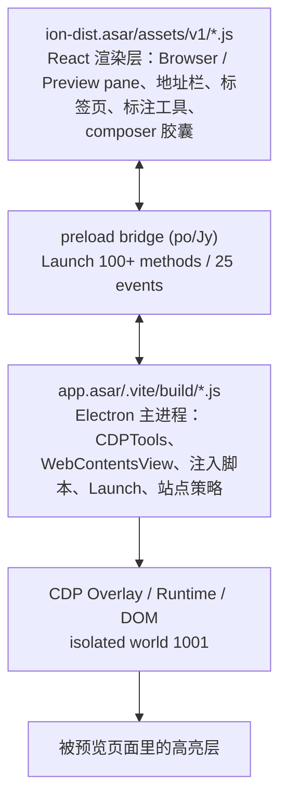

  [📚 返回总目录](README.md) · [下一篇：第二篇：导航、地址栏与标签页 ➡️](02-导航、地址栏与标签页.md)

---

## 第一篇：总体架构与设计令牌体系

> **技术领域与英文指代**：`Architecture & Design Tokens`
> **逆向工程溯源**：基于 **REA (Reverse Engineer Anything)** 对 macOS 生产包 `/Applications/Claude.app`（`@ant/desktop 4.16336.0`，`app.asar` SHA-256 `cdfee9476e3d17df5…`，`ion-dist.asar` `6adff0069a86b0d10…`）的 ASAR 成员解包、AST 静态分析与 9229 主进程 inspector 活体只读观测。Electron `44.9.3` / Chromium `152.0.7977.167` / Node `24.22.0`。

---

### 1.1 侧边浏览器的两层架构

> **技术领域与英文指代**：`Two-Layer Host / Renderer Architecture`

侧边浏览器不是单一组件，而是 **Electron 主进程宿主 + React 渲染层** 两层：

| 层 | 核心文件 | 职责 |
| :--- | :--- | :--- |
| 渲染层 | `cf580efe9-CkBqyp3f.js`（Preview pane 容器）、`ce22efec4-BTqX_V4p.js`（Browser pane）、`ce4a0ab47-DBiD0syd.js`（Navigation/PageTools）、`cf550b864-BHVEoOWt.js`（地址栏/设置菜单） | pane UI、工具栏、标签页、设置菜单、快捷键 |
| 主进程 | `index.chunk-Du-Wqi0E.js`（CDP / 策略 / bridge 契约）、`index.chunk-CnplrWND.js`（Launch 服务实现）、`index.chunk-DDNaWqT2.js`（Cookie native）、`index.pre.js`（启动黑名单） | dev server、预览生命周期、站点安全、注入脚本 |
| 注入层 | `aLi` ≈ 8.5 KB、`yLi` ≈ 17.7 KB（模板字符串，位于 `Du-Wqi0E.js` @ `4,727,255` / `4,736,825`） | 元素选择高亮、React Fiber 反射 |
| preload | `po(Jy,"Launch",nb,{methods,stores,events})` @ `2,038,841` | renderer ↔ main 的 wire 契约 |

**关键设计**：高亮层不在任何 React 组件里，而是主进程用 `executeJavaScriptInIsolatedWorld(1001, …)` 注入到**被预览页面**的 DOM，因此能穿透任意第三方页面的 CSS，也不会污染宿主页面。

---

### 1.2 面板容器与单描边纪律

> **技术领域与英文指代**：`Pane Surfaces & Single-Stroke Border Discipline`

| 位置 | 类名（生产包原文） |
| :--- | :--- |
| pane 根 | `relative isolate flex min-h-0 min-w-0 flex-col [&>:where([data-cds=Toolbar]:not([data-flush]))]:px-[var(--cds-panel-header-pad-inline)]`（`data-pane-root`，活体 `aria-label="浏览器"`） |
| 面板底 | `relative min-h-0 flex-1 overflow-hidden bg-surface-1` / `relative flex h-full min-h-0 flex-col overflow-hidden bg-surface-2` |
| 工具条 | `flex shrink-0 items-start gap-1 border-b-[length:max(var(--cds-toolbar-line,0px),0.5px)] border-[color:var(--cds-border-line,var(--cds-border))] px-1.25 py-0.75 text-footnote text-secondary` |
| 顶部状态条 | `pointer-events-none absolute inset-x-0 top-0 flex items-center justify-center gap-sm bg-surface-panel px-md py-sm text-footnote text-secondary` |
| 弹层 | `flex w-full max-w-[30rem] flex-col gap-lg rounded-card bg-surface-popover p-xl text-body text-primary shadow-panel-lg outline-none` |

**单描边纪律**：边框只由容器提供；容器内的按钮/芯片一律 `border-0` 或 `border-none`。活体实测 `[data-select-element-toggle]` 按钮为 `border: 0px solid rgba(0,0,0,0.08)`、`background: rgba(0,0,0,0)`（ghost 态），正是该纪律的体现。

---

### 1.3 色彩体系：Clay / Orange 双调色板

> **技术领域与英文指代**：`Clay & Orange Color Ramp`

| 令牌 | 主窗口 renderer（活体） | claude.ai/epitaxy renderer（活体） | 用途 |
| :--- | :--- | :--- | :--- |
| `--cds-clay` | `#d97757` | `#d97757` | 品牌呼吸灯、火花 |
| `--cds-clay-emphasized` | `#c6613f` | `#c6613f` | 悬停加深 |
| `--brand` | 官方客户端**不定义为 CSS 变量**（主进程 `UQ="#c6613f"` 硬编码）；本项目定义为 `#c6613f` | 同左 | 自动化光标层 |
| `--cds-orange-300` | **`#ec835a`** | **`#f18a59`** | 高亮框线/填充基色 |
| `--cds-orange-400` | **`#d95926`** | **`#e76624`** | 名称标签底色 |

> [!TIP]
> **第二套 orange 值是远程 epitaxy renderer 的 `colorVersion=v2` 调色板，不是暗色模式专属**：活体 `mode=light`、`prefers-color-scheme:dark=false` 时 `claude.ai` renderer 仍解析为 `#f18a59/#e76624`。注入层（`aLi`）完全硬编码 `#d95926` 与 `rgba(236,131,90,α)`，**不消费页面令牌**，因此主题切换不影响高亮层颜色。

**活体表面/文本/边框令牌**（主窗口 renderer，`id=1`）：

| 令牌 | 活体值 |
| :--- | :--- |
| `--cds-surface-0/1/2/3` | `#f9f9f7` / `#fcfcfb` / `#fff` / `#fff` |
| `--cds-text-primary/secondary/muted` | `#0b0b0b` / `#52514e` / `#898781` |
| `--cds-border` | `hsl(from #0b0b0b h s l / 10%)` |
| `--cds-alpha-1/2/3` | 5% / 10% / 20% of `#0b0b0b` |
| `--cds-focus-shadow` | `inset 0 0 0 1px #f9f9f7, 0 0 0 1px #2a78d6, 0 0 6px 1px #cde2fb`（**蓝色 ring + 蓝色 glow**）；epitaxy renderer 用中性灰 `#797979` 变体 |

---

### 1.4 几何、排版与密度

> **技术领域与英文指代**：`Geometry, Typography & Density`

| 项 | 活体值 | 本项目 `cds-theme.css` |
| :--- | :--- | :--- |
| `--cds-radius` | `calc(.5rem * 1)` = **8px** | 8px ✓ |
| `--cds-radius-card` | 组合式 `calc(--cds-radius + 4px)` = 12px | 12px ✓ |
| `--cds-radius-composer` | **`calc(.875rem * 1)` = 14px**（CSSOM 另有 `calc(.75rem * …)` = 12px 作用域定义） | **20px**（设计契约偏差） |
| `--cds-h-control` | 主窗口 **32px** / epitaxy **28px**（CSSOM 另有 24px 定义） | **26px**（设计契约偏差） |
| 字体栈 | `anthropic-sans, ui-sans-serif, -apple-system, system-ui, "Segoe UI", "PingFang SC", …, sans-serif` | 校准系统回退栈 ✓ |
| 动态数字 | `tabular-nums` / `font-mono`（计时器、行号、token 计数） | 同 ✓ |
| 密度 | `data-density="comfortable"`；`data-mode="light"` / `"system"` | — |

> [!TIP]
> `radius-composer` / `h-control` / `--cds-dur-base` 在 CSSOM 中存在**多作用域覆盖**（例如 `--cds-dur-base: 0s` 出现在 reduced-motion 作用域），不要当作单一常量使用。

---

### 1.5 动效令牌与曲线全集

> **技术领域与英文指代**：`Motion Tokens & Easing Curves`

| 令牌 / 曲线 | 活体值 | 消费场景 |
| :--- | :--- | :--- |
| `--cds-dur-fast` | `60ms` | 按钮 hover、focus ring 显现 |
| `--cds-dur-snap` | `.12s` | 分段控件滑块、标注工具条显隐 |
| `--cds-dur-base` | `.2s` | 菜单弹出、绘制属性过渡 |
| `--cds-dur-slow` | `.45s` | 长展开 |
| `--cds-ease-out` | 主窗口 `cubic-bezier(.165,.84,.44,1)`；epitaxy `cubic-bezier(0,0,.2,1)` | 通用出场 |
| `--cds-ease-snap` | `cubic-bezier(.32,.72,0,1)` | 磁吸对齐 |
| **`cubic-bezier(0.16, 1, 0.3, 1)`** | **官方无同名令牌**；硬编码在注入脚本与 Tailwind 任意值类 | easeOutExpo，零过冲 |
| `--cds-ease-swift` | 官方客户端**未定义**；本项目定义为 `cubic-bezier(.16,1,.3,1)` | 项目级等价令牌 |

**整页 computed transition 曲线分布**（活体 1172 节点，见第七篇）：

| 曲线 | 次数 |
| :--- | :--- |
| `cubic-bezier(0.4, 0, 0.2, 1)` | 140 |
| `cubic-bezier(0.165, 0.84, 0.44, 1)` | 116 |
| `cubic-bezier(0.32, 0.72, 0, 1)` | 12 |

CSSOM 里 `cubic-bezier(0.16,1,0.3,1)` 共 **5 条规则**（19,502 条 style rule 全扫描）：`320ms step-slide-in`、可复用 `ease-[…]` 工具类、`700ms translate`、`1050ms clip-path`、以及 `transition: opacity .14s, transform .18s cubic-bezier(.16,1,.3,1)`。

> [!TIP]
> 复刻元素选择高亮时**不要套 `SPRING_BOUNCY`（+8.8% 过冲）**：官方几何过渡刻意零过冲，因为高亮框必须严格贴合元素边界，任何回弹都会看起来「框没对准」。本项目 4 套弹簧预设与该曲线属于不同物理谱系，见第七篇。

---

### 1.6 明暗双模与暗色令牌

> **技术领域与英文指代**：`Light / Dark Dual Mode`

- 活体当前：`data-mode="light"`（epitaxy）/ `"system"`（主窗口），`prefers-color-scheme:dark=false`，`prefers-reduced-motion:reduce=false`，`hover:hover=true`，`pointer:fine=true`
- 静态 CSS 的第二套调色板位于 `c6a992d55-_JRfOmTh.css` @ `1,703,192`（`#f18a59/#e76624`），第一套在 @ `1,568,916`（`#ec835a/#d95926`）
- `setPreviewColorScheme(scheme, tabId)` → CDP `Emulation.setEmulatedMedia({features:[{name:"prefers-color-scheme",value}]})`
- 暗色下 `Surface 0-3` 收敛到 `#0b0b0b / #151515 / #1a1a19 / #20201f`

---

### 1.7 证据索引（本篇）

| 载体 | 偏移 | 事实 |
| :--- | :--- | :--- |
| `ion-dist.asar/assets/v1/c6a992d55-_JRfOmTh.css` | `1,568,916` / `1,703,192` | 两套 orange/clay 调色板 |
| `…/c2ca5c0fe-CviDYFOY.js` | 全文 3.2 KB | 视口预设（第三篇） |
| `…/cc43287c9-dzfX-J5i.js` | `58,744` | 分屏网格常量 |
| `app.asar/.vite/build/index.chunk-Du-Wqi0E.js` | `4,779,000` | `CDPTools.setViewport` |
| 9229 活体 | `06` 章 §2/§3 | 活体令牌表、双调色板 |
| REA Evidence | `ev_e6f527fe2c…` / `ev_d40ebeb98f…` / `ev_87443686…` | 静态分析与目标登记 |

---

  [📚 返回总目录](README.md) · [下一篇：第二篇：导航、地址栏与标签页 ➡️](02-导航、地址栏与标签页.md)

